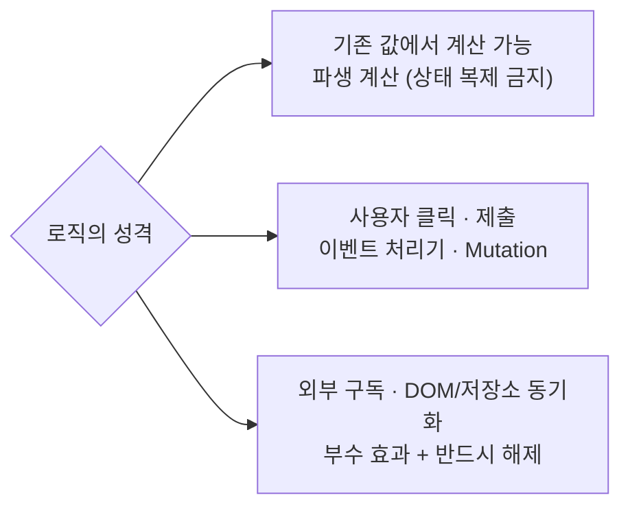

# 코드 스타일과 네이밍

폴더 계층과 공개 API 배치 규칙은 [디렉토리 구조](../directory-structure/index.md)를 따릅니다. 이 문서는 파일·식별자 명명, 파생값·명령·부수 효과의 경계, 메모이제이션과 코드 품질 기준을 명세합니다.

- 스택별 구현: [react-tanstack.md](react-tanstack.md) · [angular.md](angular.md)
- 설계 배경: 부수 효과를 줄이고 파생 계산으로 사고를 옮기기까지

## 1. 파일과 네이밍 규칙

- **파일당 컴포넌트 하나**: 재사용하거나 독립 역할을 갖는 컴포넌트는 파일 하나에 하나씩 둡니다. 한 파일 안에서만 쓰이는 작은 내부 보조 조각만 예외로 같은 파일에 둡니다.
- **페이지 식별 접미사**: 페이지 최상위 컴포넌트는 이름만 보고 페이지임을 알 수 있게 `Page` 접미사를 붙입니다.
- **스택 공식 스타일 준수**: 파일 이름의 대소문자(PascalCase vs kebab-case)와 접미사는 해당 스택의 공식 스타일 가이드를 따르며 한 프로젝트 안에서 두 스타일을 섞지 않습니다.
- **작업 전 설정 확인**: 라우트 묶음 폴더, 경로 별칭(`@/`), 린트·포맷 규칙은 저장소마다 다를 수 있으므로 작업 전에 프로젝트 설정을 먼저 확인합니다. 다른 프로젝트의 헬퍼나 폴더 이름을 가정하지 않습니다.

## 2. 파생값, 사용자 명령, 부수 효과 경계

컴포넌트 내부 로직은 성격에 따라 세 자리로 엄격히 나눕니다.

| 성격 | 올바른 위치 | 금지 패턴 |
| - | - | - |
| **파생값 계산** | 렌더링 중 직접 계산 또는 반응형 파생 계산 | 기존 props·상태를 별도 상태로 복제하고 부수 효과로 동기화 |
| **사용자 명령** | 이벤트 핸들러, 변경 요청(Mutation) 함수 | 상태 플래그를 바꾼 뒤 부수 효과에서 간접 실행 |
| **외부 동기화 · 구독** | 부수 효과 + 정리(cleanup) 함수 | 해제 없는 리스너·타이머·요청, 데이터 흐름 연쇄 트리거 |

- 부수 효과 안에서 타이머, 이벤트 리스너, WebSocket, 비동기 요청을 등록했다면 반드시 대응하는 정리(cleanup) 경로를 둡니다.
- 상태 A가 바뀌면 부수 효과로 상태 B를 갱신하고, 다시 상태 B를 감시해 상태 C를 바꾸는 연쇄 동기화를 만들지 않습니다.

## 3. 메모이제이션과 개발 모드 검사

- **습관적 메모이제이션 금지**: 모든 계산과 콜백에 기계적으로 메모이제이션을 붙이지 않습니다. 측정된 계산 비용이 크거나, 하위 컴포넌트·외부 구독이 참조 안정성(referential equality)을 요구하는 경계에만 적용합니다.
- **개발 모드 이중 실행 대응**: 개발 모드의 수명주기 검사(이중 마운트·이중 실행)에서 문제가 드러나면, 실행 방지 플래그(`initializedRef` 등)로 증상을 덮지 않고 정리 함수나 멱등한 초기화로 원인을 고칩니다.

## 4. TypeScript와 코드 품질 위생

- **타입 안전성**: `any`와 근거 없는 타입 단언(`as unknown as ...`)을 피합니다. API 응답과 URL 파라미터처럼 외부에서 들어오는 경계값은 검증·정규화 함수를 거쳐 좁힌 타입으로 넘깁니다.
- **명시적 공개 API**: 슬라이스의 `index.ts`에서 `export *` 와일드카드 재내보내기를 금지하고, 외부에 노출할 심볼만 명시적으로 내보냅니다.
- **도구 역할 분리**: 포맷터(들여쓰기·줄바꿈·정렬), 린터(결함 패턴·레이어 경계), 타입 검사기(`tsc`)가 같은 항목을 중복 검사하지 않게 역할을 나눕니다.
- **무경고 원칙과 생성 코드 제외**: 린트 경고 허용치는 `0`으로 유지하고, 라우트 트리(`routeTree.gen.ts`)처럼 빌드 도구가 자동 생성하는 파일은 포맷·린트 대상에서 제외합니다.
- **예외 사유 기록**: 린트 규칙이나 타입 검사를 개별 줄에서 억제할 때는 반드시 이유를 주석으로 남깁니다.
