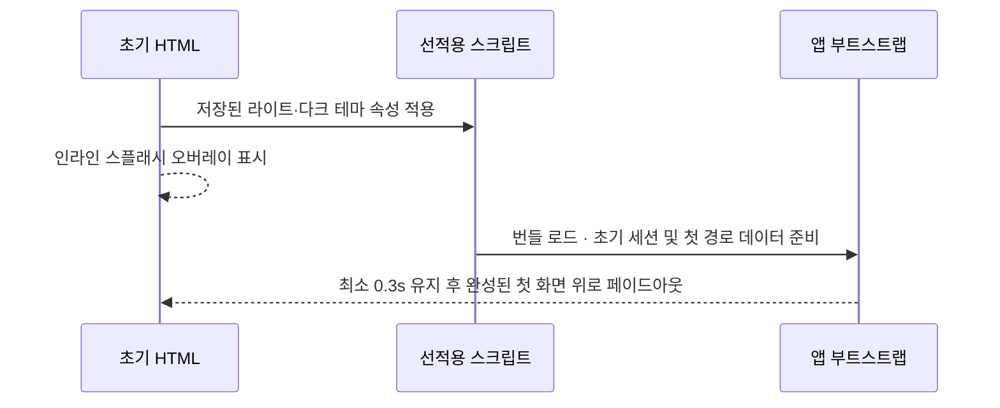

# 렌더링과 초기 로딩

앱 첫 진입 이후의 화면 이동과 대기 표시는 [라우팅과 화면 전환](../routing/index.md)에서 다룹니다. 이 문서는 렌더링 방식 선택, 초기 진입·새로고침 시 빈 화면과 깜빡임 방지, 지연 로딩 준비 기준을 명세합니다.

- 스택별 구현: [react-tanstack.md](react-tanstack.md) · [angular.md](angular.md)

## 1. 렌더링 방식 선택 기준

로그인 뒤에만 보이는 업무 화면은 브라우저 렌더링(CSR)과 정적 파일 배포를 기본으로 합니다. 검색 노출이나 첫 화면 도달 속도가 중요한 공개 화면은 정적 생성(SSG)을 먼저 검토합니다.

| 화면 유형 | 렌더링 방식 | 배포 형태 |
| - | - | - |
| 로그인 뒤 업무 화면 | **CSR** (기본) | 정적 파일 |
| 랜딩 · 문서 · 블로그 같은 공개 페이지 | **SSG** 우선 검토 | 정적 파일 |
| 요청마다 본문이 달라지는 공개 화면 | **SSR** (명확한 요구 시에만 도입) | 운영 서버 필요 |

- 요청마다 서버에서 HTML을 생성하는 SSR은 정적 생성으로 해결되지 않는 구체적인 요구가 있을 때만 도입하며, 운영 서버 구성과 배포 방식을 함께 결정합니다.

## 2. 초기 진입과 새로고침

앱 번들이 다운로드되기 전에도 빈 흰 화면이나 테마가 빠진 화면을 노출하지 않도록, 빌드 시점에 HTML에 첫 화면을 삽입합니다.

| 화면 유형 | 빌드 시 HTML에 포함하는 첫 화면 |
| - | - |
| 공개 문서 · 랜딩 | 실제 본문을 미리 렌더링한 HTML (SSG · 프리렌더) |
| 로그인 뒤 업무 앱 | 앱 심볼 정지 그림과 대기 문구가 담긴 스플래시 오버레이 |

### 웹폰트 로딩과 흔들림 방지

- `font-display: swap`만 쓰면 시스템 폰트로 먼저 그려진 뒤 웹폰트가 도착할 때 글자 폭과 줄바꿈이 흔들립니다(FOUT). 반대로 폰트 완료를 무한 대기하면 느린 네트워크에서 빈 화면이 길어집니다(FOIT).
- CDN 호스트에 `rel="preconnect"`를 선언하고 한국어 웹폰트는 다이나믹 서브셋을 사용합니다.
- `document.fonts.ready`와 짧은 타임아웃(`180ms`)을 함께 두어 빠른 환경에서는 흔들림 없이 한 번에 표시하고, 느린 환경이나 스크립트 실패 시에도 화면이 가려지지 않게 합니다.

```html
<link rel="preconnect" href="https://cdn.jsdelivr.net" crossorigin />
<style>
  html.fonts-loading { opacity: 0; }
  html { transition: opacity 120ms ease-out; }
</style>
<script>
  (() => {
    const root = document.documentElement;
    root.classList.add("fonts-loading");
    const reveal = () => root.classList.remove("fonts-loading");
    const timer = setTimeout(reveal, 180);
    if (document.fonts && document.fonts.ready) {
      document.fonts.ready.then(() => {
        clearTimeout(timer);
        reveal();
      });
    } else {
      reveal();
    }
  })();
</script>
```

### 초기 부트와 스플래시 화면

세션, 권한, 공간 목록처럼 화면 골격을 결정하는 초기 데이터가 도착하기 전에 앱을 그대로 그리면 빈 메뉴 → 권한 리다이렉트 → 본문 스켈레톤이 연달아 깜빡입니다.



1. **빌드 타임 오버레이 삽입**: 앱 CSS가 도착하기 전이므로 배경·보조 글자 색은 테마 토큰 값을 `light-dark()` 등으로 인라인 지정합니다. 각 제품은 자기 심볼을 쓰며 다른 제품의 그림을 옮기지 않습니다.
2. **테마 선적용 스크립트**: 앱 스크립트보다 먼저 실행되는 짧은 스크립트가 저장된 라이트·다크 모드를 문서 루트에 적용해 테마 깜빡임을 막습니다.
3. **앱 부트 인계**: 앱이 마운트되면 같은 모양의 오버레이가 자리를 이어받아 첫 경로의 필수 데이터가 준비될 때까지 유지합니다. 너무 빨리 걷혀 깜빡이지 않도록 최소 `0.3s` 유지한 뒤 `0.7s`에 걸쳐 부드럽게 걷습니다.
4. **오류 시 즉시 이탈**: 인증 실패나 네트워크 오류가 발생하면 스플래시에 갇히지 않고 오류 화면이나 로그인 화면으로 즉시 전환합니다.
5. **이후 이동은 스플래시 미사용**: 첫 진입이 끝난 뒤의 화면 전환에는 스플래시 화면을 다시 쓰지 않고 [라우팅과 화면 전환](../routing/index.md)의 지연 진행 막대 규칙을 따릅니다.

- 스타일과 토큰은 빌드된 정적 CSS로 배포해 런타임 스타일 주입 단계를 두지 않습니다.
- 빌드 시점에는 창 폭을 알 수 없으므로 휴대폰·데스크톱 첫 배치는 CSS 미디어 쿼리로 분기하거나 오버레이 뒤에서 결정합니다.

## 3. 지연 로딩과 코드·데이터 동시 준비

지연 로딩(code splitting)하는 화면 코드와 대형 컴포넌트(리치 에디터, 차트 등)는 라우트 데이터와 함께 **전환 전에 미리 준비**합니다.

- **전환 중 대기 누수 방지**: 바깥 라우트만 준비하고 안쪽 지연 로딩 컴포넌트가 렌더 시점에 처음 로드되면, 가장 가까운 대기 경계가 앱 셸까지 숨기거나 본문이 뒤늦게 붙어 레이아웃이 밀립니다.
- **미리 받기 래퍼**: 지연 로딩 컴포넌트는 번들이 이미 도착해 있어도 최초 렌더 때 한 번 멈출 수 있으므로, `preload()`를 호출해 둔 모듈은 대기 경계를 거치지 않고 즉시 렌더링하는 래퍼로 감쌉니다.
- **레이아웃 안정성**: 배치 높이에 영향을 주는 비동기 컴포넌트는 빈 상태로 먼저 그렸다가 나중에 채우지 않습니다.
- **부수 데이터 누락 방지**: 본문뿐 아니라 첫 화면 렌더링에 필요한 목록, 선택지, 작성자·연결 정보도 같은 조회 옵션으로 함께 준비합니다.
- **캐시 수명 분리**: 라우터가 데이터 준비 결과를 기억하는 기간과 서버 상태 캐시의 신선도 수명을 따로 두어, 라우터가 준비를 생략했는데 빈 캐시에서 컴포넌트가 다시 조회하는 일이 없게 합니다.
