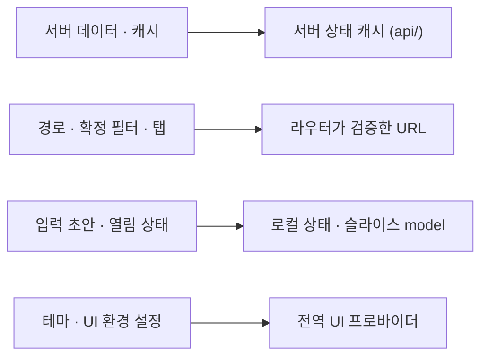
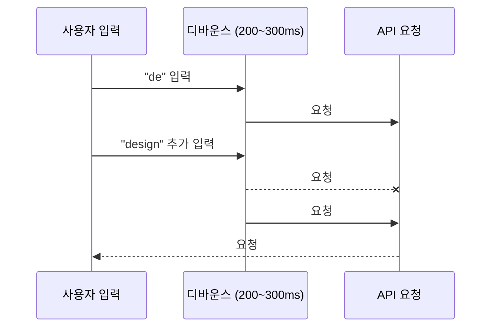

# 상태 관리와 데이터 흐름

실행 구성 요소 간의 큰 흐름은 [구성 요소와 실행 흐름](../components-and-flow/index.md)에서 다룹니다. 이 문서는 상태를 어떤 소유자에게 맡길지, 서버 데이터를 어떻게 조회·갱신·무효화할지, 검색 입력과 비동기 요청을 어떻게 통제할지를 명세합니다.

- 스택별 구현: [react-tanstack.md](react-tanstack.md) · [angular.md](angular.md)
- 설계 배경: 상태를 한곳에 모으지 않고 소유자별로 나누는 이유

## 1. 상태 소유자 구분

같은 값을 두 곳 이상에 복제해 수동으로 동기화하지 않습니다. 모든 상태는 성격에 따라 단일 소유자에게 맡깁니다.

| 상태 종류 | 소유자 | 대상 예시 |
| - | - | - |
| **서버 상태** | 서버 상태 캐시 (`api/`) | 로그인 세션, 목록·상세 데이터, 권한 정보 |
| **URL 상태** | 라우터가 검증한 URL | 경로 파라미터, 확정 필터, 정렬, 페이지 번호, 선택 탭 |
| **로컬 UI 상태** | 해당 컴포넌트 또는 슬라이스 `model/` | 저장 전 입력 초안, 적용 전 필터 선택, 모달·드로어 열림 |
| **클라이언트 전역 상태** | 전역 프로바이더·서비스 (`app/`, `shared/`) | 테마, 사이드바 접힘 등 화면 공통 비서버 설정 |

- 하위 표시 컴포넌트가 상위 페이지의 캐시 키를 직접 참조하지 않도록 콜백이나 데이터만 전달합니다.
- URL로 표현할 수 있는 탐색·필터 조건은 URL이 원본을 소유하고, 컴포넌트 로컬 상태로 복사해 이중 관리하지 않습니다.

## 2. 서버 데이터와 입력 초안 분리

서버에서 읽어 온 원본 데이터와 사용자가 편집 중인 초안은 분리합니다.

- **백그라운드 재조회 보호**: 화면이 열려 있는 동안 서버 캐시가 백그라운드에서 재조회되더라도, 사용자가 입력 중인 초안을 덮어쓰지 않습니다.
- **저장 중 편집 판본 비교**: 저장 요청이 진행 중인 동안에도 계속 편집할 수 있는 화면이라면, 요청에 실어 보낸 초안 판본과 현재 편집 중인 초안 판본을 구분합니다. 늦게 도착한 이전 저장 응답이 이후에 입력한 내용을 초기화하지 않게 걸러 냅니다.
- **충돌·실패 시 초안 보존**: 저장에 실패하거나 버전 충돌이 발생해도 입력 초안을 버리지 않고 유지한 채 다시 읽기나 재시도 경로를 제공합니다.
- **문맥 전환 격리**: 대상 문서나 계정이 바뀐 뒤 도착한 이전 요청의 응답은 현재 화면에 반영하지 않습니다.

### 필터 확정과 URL 동기화

- 적용 버튼을 누르기 전의 필터 선택값은 로컬 초안으로 둡니다. 취소를 누르면 기존 URL을 그대로 유지합니다.
- 필터를 확정하는 순간에 URL 갱신, 페이지 번호 초기화, 조회 키 변경을 하나의 전환으로 처리합니다.
- URL에서 읽는 숫자, 날짜, 열거형, 기본값은 라우터 진입 경계에서 검증해 새로고침·링크 공유·뒤로가기에서도 같은 조건이 복원되게 합니다.

## 3. 조회 옵션, 캐시 키, 준비 함수

조회를 소유한 슬라이스의 `api/`에 요청 함수, 캐시 키, 조회 옵션(`queryOptions`)을 함께 둡니다.

- **단일 조회 옵션 공유**: 라우트 데이터 준비(가드·로더·리졸버)와 화면 컴포넌트는 반드시 같은 조회 옵션을 써서 중복 요청과 캐시 키 불일치를 막습니다.
- **완전한 캐시 키**: 서버 응답을 바꾸는 모든 인자(필터, 정렬, 페이지, 검색어, 대상 ID)를 캐시 키에 빠짐없이 포함합니다.
- **신선도 기준 명시**: 캐시에서 꺼낸 값이 항상 최신 응답이라고 가정하지 않으며, 최신 응답을 기다려야 하는 경우와 캐시 우선 표시(`stale-while-revalidate`)를 허용하는 경우의 신선도 기준(`staleTime`)을 명시합니다.
- **필수 조회와 선택 조회 분리**: 라우트 준비 함수는 실패 시 화면 진입을 멈추는 **필수 조회**와 실패해도 화면에 진입해 개별 오류로 처리하는 **선택 조회**를 구분합니다.

## 4. 변경(Mutation)과 캐시 무효화

- **성공 후 무효화 기본**: 쓰기 요청(생성·수정·삭제)은 성공 직후 영향받는 캐시 키를 무효화해 화면을 최신 상태로 맞춥니다.
- **저장 성공과 재조회 실패 분리**: 저장 요청 자체는 성공했는데 뒤따른 재조회만 실패한 상황을 저장 실패로 오인해 알리지 않습니다.
- **낙관적 갱신·자동 재시도 제한**: 낙관적 갱신(Optimistic Update)과 쓰기 요청 자동 재시도는 기본으로 켜지 않고, 중복 실행 위험과 롤백 비용을 검토해 필요한 곳에만 선별 적용합니다.

## 5. 상태 구분, 계정 전환, 큰 목록

| 상황 | 처리 기준 |
| - | - |
| **조회 결과 구분** | 초기 로딩, 정상 빈 결과, 조회 오류를 서로 섞어 표시하지 않음 |
| **계정 · 권한 전환** | 진행 중인 조회를 즉시 취소하고 이전 범위의 캐시 전체를 비움 |
| **큰 목록** | 전체 데이터를 내려받지 않고 서버에서 필터·정렬·페이징 처리 |
| **무한 목록** | 누적 페이지 조각 전체가 한꺼번에 재조회되는 비용을 확인하고 목록 복귀·새 진입·갱신 정책을 분리 |

- 초기 로딩, 빈 상태, 오류 상태의 시각 표현 규칙은 [디자인 시스템 화면 상태](../../../design-system/ui-states/index.md)를 따릅니다.
- 로그아웃이나 계정·권한 전환 시에는 이전 계정의 응답이 늦게 도착해 새 계정의 캐시에 섞이지 않도록 진행 중 요청을 취소하거나 세대(generation) 번호로 차단합니다.

## 6. 검색 입력 디바운스와 요청 취소

검색어 입력처럼 짧은 간격으로 반복 발생하는 조회는 **디바운스**와 **요청 취소**를 함께 적용합니다.

- **디바운스 지연**: 입력이 멈춘 뒤 `200~300ms` 후에 검색을 실행합니다.
- **즉시 예외 처리**: 입력창을 비우면 대기 없이 즉시 초기 상태로 되돌리고, `Enter`를 누르면 디바운스를 기다리지 않고 현재 검색어로 바로 실행합니다.
- **이전 요청 취소**: 디바운스는 요청 횟수만 줄일 뿐 네트워크 응답 순서를 보장하지 않습니다. 새 요청을 보내기 전에 반드시 이전 요청을 취소해 늦게 도착한 이전 응답이 최신 검색 결과를 덮어쓰는 경쟁 상태(race condition)를 막습니다.
