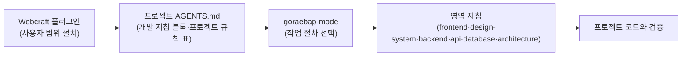

Webcraft는 목록·상세·작성 양식·결재 같은 업무 화면으로 이루어진 웹 앱을 사람과 에이전트가 같은 규칙과 절차로 만들도록 묶는 지침입니다. 가장 먼저 지키는 품질은 화면의 일관성, 화면 전환 중 밀림이 없는 것, 상태와 데이터의 소유자가 분명한 것, 서버와 화면의 계약이 어긋나지 않는 것, 그리고 바꾼 것을 실제로 확인할 수 있는 것입니다.

## 1.1 요구사항 개요

Webcraft는 로그인한 사용자가 데스크톱과 휴대폰 브라우저에서 업무를 처리하는 웹 앱을 대상으로 합니다. 레퍼런스 키트의 Playground가 그 범위를 보여 줍니다. 인박스, 이슈, 문서함, 일정, 결재 신청, 권한 설정, 사용자 관리처럼 목록에서 대상을 찾고, 상세에서 읽고 고치고, 양식으로 새로 만드는 화면이 중심입니다. 휴대폰과 데스크톱은 `64rem` 분기점 하나로 가르고 같은 앱이 두 기기를 모두 지원합니다. 공개 문서·랜딩처럼 검색과 스크립트 없는 읽기가 필요한 화면은 첫 화면만 미리 그린 HTML(SSG)로 따로 다룹니다.

제품의 업무 도메인, 다루는 문서 종류, 권한 체계, 단일 조직·다중 조직 같은 제품 범위는 Webcraft가 정하지 않습니다. 프로젝트가 자기 요구사항 문서에서 정하고, 이 정의서를 프로젝트에 맞춰 쓸 때는 그 문서에서 가져옵니다.

지침은 영역마다 스킬 하나가 소유합니다. 규칙 본문은 담당 스킬 한 곳에만 있고 다른 스킬은 그곳을 연결합니다.

| 지침 | 다루는 범위 |
| :--- | :--- |
| [goraebap-mode](/rules/goraebap-mode/) | 작업 시작, 작업 종류별 절차(조사·기능·버그·리팩터링·지침 개선), 필요한 지침 고르기, 검증과 완료 |
| [manage-workflow](/rules/manage-workflow/) | 프로젝트를 지침에 연결, 프로젝트 규칙 정리, 예전 사본 방식에서 전환, 지침 제안 |
| [frontend](/rules/frontend/) | React 코드 배치, TanStack Router/Query 데이터 흐름, 폼 초안, 화면 전환 |
| [design-system](/rules/design-system/) | Astryx 테마·아이콘·부품 조합, 앱 셸, 페이지 배치, 반응형, 데이터 상태와 상호작용 |
| [backend](/rules/backend/) | Java 모듈 경계, 도메인·서비스·저장소, 조회 포트, 모듈 간 계약, 오류 |
| [api](/rules/api/) | HTTP 경로와 상태 코드, 오류 응답, 인증·권한, 업로드, OpenAPI 생성 타입 |
| [database](/rules/database/) | Flyway 마이그레이션, 기존 데이터 이관, jOOQ 코드 생성 |
| [architecture](/rules/architecture/) | 모듈 경계, 상태 소유권, 외부 연동, 비밀값, 배포·복구 설계, 제품 플러그인 |

Webcraft가 프로젝트에 닿는 경로는 다음과 같습니다.

화살표는 에이전트 세션이 읽는 순서입니다. 지침의 원본은 사용자 범위에 설치한 플러그인이고 프로젝트에는 `AGENTS.md` 하나만 둡니다. `AGENTS.md`의 "개발 지침" 블록이 플러그인 지침을 따른다고 밝히고 최소 플러그인 판을 적으며, 그 아래 "프로젝트 규칙" 표가 지침보다 우선합니다. 에이전트는 goraebap-mode에서 작업에 맞는 플레이북 하나를 고른 뒤 바꾸는 영역의 지침만 읽습니다. 플러그인을 갱신하면 연결된 모든 프로젝트가 새 지침을 따릅니다.

## 1.2 품질 목표

품질 목표는 우선순위 순으로 다음과 같습니다. 확인 방법은 [검증](/architecture/8-9/)의 변경별 확인 항목에서 가져왔습니다.

| 목표 | 이유 | 확인 방법 |
| :--- | :--- | :--- |
| 화면 일관성 | 여러 제품과 화면이 같은 부품·테마·분기점을 쓰면 사용자가 화면마다 조작법을 다시 익히지 않습니다. 키트의 셸·페이지·패턴을 출발점으로 삼고 페이지마다 메뉴·테마·밀도를 새로 만들지 않습니다. | 바뀐 화면을 데스크톱·휴대폰, 제공하는 밝게·어둡게 모드, 포커스·키보드·확대 상태에서 봅니다. |
| 밀림 없는 화면 전환 | 화면을 옮길 때 빈 화면·스켈레톤·가리는 막이 번갈아 나타나면 읽던 자리를 잃습니다. 캐시는 즉시 그리고, 캐시가 없으면 지금 화면을 유지한 채 150ms가 지나야 카드 위쪽 진행 표시만 띄웁니다. | 실행 중인 앱에서 같은 틀 안 이동, 3초 넘게 지난 재방문, 목록 → 상세 → 뒤로 → 같은 상세를 누르는 Playwright 점검에서 `layout-shift` 합이 0.01 이하이고 재방문에 진행 표시가 뜨지 않습니다. |
| 상태와 데이터의 소유 명확성 | 같은 원본을 여러 곳에서 편집하고 맞추면 초안이 사라지거나 오래된 값이 덮입니다. 서버 데이터는 TanStack Query, 확정 조건은 검증한 URL, 입력 초안은 로컬 state가 소유합니다. | 새로고침·링크 공유·뒤로가기에서 같은 조건이 복원되는지, 저장 충돌·크게 보기·분기점 전환 뒤에도 초안이 남는지 확인합니다. |
| 계약 일치 | 서버와 화면이 따로 타입을 맞추면 한쪽만 바뀐 채 배포됩니다. 서버가 계약의 원본이고 OpenAPI·생성 클라이언트 타입·호출자를 같은 변경에서 맞춥니다. | 서버 명세와 생성 타입, 영향받는 호출자, 성공·실패 응답과 권한을 확인합니다. |
| 단순한 구조 | 서비스·큐·캐시·복제를 미리 두면 운영 비용이 요구보다 먼저 늘어납니다. 필요한 경계를 가진 모듈형 모놀리스에서 시작합니다. | 새 기술·인프라를 들일 때 구체적인 요구와 운영 비용, 맥락·결정·대안을 프로젝트 기록에 남겼는지 봅니다. |
| 확인 가능한 변경 | 자동 검사가 통과해도 사용자 동작이 맞는지는 따로 봐야 합니다. 변경 위험에 맞춰 확인 범위를 정하고, 하지 않은 검증을 완료로 기록하지 않습니다. | 변경 종류별 확인 항목(화면·전환·반응형·서버 로직·API·스키마·문서)을 수행하고 수행한 검증과 남은 제한을 나눠 보고합니다. |

## 1.3 이해관계자

Webcraft 아키텍처에 직접 관심을 두는 이해관계자와 주요 관심사는 다음과 같습니다.

| 역할 | 아키텍처 관심사 |
| :--- | :--- |
| 개발자 | 모듈 경계와 계층 규칙, 상태 소유자, 계약 변경 방식, 변경에 맞는 검증 범위 |
| AI 에이전트 | 작업마다 읽을 지침과 절차, 프로젝트 규칙의 우선순위, 지침을 읽을 수 없을 때 멈추고 이어받기 문서를 남기는 조건, 커밋·배포 권한의 한계 |
| 제품 책임자·디자이너 | 화면 패턴과 상태 표현의 일관성, 키트와 다른 디자인을 택할 때의 기록 방식, 휴대폰·데스크톱 지원 범위 |
| 운영 담당자 | 배포 순서·설정·데이터 이관·백업·복구 절차, 비밀값 관리, 외부 제공자 실패 처리 |
| 플러그인 관리자 | 지침 제안 이슈의 수락·수정·기각, 지침과 키트를 함께 고치는 개선 절차, 플러그인 판 관리 |

## 이 절의 지침

<SectionDocs section="1" />
