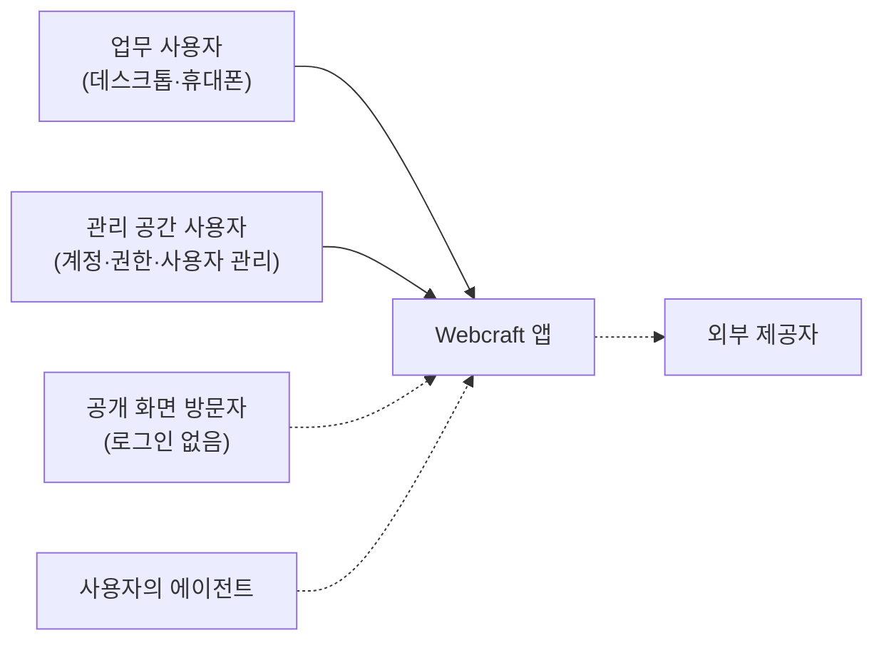
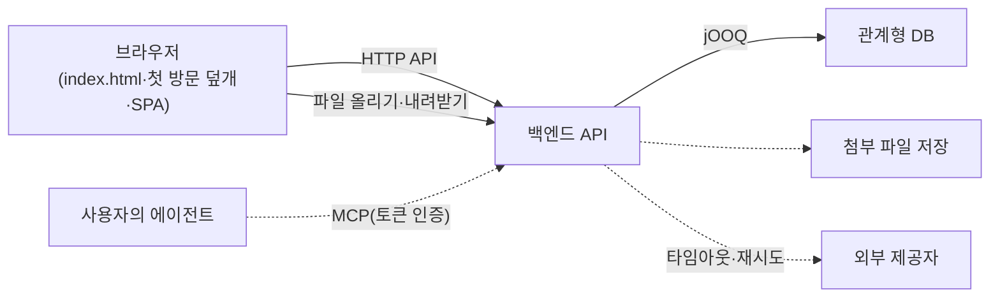

이 절은 Webcraft를 따르는 앱이 바깥의 사용자·시스템과 만나는 경계, 그리고 공통 지침과 개별 프로젝트가 결정을 나누는 경계를 다룹니다. 앱의 바깥에는 브라우저로 들어오는 사용자, 제품이 필요할 때 두는 외부 제공자와 사용자의 에이전트가 있습니다. Webcraft는 여러 제품에서 반복되는 구조·상태·계약·화면 규칙만 정하고, 업무 도메인과 외부 연동 대상, 인프라와 배포는 프로젝트가 정합니다.

## 3.1 업무 맥락

앱의 주 사용자는 로그인한 뒤 데스크톱이나 휴대폰 브라우저로 업무를 처리하는 사람입니다. 어떤 업무를 누가 처리하는지는 제품마다 다르므로 Webcraft는 사용자 부류를 정하지 않고, 화면 구성에 영향을 주는 접근 방식만 구분합니다.

화살표는 요청을 보내는 쪽에서 받는 쪽으로 향합니다. 실선은 모든 업무 앱에 있는 상대이고, 점선은 제품이 필요할 때만 생기는 상대입니다. 관리 공간 사용자는 같은 앱 안에서 주 메뉴를 대체하는 별도 공간(내 계정·관리)으로 들어오는 사용자입니다.

| 상대 | 앱과 주고받는 것 |
| :--- | :--- |
| 업무 사용자 | 목록에서 대상을 찾고, 상세에서 읽고 고치고, 양식으로 새로 만듭니다. 데스크톱은 사이드바, 휴대폰은 하단 탭으로 이동합니다. |
| 관리 공간 사용자 | 계정·권한·사용자 같은 설정을 바꿉니다. 화면은 주 메뉴 대신 "← 공간 이름"이 붙은 별도 메뉴로 엽니다. |
| 공개 화면 방문자 | 공개 문서·랜딩을 검색과 스크립트 없이도 읽습니다. 이 화면은 빌드 때 실제 본문을 미리 그린 HTML(SSG)로 내려보냅니다. |
| 사용자의 에이전트 | 제품이 MCP 연결과 사용자용 플러그인을 제공할 때만 생깁니다. 서버가 화면 요청과 같은 권한 검사를 적용합니다. |
| 외부 제공자 | 앱이 업무 처리 중에 호출하는 바깥 시스템입니다. 대상과 계약은 프로젝트가 정합니다. |

## 3.2 기술 맥락

앱의 기술 경계는 브라우저와 API 사이의 HTTP 계약, 백엔드와 DB·파일·외부 제공자 사이의 연결, 제품이 제공할 때의 MCP 연결로 이루어집니다.

화살표는 요청을 보내는 쪽에서 받는 쪽으로 향하고, 점선은 제품이 필요할 때만 두는 연결입니다. 브라우저 상자의 첫 방문 덮개는 앱 코드가 오기 전에 빈 화면을 보이지 않도록 빌드 때 `index.html`에 넣는 첫 화면입니다. 외부 제공자로 가는 화살표의 "타임아웃·재시도"는 그 호출을 핵심 트랜잭션과 분리하고 실패 처리를 따로 정한다는 뜻입니다.

| 인터페이스 | 형식과 규칙 |
| :--- | :--- |
| 브라우저 ↔ API | HTTP 상태 코드(조회 200, 생성 201과 Location, 변경·삭제 204), 오류는 `application/problem+json`과 안정된 오류 코드. 서버의 OpenAPI 명세에서 생성한 클라이언트 타입으로 부릅니다. 인증과 자원 권한은 서버가 검사합니다. |
| 파일 올리기·내려받기 | 임시 파일과 업무 자원 연결의 소유권·만료·권한을 구분합니다. 파일명·확장자를 믿지 않고 크기·타입·경로를 검증하며, 읽는 경로에서도 권한을 확인합니다. 사진은 대표색과 원본 가로·세로를 함께 보내 첨부 정보로 돌려받습니다. |
| 사용자의 에이전트 ↔ API | 제품이 제공할 때만 둡니다. REST·MCP·다운로드에 같은 존재 노출 정책을 적용합니다. 토큰은 각 에이전트가 지원하는 로컬 비밀 저장 수단으로 받습니다. |
| API ↔ DB | jOOQ로 조회·저장하고 스키마는 Flyway 마이그레이션으로 바꿉니다. 필터·정렬·페이징·건수는 DB가 결정합니다. |
| API ↔ 외부 제공자 | 타임아웃·실패·재시도·멱등성을 정합니다. 외부 전송을 확실히 보장해야 하면 커밋과 연결한 영속 outbox를 설계합니다. 외부 호출을 DB 원자성으로 착각하지 않습니다. |

파일을 실제로 어디에 저장하는지, 어떤 외부 제공자를 쓰는지, 에이전트 연결을 제공하는지는 Webcraft 지침에 없습니다. 프로젝트가 정해 이 절에 채웁니다.

## 3.3 Webcraft와 프로젝트의 경계

Webcraft의 공통 원본은 플러그인 지침과 레퍼런스 키트 두 가지이고, 나머지는 모두 프로젝트가 소유합니다. 프로젝트가 지침과 다르게 정한 것은 `AGENTS.md`의 프로젝트 규칙 표에 적어 지침보다 먼저 적용합니다.

| 정하는 곳 | 무엇 |
| :--- | :--- |
| Webcraft 플러그인 지침 | 여러 제품에서 반복하는 구조·상태 소유·API 계약·화면 패턴·작업 절차·검증 항목 |
| 레퍼런스 키트 | 지정이 없을 때 출발점으로 쓰는 셸·페이지·부품·패턴 코드와 실행 견본. 채택할 파일만 프로젝트로 옮깁니다. |
| 프로젝트 `AGENTS.md`의 "개발 지침" 블록 | 따르는 플러그인과 최소 판, 지침을 읽을 수 없을 때의 행동 |
| 프로젝트 `AGENTS.md`의 "프로젝트 규칙" 표 | 지침과 다르게 하는 결정 하나를 한 줄로(지침, 지침의 기준, 이 프로젝트, 이유). 길면 `.agents/rules/<지침>.md` |
| 프로젝트 설명·기록 | 제품 용어, 도메인 규칙, 실행 명령, 되돌리기 어려운 기술 선택의 맥락·결정·대안 |
| 프로젝트 코드 | 채택한 키트 코드를 포함한 모든 제품 코드. 공통 변경이 자동으로 들어오지 않습니다. |

## 이 절의 지침

<SectionDocs section="3" />
