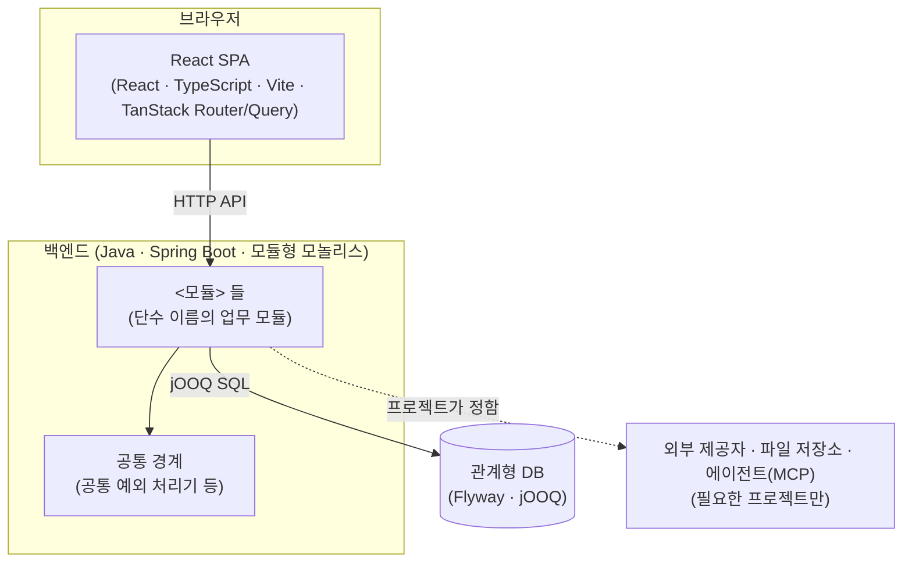
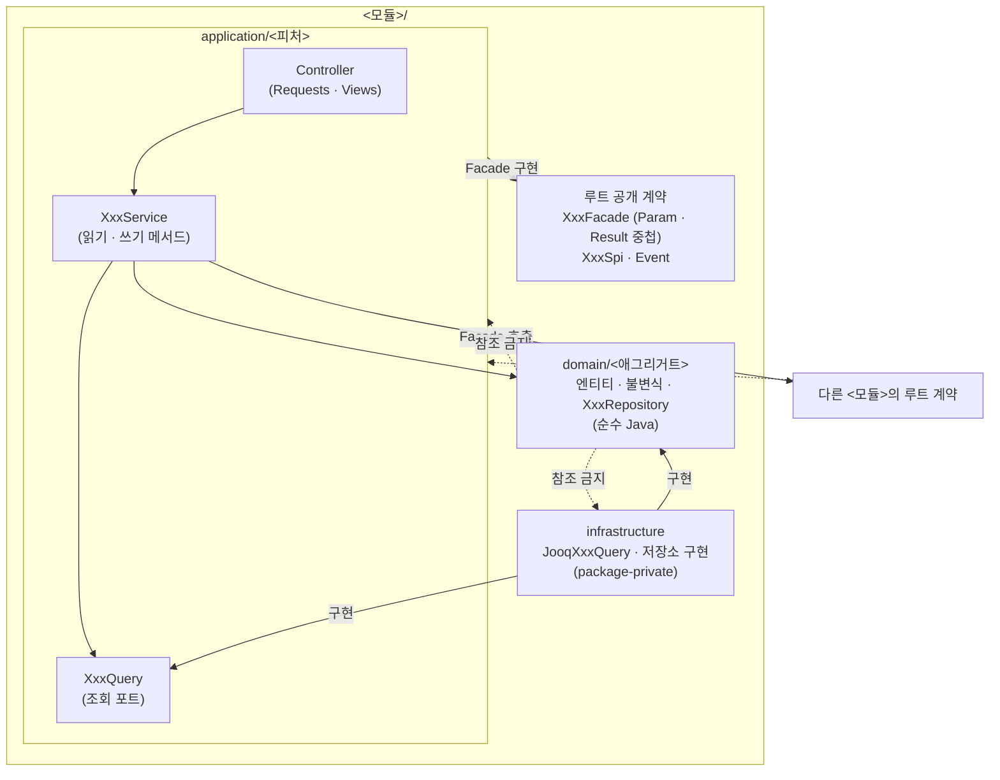
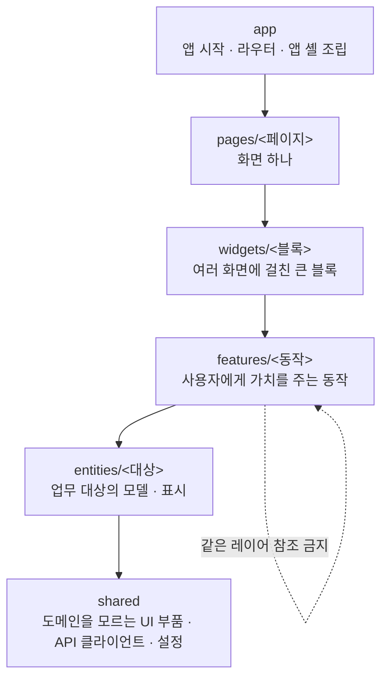
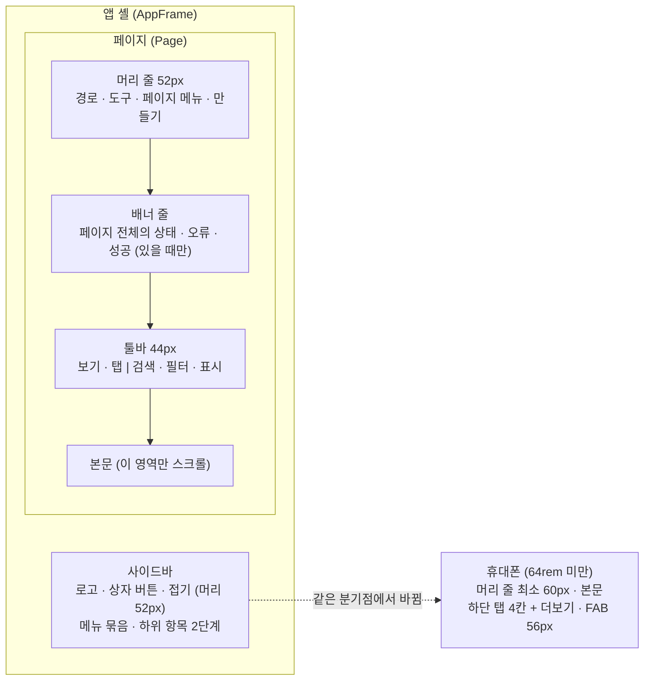

이 절은 Webcraft를 따라 만든 웹 앱 하나를 정적인 블록으로 나누고, 블록마다 책임과 참조 방향을 정합니다. 최상위는 브라우저의 React SPA, Java 백엔드(모듈형 모놀리스), 관계형 DB 세 블록이고, 백엔드는 업무 모듈과 모듈 안의 `application`·`domain`·`infrastructure` 계층으로, 프론트엔드는 Feature-Sliced Design(FSD)의 레이어와 슬라이스로 다시 나눕니다. 화면 바깥 틀은 앱 셸 하나가 모든 페이지에 공통으로 조립합니다.

어떤 업무 모듈과 프론트엔드 슬라이스를 둘지, 메뉴 공간과 하위 묶음을 어떻게 구성할지, 패키지 루트와 경로 별칭은 프로젝트가 정합니다. 이 절의 이름은 모두 일반형(`<모듈>`, `<피처>`, `XxxService`)입니다.

## 5.1 Level 1

시스템은 브라우저 앱, 백엔드 업무 모듈과 공통 경계, DB로 나뉘고, 브라우저 앱은 HTTP로만 백엔드에 닿습니다.

화살표는 참조하거나 요청을 보내는 쪽에서 받는 쪽으로 향합니다. 라벨 `HTTP API`는 코드 참조가 아니라 네트워크 요청이고, 서버가 그 계약의 원본입니다(OpenAPI와 생성 클라이언트 타입을 같은 변경에서 맞춥니다). 점선은 Webcraft가 블록의 존재와 연결 방식을 정하지 않아 프로젝트가 고르는 연결입니다.

| 블록 | 책임 | 위치 |
| :--- | :--- | :--- |
| 브라우저 앱 | 화면, 라우트와 URL 상태, 서버 데이터 캐시, 입력 초안 | 프로젝트의 프론트엔드 루트. 안은 FSD 레이어(`app/`·`pages/`·`widgets/`·`features/`·`entities/`·`shared/`) |
| 업무 모듈 | 한 업무 영역의 유스케이스·도메인 규칙·영속성. 모듈 루트의 `Facade`·`Spi`·`Event`만 밖에 공개 | 패키지 루트 아래 `<모듈>/` (루트 이름은 프로젝트가 정함) |
| 공통 경계 | 예외를 `application/problem+json` 응답과 상태 코드로 바꾸는 공통 HTTP 처리 등 도메인을 모르는 기반 | 프로젝트가 정함 |
| DB | 업무 데이터의 원본. 스키마는 Flyway 마이그레이션, 코드는 jOOQ 생성 타입 | 엔진·버전은 프로젝트가 정함 |
| 외부 연결 | 외부 제공자 호출, 첨부 파일, 제품이 사용자에게 주는 에이전트 플러그인(MCP) | 프로젝트가 정함 |

## 5.2 백엔드 Level 2

다른 모듈은 상대 모듈 루트의 공개 계약(`XxxFacade`·`XxxSpi`·Event)만 참조하고, 모듈 안에서는 Controller → `XxxService` → `XxxQuery`·도메인 저장소 순으로만 참조합니다. 모듈은 단수 이름이며 내부를 `application`·`domain`·`infrastructure`로 나눕니다.

화살표는 참조하는 쪽에서 참조되는 쪽으로 향하고, 실선은 허용된 참조, 점선은 금지된 참조입니다. `구현` 라벨은 인터페이스를 구현하는 방향이라 의존 방향이 안쪽(조회 포트·도메인)을 향합니다. 도메인은 HTTP 상태, Spring 예외, 응답 DTO, application의 `ErrorCode`를 모르고, 다른 모듈은 `application`·`domain`·`infrastructure` 안의 타입을 참조하지 않으며 순환 호출도 하지 않습니다.

| 요소 | 책임 | 위치·이름 |
| :--- | :--- | :--- |
| Controller | 요청 형식 검증, HTTP 변환 | `application/<피처>`, HTTP DTO는 피처의 `Requests`·`Views` |
| `XxxService` | 피처의 읽기·쓰기 유스케이스, 트랜잭션, 도메인 조율 | 피처마다 하나. `XxxQueryService`·명령 서비스로 나누지 않음 |
| `XxxQuery` | 화면 조회 포트. 결과가 그대로 화면에 나가면 피처의 Views를 반환 | 같은 피처의 `application`, 서비스와 1:1 |
| 도메인 | 업무 불변식, 의미 있는 상태 전이, 저장소 인터페이스 | `domain/<애그리거트>`, 프레임워크에 의존하지 않는 Java |
| infrastructure | jOOQ 영속성·조회·외부 연동 | 기술 이름 접미사(`JooqXxxQuery`), package-private |
| `XxxFacade` | 피처가 다른 모듈에 제공하는 계약. 전용 입력·결과는 `Param`·`Result`에 중첩 | 모듈 루트, 구현은 선언 모듈의 `application` |
| `XxxSpi` | 소유 모듈이 외부 모듈에 구현을 요구하는 계약 | 모듈 루트에 선언, 선언 모듈 밖에서 구현 |
| `XxxErrorCode` | 서비스가 판정하는 부재·권한·충돌 코드 | 모듈마다 `application` 루트에 하나 |

모듈 안의 공유와 모듈 사이의 참조는 다음 기준을 따릅니다.

- 피처마다 Facade 하나로 모읍니다. `QueryFacade`·`CommandFacade`·`ViewFacade`로 나누지 않습니다.
- Spi는 소유 모듈이 자기 불변식을 판정하는 데 그 정보가 필요하고, 자기 데이터로 판정할 수 없고, 호출 인자로 받을 수 없을 때만 둡니다.
- 다른 피처의 완성된 조회는 그 피처 서비스의 읽기 메서드로 받습니다. 인접 피처의 조회 포트를 직접 부르거나 피처의 쓰기 메서드끼리 호출하지 않습니다.
- 애그리거트끼리는 ID로 참조합니다. 여러 애그리거트를 조율하는 일은 application 서비스가 맡습니다.
- 계층 안의 공용 코드는 그 계층 루트에 둡니다. `application/shared`·`application/common`·`<모듈>/shared` 같은 공용 층을 만들지 않습니다.
- 다른 모듈 값으로 검색·정렬·건수를 정해야 하는 화면 조회는 그 조회 구현의 SQL에서 직접 읽을 수 있습니다. 표시값만 필요하면 부모 페이지를 확정한 뒤 Facade로 배치 조회합니다. 교차 모듈 SQL은 조회 구현 안에만 둡니다.

## 5.3 프론트엔드 Level 2

브라우저 앱은 FSD의 레이어 `app` → `pages` → `widgets` → `features` → `entities` → `shared`로 나뉘고, 위 레이어가 아래 레이어만 참조합니다. 레이어·슬라이스·공개 API 규칙은 공식 `feature-sliced-design` 스킬이 원본이며, Webcraft는 FSD 규칙과 검사기를 따로 두지 않습니다.

화살표는 import하는 쪽에서 import되는 쪽으로 향합니다. 그림은 이웃 레이어만 이었지만 위 레이어는 자기보다 아래 레이어 전부를 참조할 수 있고, 아래에서 위로는 참조하지 않습니다. 점선은 같은 레이어의 다른 슬라이스를 직접 import하지 않는다는 금지입니다. `app`과 `shared`는 슬라이스 없이 세그먼트로만 나뉩니다.

| 단위 | 규칙 |
| :--- | :--- |
| 슬라이스 | `pages`·`widgets`·`features`·`entities` 안을 업무 대상이나 동작 이름으로 나눕니다 |
| 세그먼트 | 슬라이스 안을 `ui`·`api`·`model`·`lib`·`config`처럼 기술 목적별로 나눕니다 |
| 공개 API | 슬라이스 루트의 `index.ts`만 밖에서 import합니다. 슬라이스 내부 파일 경로를 직접 가져오지 않습니다 |
| 조회 옵션 | 조회를 소유한 슬라이스의 `api` 세그먼트에 요청·쿼리 키·`queryOptions`를 함께 둡니다. 라우트 loader와 페이지가 같은 옵션을 씁니다 |
| 상태 소유 | 서버 데이터는 TanStack Query, 경로·확정 필터·정렬·페이지·탭은 검증한 URL, 입력 초안·열림 상태는 로컬 state나 슬라이스의 `model` |
| 이름 | 컴포넌트는 PascalCase 파일 하나에 하나, 페이지는 `Page` 접미사, 훅은 `use`로 시작, 일반 유틸·설정 파일은 kebab-case |

디자인 시스템의 조합 부품(Composites)은 재사용 코드의 단위이며 FSD의 `widgets`와 같은 분류가 아닙니다. 조합 부품은 값과 동작을 props로 받고 제품의 API·라우트·업무 정책을 직접 소유하지 않습니다. 경로 별칭, 페이지 그룹, lint·경계 검사 설정은 프로젝트에서 확인하고, 다른 프로젝트의 그룹이나 도우미 함수가 있다고 가정하지 않습니다.

## 5.4 앱 셸

앱 셸은 앱 전체에 한 번만 두는 바깥 틀로, 사이드바와 콘텐츠 영역을 조립하고 페이지는 그 안에 머리 줄·배너 줄·툴바·본문 순서로 들어갑니다. 64rem(1024px) 미만에서는 사이드바 대신 휴대폰 하단 탭이 같은 자리를 맡고, 두 탐색은 동시에 보이지 않습니다.

화살표는 위에서 아래로 쌓이는 페이지 슬롯의 순서이고, 점선은 분기점에서 사이드바가 하단 탭으로 바뀌는 적응형 전환입니다. 머리 줄과 툴바는 고정하고 본문만 스크롤합니다. 뷰나 탭이 없으면 툴바를 두지 않고 도구를 머리 줄 오른쪽에 두며, 안내가 없으면 배너 줄도 없습니다.

| 부분 | 기준 | 위치 |
| :--- | :--- | :--- |
| 셸 배치 | Inset(바탕 위에 떨어진 페이지 카드)과 Split(가는 선으로 나눈 면) 중 사용자 설정. 휴대폰에는 적용하지 않음 | `AppFrame` |
| 사이드바 | 열 때 340px, 220~380px로 끌어 조절. 현재 항목은 주소의 가장 긴 접두사로 정함. 내 계정·관리 같은 하위 공간은 주 메뉴를 대체하고 위에 `← 공간 이름` | 셸 왼쪽 |
| 머리 줄 | 데스크톱 52px, 휴대폰 최소 60px, 좌우 16px. 왼쪽 경로, 오른쪽 도구 → 페이지 메뉴(…) → 만들기. 시각적 경로와 별개로 접근 가능한 h1 | `Page`의 머리 슬롯 |
| 배너 줄 | 페이지 전체의 상태·오류·성공. 안내가 없으면 줄도 없음 | 머리 줄 아래, 툴바 위 |
| 툴바 | 44px(휴대폰 최소 60px). 왼쪽 보기는 가로로 넘기고 오른쪽 도구는 고정 | 뷰·탭이 있을 때만 |
| 본문 | 목록은 작업 영역 전체 폭, 상세 읽기 열 최대 45rem, 설정 가운데 열 최대 45rem | 스크롤 영역 |
| 바닥 동작 줄 | 일반 페이지는 `Page`의 `footer`에 `PageFootBar`, 상세·작성은 `PageActions` | 페이지 바닥 |
| 하단 탭 | 현재 메뉴 공간의 앞 네 곳과 더보기(바텀시트). 높이 3.5rem에 홈 표시줄을 더함 | 휴대폰 화면 바닥 |

휴대폰의 상세·양식·대화는 앱 도구와 하단 탭을 치운 전체 화면으로 열고, ←·이름·자기 도구와 바닥 고정 동작 줄을 둡니다. 분기점이나 배치를 바꿔도 페이지의 부모 요소 종류를 바꾸지 않아, 작성 중인 초안이 다시 마운트되지 않습니다. 셸과 페이지 슬롯의 화면 규칙은 [셸과 사이드바](/app-shell/shell-and-sidebar/)와 [머리 줄과 툴바](/app-shell/header-and-toolbar/)에서 다룹니다.

## 이 절의 지침

<SectionDocs section="5" />
