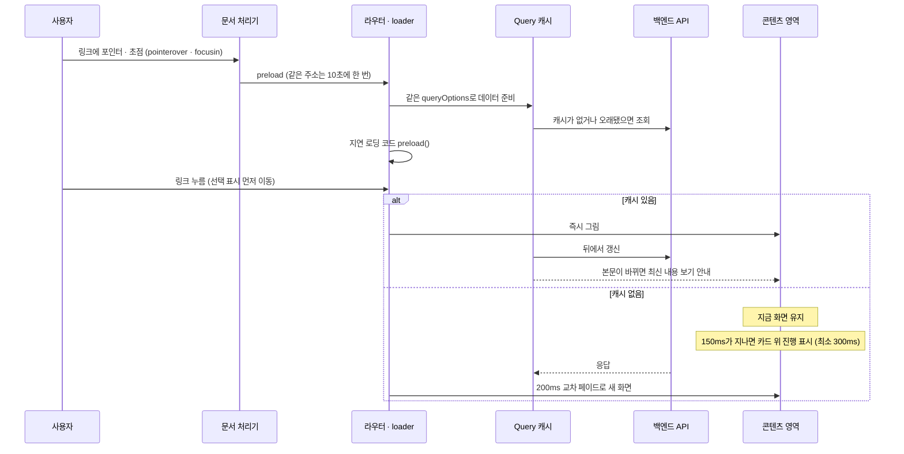
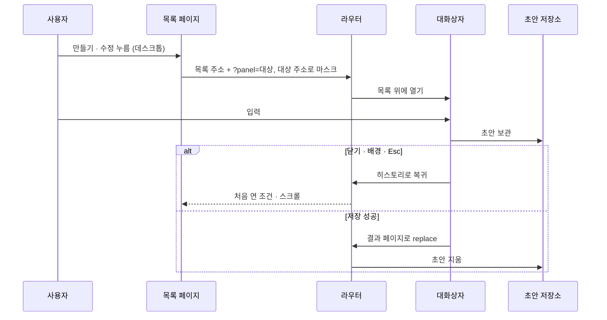
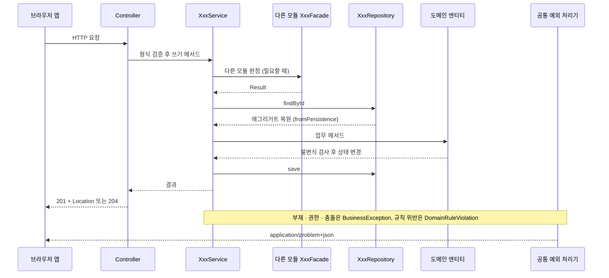
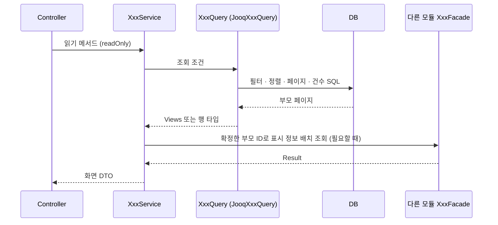
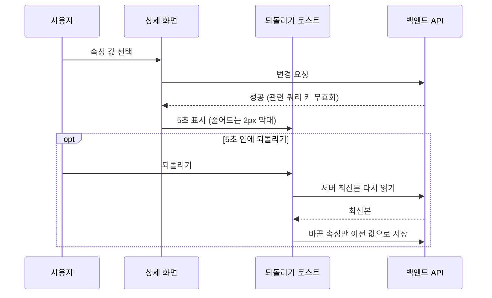

이 절은 5절의 블록들이 실행 중에 협력하는 대표 흐름 다섯 가지를 순서대로 적습니다. 프론트엔드에서는 다음 화면을 미리 준비해 기다림을 숨기고, 기다려야 하면 지금 화면을 유지한 채 150ms 뒤에만 진행 표시를 띄웁니다. 백엔드에서는 쓰기가 도메인 엔티티 복원 → 업무 메서드 → 명시적 저장으로, 읽기가 조회 포트 → jOOQ → 화면 DTO로 흐릅니다.

각 흐름에는 지침이 정한 단계만 적습니다. 개별 유스케이스의 트랜잭션 범위, 외부 후속 작업(영속 outbox 등), 화면별 검색 조건과 복귀 경로, 인증 방식은 프로젝트가 정합니다.

## 6.1 화면 이동

앱 안에서 다른 화면으로 갈 때는 링크에 포인터나 초점이 오는 순간 다음 화면의 데이터와 코드를 준비하고, 준비된 화면끼리 콘텐츠 영역만 200ms 교차 페이드합니다. 기다리는 동안 본문을 가리는 막이나 화면 전체 스켈레톤은 쓰지 않습니다.

1. 문서에 한 번 건 처리기가 `pointerover`·`focusin`에서 앱 안 `a[href]`를 찾아 라우터의 preload를 부릅니다. 같은 주소는 10초에 한 번만 부릅니다.
2. 대상 라우트의 loader가 페이지와 같은 `queryOptions`로 Query 캐시를 채우고, 지연 로딩하는 화면 코드와 큰 부품(리치 에디터 등)의 `preload()`를 함께 부릅니다.
3. 사용자가 누르면 메뉴의 선택 표시를 응답 전에 먼저 옮깁니다.
4. 캐시가 있으면 오래됐어도 즉시 그리고 뒤에서 갱신합니다(stale-while-revalidate). 먼저 그린 본문이 서버 최신본과 다르면 읽는 글을 바로 바꾸지 않고 "최신 내용 보기" 안내만 띄웁니다.
5. 캐시가 없으면 지금 화면을 그대로 둡니다. 150ms가 지나도 준비되지 않으면 콘텐츠 카드 위쪽 테두리에 높이 2px 진행 표시를 띄우고, 한 번 띄웠으면 최소 300ms 둡니다.
6. 준비되면 콘텐츠 영역만 200ms 교차 페이드하고 진행 표시를 새 화면과 함께 내립니다.

화살표는 호출이나 요청을 보내는 쪽에서 받는 쪽으로, 점선 화살표는 응답이나 결과가 돌아오는 방향입니다. `alt` 상자는 캐시가 있을 때와 없을 때 중 하나만 실행됩니다. 앱 첫 진입만 첫 방문 덮개(최소 0.3초, 0.7초에 걸쳐 걷힘)로 덮고, 그 뒤의 이동에는 이 흐름만 씁니다.

| 상황 | 동작 |
| :--- | :--- |
| 교차 페이드를 쓰지 않는 경우 | 동작 줄이기 설정, 로그인 오가기, 진행 중인 전환, 열린 대화상자 |
| View Transition | 문서 전체의 기본 스냅샷을 빼고 이름을 콘텐츠 영역 하나에만 붙임. TanStack Router는 loader가 끝난 뒤 시작하므로 준비 중 진행 표시가 멈추지 않음 |
| 목록 조건 변경 | 이전 결과를 유지(`placeholderData`)하고 진행 중임을 알림 |
| 대화상자 안 데이터 준비 | 이름 있는 원형 Spinner를 보이다가 준비되면 내용을 한 번에 표시. 바깥 창의 최소 크기 유지 |

이 흐름은 Playwright 점검으로 확인합니다. 단계마다 누른 뒤 레이아웃 이동 합이 0.01을 넘거나, 캐시가 있어야 하는 다시 방문에서 진행 표시가 뜨면 실패입니다.

## 6.2 주소 있는 대화상자

자기 주소가 있는 작성·수정 양식은 데스크톱 목록 위에서 대화상자로 열고, 주소창에는 양식의 실제 주소를 보입니다(라우트 마스킹). 같은 주소로 직접 들어오거나 새로고침하면 대화상자가 아니라 그 대상의 페이지로 엽니다.

1. 데스크톱 목록에서 열기를 누르면 라우터가 목록 주소에 `?panel=대상`을 더하고, 주소창에는 대상의 실제 주소를 마스크로 보입니다.
2. 목록은 그대로 두고 그 위에 대화상자를 띄웁니다. 입력 초안은 라우터 위의 초안 저장소에 둡니다.
3. 크게 보기를 누르면 대상 페이지로 바꿔 갑니다(replace). 초안 저장소가 대화상자보다 오래 살아 초안이 남습니다.
4. 대화상자 안에서 허용한 다른 대상으로 옮기면 같은 마스킹 이력을 replace하고 바깥 대화상자를 유지합니다.
5. 닫기·배경·Esc는 내부 이동 횟수와 관계없이 창 전체를 닫고, 라우터 히스토리로 처음 연 목록의 조건·스크롤로 돌아갑니다. 처음 연 이력이 없으면 패널만 뺀 목록으로 바꿉니다.
6. 저장에 성공하면 결과 페이지로 바꿔 가고(replace) 초안을 지웁니다. 거기서 뒤로 가면 목록입니다.

화살표는 동작을 넘기는 쪽에서 받는 쪽으로, 점선 화살표는 되돌아가는 결과입니다. 그림은 데스크톱 목록에서 시작한 경우만 그립니다. 다음 진입은 대화상자를 거치지 않고 처음부터 대상 페이지로 엽니다.

| 진입 | 결과 |
| :--- | :--- |
| 직접 링크, 새로고침(`unmaskOnReload`) | 대상 페이지 |
| 휴대폰에서 열기, 휴대폰 폭에서 남은 `?panel` | 대상 페이지 |
| 상세처럼 읽는 대상 | 대화상자가 아니라 자기 페이지 |

입력이 남은 채로 닫으려 하면 변경 내용을 버릴지 먼저 묻습니다. 계약 전체는 [라우트 마스킹](/app-shell/route-masking/)에서 다룹니다.

## 6.3 쓰기 요청

쓰기 요청은 Controller에서 피처의 `XxxService` 쓰기 메서드로 들어가, 저장소에서 애그리거트를 복원하고 업무 메서드를 부른 뒤 명시적으로 저장합니다. jOOQ에는 변경 감지가 없으므로 저장 호출을 생략하지 않고, 조회 DTO를 명령 판정의 원본으로 쓰지 않습니다.

1. Controller가 요청 형식을 검증하고 HTTP 요청을 피처의 `Requests` 타입으로 바꿔 서비스의 쓰기 메서드(`@Transactional`)를 부릅니다.
2. 서비스가 요청 주체의 자원 접근 권한과 대상의 존재를 판정합니다. 다른 모듈의 판정이 필요하면 그 모듈의 `XxxFacade`를 부릅니다.
3. 서비스가 도메인 저장소(`findById`·`findAllById` 등)로 애그리거트를 복원합니다. 복원은 `fromPersistence`로, 현재 생성 규칙을 과거 데이터에 다시 적용하지 않습니다.
4. 서비스가 엔티티의 업무 메서드를 부릅니다. 엔티티는 모든 입력을 검증한 뒤 상태를 바꾸고, 규칙 위반이면 `DomainRuleViolation`을 던집니다.
5. 서비스가 `save`·`saveAll`로 저장합니다. 감사 주체는 명시적으로 전달합니다. 함께 성공해야 하는 변경은 같은 트랜잭션에서 처리합니다.
6. 성공하면 Controller가 생성 201과 `Location`, 변경·삭제 204로 응답합니다.

화살표는 호출하는 쪽에서 받는 쪽으로, 점선 화살표는 반환입니다. 마지막 `Note`와 점선은 실패 경로로, 어느 단계에서 던진 예외든 공통 예외 처리기가 응답으로 바꿉니다.

| 오류 | 판정 주체 | 응답 |
| :--- | :--- | :--- |
| 업무 규칙 위반 | 도메인. HTTP 상태나 application 코드를 담지 않는 순수 Java `DomainRuleViolation` | 공통 처리기가 400으로 변환 |
| 부재·권한·충돌 | 서비스. 모듈의 `XxxErrorCode`를 가진 `BusinessException` | 안정된 오류 코드와 상태 코드. 권한 없는 자원의 존재 노출 정책을 유지 |
| 모든 오류 | 공통 HTTP 경계 | `application/problem+json`. 스택·비밀값은 넣지 않음 |

외부 전송을 확실히 보장해야 하면 커밋과 연결한 영속 outbox와 재시도·멱등성을 설계합니다. 외부 호출·파일·메시지 전송을 DB 원자성으로 착각하지 않습니다.

## 6.4 조회 요청

화면 조회는 `XxxService`의 읽기 메서드가 같은 피처의 조회 포트 `XxxQuery`를 부르고, infrastructure의 `JooqXxxQuery`가 SQL로 화면 DTO를 바로 만듭니다. 화면 조회에서는 도메인 엔티티를 복원하지 않습니다.

1. Controller가 서비스의 읽기 메서드(`@Transactional(readOnly = true)`)를 부릅니다.
2. 서비스가 같은 피처의 `XxxQuery`를 부릅니다. 다른 피처의 완성된 조회가 필요하면 그 피처 서비스의 읽기 메서드로 받습니다.
3. `JooqXxxQuery`가 필터·정렬·페이지·건수를 SQL에서 같은 부모 집합 기준으로 계산합니다.
4. 결과가 그대로 화면에 나가면 피처의 `Views` 타입을 직접 반환합니다. 서비스에서 가공이 필요할 때만 포트 안에 중첩한 행 타입을 씁니다.
5. 서비스가 확정한 부모 ID로 자식 목록이나 다른 모듈의 표시 정보(Facade)를 배치로 읽어 붙입니다.
6. 없는 결과는 포트 계약대로 받고, 서비스가 해당 업무 오류로 바꿉니다.

화살표는 호출하는 쪽에서 받는 쪽으로, 점선 화살표는 반환입니다. 페이지를 정한 뒤 애플리케이션에서 검색 조건을 적용하면 페이지와 건수가 틀어지므로, 검색·정렬·건수에 다른 모듈 값이 필요하면 Facade가 아니라 그 화면의 SQL에서 직접 읽습니다. 조건에 맞는 자식의 존재는 `EXISTS`, 자식 개수 기준 정렬은 부모당 한 값인 집계로 처리합니다.

## 6.5 바로 저장되는 속성 변경과 되돌리기

상세에서 저장 버튼 없이 바로 저장되는 속성(상태·담당·날짜·라벨·우선순위 등)을 바꾸면, 결과가 화면에 보여도 "되돌리기" 토스트를 5초 띄웁니다. 확인 단계가 없어 잘못 누른 변경을 되돌릴 길이 필요하기 때문입니다.

1. 사용자가 상세의 속성 값을 고르면 변경 요청을 보냅니다.
2. 변경 요청이 성공하면 관련 쿼리 키를 무효화합니다. 저장 성공 뒤 재조회가 실패해도 저장 실패로 알리지 않습니다.
3. "되돌리기" 토스트를 5초 띄웁니다. 토스트 아래 2px 막대가 남은 시간만큼 줄어들고, 포인터가 올라가 있으면 멈춥니다.
4. 사용자가 되돌리기를 누르면 서버 최신본을 다시 읽습니다.
5. 바꾼 속성만 이전 값으로 저장합니다. 그 사이 다른 사람이 바꾼 다른 속성은 덮지 않습니다.

화살표는 요청을 보내는 쪽에서 받는 쪽으로, 점선 화살표는 응답입니다. `opt` 상자는 사용자가 5초 안에 되돌리기를 누를 때만 실행되는 구간이고, 포인터가 토스트에 올라가 있는 동안은 남은 시간이 줄지 않습니다. 변경 요청이 실패하면 토스트가 아니라 머리 아래 배너 줄에 알립니다. 오류·경고·되돌릴 수 없는 결과는 토스트에 두지 않습니다.

## 이 절의 지침

<SectionDocs section="6" />
