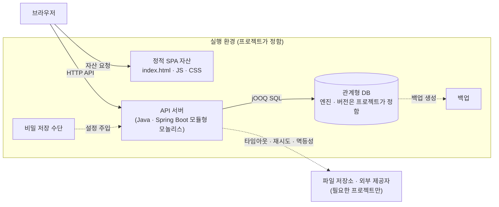
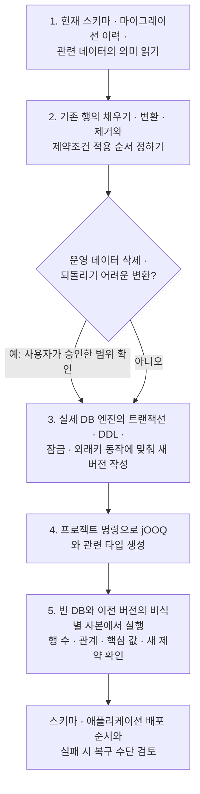

이 절은 Webcraft를 따르는 웹 앱이 실행되는 단위와, 스키마 변경·운영 변경을 내보내기 전에 검토할 항목을 다룹니다. Webcraft가 배치에서 정하는 것은 적습니다. 실행 단위의 종류(정적 SPA 자산, API 서버, DB)와 비밀값·백업·복구를 다루는 원칙, 스키마 변경의 검증 순서까지만 정하고, 클라우드·호스트·네트워크·컨테이너·태그·배포 권한은 모두 프로젝트 정책입니다.

그래서 이 절의 도표와 표는 기준 배치의 뼈대만 그리고, 프로젝트가 채울 칸을 "프로젝트가 정함"으로 표시합니다. 프로젝트의 아키텍처 정의서는 이 칸을 실제 인프라 구성과 배포 절차로 채웁니다.

## 7.1 기준 배치

기준 배치는 브라우저가 받는 정적 SPA 자산, HTTP API를 제공하는 백엔드 서버 하나(모듈형 모놀리스), 관계형 DB 세 단위이고, 비밀값과 백업은 실행 환경 쪽 수단에 둡니다. 서비스·큐·캐시·복제는 기본 배치에 넣지 않고 구체적인 요구와 운영 비용이 있을 때 더합니다.

실선 화살표는 실행 중 요청이 흐르는 방향입니다. 점선은 요청 흐름이 아니라 운영 관계로, 비밀값을 서버에 넣는 경로, 백업을 만드는 경로, 프로젝트가 고르는 외부 연결을 뜻합니다. `실행 환경` 상자 안의 노드를 한 호스트에 둘지 나눌지, 정적 자산과 API를 같은 출처로 낼지는 Webcraft가 정하지 않습니다.

| 노드 | Webcraft가 정하는 것 | 프로젝트가 정하는 것 |
| :--- | :--- | :--- |
| 정적 SPA 자산 | 로그인 뒤 업무 앱은 빌드 때 `index.html`의 앱 자리에 첫 방문 덮개를 넣어 앱 코드가 오기 전에도 빈 화면을 보이지 않음. 공개 문서·랜딩처럼 스크립트 없는 읽기가 필요한 화면은 본문을 미리 그린 HTML(SSG·프리렌더) | 호스팅 방식, 캐시 정책, 출처 구성 |
| API 서버 | Java·Spring Boot·jOOQ 모듈형 모놀리스. 서버가 HTTP 계약의 원본 | 런타임 버전, 패키지 루트, 실행 방식(컨테이너 등), 포트 |
| DB | 스키마는 Flyway 마이그레이션, 코드는 jOOQ 생성 타입. 특정 프로젝트의 엔진 선택을 모든 프로젝트에 강제하지 않음 | 엔진과 버전, 호스팅, 접속 방식 |
| 비밀 저장 수단 | 비밀값은 실행 환경의 비밀 저장 수단으로 관리. 계정·접속 정보·업무 데이터는 공통 지침이나 시드에 넣지 않음 | 저장 수단의 종류와 주입 방법 |
| 백업 | 백업을 만들었다는 사실과 복구를 확인했다는 사실을 구분 | 백업 주기·보관 위치·복구 절차 |
| 파일 저장소·외부 제공자 | 외부 호출의 타임아웃·실패·재시도·멱등성을 정하고, 핵심 트랜잭션과 외부 작업의 성공을 혼동하지 않음 | 둘지 여부, 제공자, 연결 설정 |

## 7.2 스키마 변경과 이관 순서

스키마 변경은 현재 스키마와 이력을 읽고, 새 마이그레이션 버전을 추가해 기존 데이터의 처리 순서를 정한 뒤, 빈 DB와 이전 버전의 비식별 사본에서 검증하고 나서 배포 순서와 복구 수단을 함께 검토합니다. 공유 환경에 이미 적용된 마이그레이션은 고치지 않습니다.

화살표는 작업 순서이고, 마름모는 판단 지점입니다. 승인 확인은 운영 데이터 삭제나 되돌리기 어려운 변환이 있을 때만 거치며, 이미 정한 결정은 다시 묻지 않습니다. 번호는 database 지침의 단계 번호와 같습니다.

| 단계 | 하지 않는 것 |
| :--- | :--- |
| 마이그레이션 작성 | 공유 환경에 적용된 마이그레이션을 고치는 것. 다른 엔진의 문법·잠금 방식을 그대로 쓰는 것 |
| 생성 코드 | 생성 파일을 손으로 맞추는 것 |
| 검증 | 운영 DB 자체를 검증용으로 변경하는 것 |
| API 계약이 함께 바뀔 때 | OpenAPI·생성 클라이언트 타입·실제 호출자를 다른 변경으로 미루는 것 |

Webcraft는 스키마를 애플리케이션보다 먼저 배포할지 같이 배포할지 같은 고정 순서를 정하지 않습니다. 변경마다 순서와 실패 시 복구 수단을 함께 검토해 운영 변경 검토 항목(7.3)에 적습니다.

## 7.3 운영 변경 검토 항목

운영 변경은 배포 순서·설정·데이터 이관·백업·복구·수동 작업을 다른 사람이 미리 검토할 수 있는 형태로 만들어 둔 뒤 내보냅니다. 검증은 실제 실패·복구 경로까지 변경 위험에 맞게 정하며, 스킬이 배포 권한을 부여하지 않습니다.

| 항목 | 검토할 내용 | 근거 |
| :--- | :--- | :--- |
| 배포 순서 | 스키마와 애플리케이션을 어떤 순서로 내보내는지 | architecture, database |
| 설정 | 새로 필요하거나 바뀌는 환경 설정. 비밀값은 실행 환경의 비밀 저장 수단에 두고 저장소·시드에 넣지 않음 | architecture |
| 데이터 이관 | 기존 행의 채우기·변환·제거 순서와 제약조건 적용 시점, 사용자가 승인한 삭제·변환 범위 | database |
| 백업 | 변경 전에 만든 백업과 그 위치 | architecture, database |
| 복구 | 실패 시 되돌리는 수단과, 그 수단으로 실제 복구해 본 확인. 백업 생성과 복구 확인을 구분해 적음 | architecture, database |
| 수동 작업 | 사람이 직접 실행해야 하는 단계 | architecture |
| 외부 연동 | 외부 제공자 호출의 타임아웃·실패·재시도·멱등성. 커밋과 연결해야 하는 외부 전송은 영속 outbox | architecture, backend |
| 기술 선택 | 되돌리기 어려운 기술 선택이면 맥락·결정·대안을 프로젝트 기록에 남김 | architecture |

## 7.4 프로젝트가 정하는 것

다음 항목은 Webcraft가 기본값을 두지 않으며, 프로젝트의 아키텍처 정의서 7절과 운영 문서가 채웁니다. 공통 지침과 다르게 정한 것은 각 저장소 `AGENTS.md`의 프로젝트 규칙 표에 적습니다.

| 항목 | 예 |
| :--- | :--- |
| 인프라 | 클라우드·온프레미스 여부, 호스트, 네트워크, TLS 종료 지점 |
| 실행 단위 | 웹 서버, 컨테이너 사용 여부, 런타임 버전, 포트 |
| DB | 엔진과 버전, 접속 방식, 백업 수단과 보관 기간 |
| 환경 | 개발·검증·운영 환경의 구분과 데이터 분리 방식 |
| 릴리스 | 브랜치·태그 규칙, CI/CD 단계, 자동·수동 배포 구분 |
| 배포 권한 | 누가 배포·복구를 실행하고 승인하는지 |
| 비밀값 | 비밀 저장 수단과 주입 방법 |
| 업무 시간대 | API가 다루는 업무 날짜·지역 시각의 기준 시간대(절대 시각은 UTC로 전달) |
| 명령 | 생성 명령, 검사 명령, 개발 포트, 개발용 로그인 방법 |

## 이 절의 지침

<SectionDocs section="7" />
