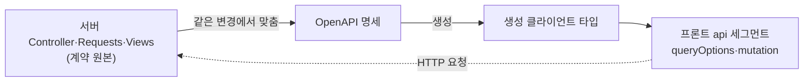
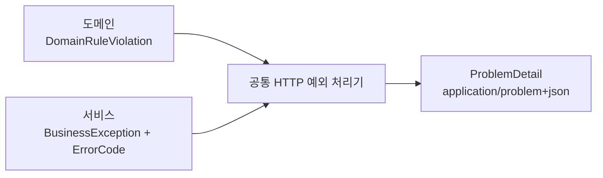
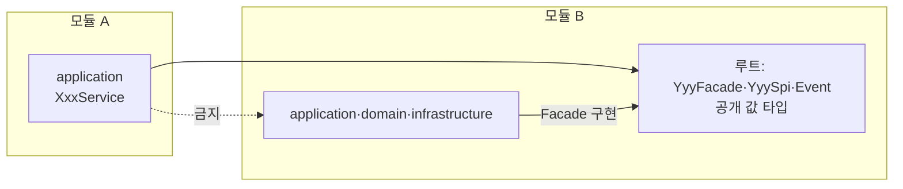

이 절은 시스템 안의 두 경계, 곧 브라우저·외부 호출자와 서버가 만나는 HTTP 경계와 백엔드 모듈끼리 만나는 모듈 경계의 계약을 다룹니다. HTTP 계약은 서버가 원본이고 OpenAPI와 생성 클라이언트 타입이 그 사본입니다. 모듈 계약은 모듈 루트의 `Facade`·`Spi`·`Event`와 공개 값 타입뿐이며, 다른 모듈의 내부 타입은 참조하지 않습니다. 자원 경로 접두사·식별자 형식·업무 시간대·숨긴 자원의 존재 노출 정책과 실제 도메인 계약은 프로젝트가 정합니다.

## 8.1.1 HTTP 계약의 원본

서버가 계약의 원본이며, API를 바꾸면 OpenAPI·생성 클라이언트 타입·실제 호출자를 같은 변경에서 맞춥니다.

실선은 원본에서 사본으로 맞추는 방향이고, 점선은 실행 중 요청이 가는 방향입니다. 사람이 고치는 곳은 서버 하나이며 명세와 생성 타입은 프로젝트의 생성 명령으로 다시 만듭니다. 생성 명령과 경로는 프로젝트 설정에서 확인합니다.

| 규칙 | 내용 | 이유 |
| :--- | :--- | :--- |
| 자원 경로 | 복수 명사를 기본으로 하고 업무 전이는 의미 있는 하위 자원으로 표현합니다 | 동사 경로가 늘어나면 같은 자원의 계약이 흩어집니다 |
| 상태 코드 | 조회 200, 생성 201과 `Location`, 변경·삭제 204. 전역 success/data 래퍼를 기본으로 두지 않습니다 | HTTP가 이미 결과를 구분합니다. 즉시 필요한 결과가 있을 때만 응답 모델을 명시합니다 |
| PATCH | 생략·`null`·값 전달의 의미를 구분합니다 | "그대로 둠"과 "비움"이 섞이면 데이터를 잃습니다 |
| 시각 | 업무 날짜·지역 시각·절대 시각을 구별하고 절대 시각은 UTC로 전달합니다 | 업무 시간대는 프로젝트가 정합니다 |
| 목록 | 서버 필터·안정된 정렬·페이지/커서 계약을 명시하고 count와 목록이 같은 조건을 씁니다 | 건수와 행이 다른 조건으로 계산되면 페이지가 틀어집니다 |
| 업로드 | 임시 파일과 업무 자원 연결의 소유권·만료·권한을 구분하고, 파일명·확장자를 믿지 않고 크기·타입·경로를 검증합니다. 파일을 읽는 경로에서도 권한을 확인합니다 | 사진의 대표색·가로·세로를 함께 보내면 파일과 함께 저장해 첨부 정보로 돌려줍니다 |
| 변경 | 버전 충돌과 명령 재시도 시 중복 효과를 검토합니다 | 브라우저 캐시 무효화는 동시 편집 충돌을 해결하지 않습니다 |

## 8.1.2 오류 응답과 권한

오류 응답은 `application/problem+json` 하나의 모양이며, 오류를 누가 판정했는지에 따라 상태 코드와 코드가 정해집니다.

화살표는 예외가 던져져 변환되는 방향입니다. 도메인의 순수 규칙 위반은 경계에서 400으로 바뀌고, 서비스가 판정한 부재·권한·충돌은 안정된 오류 코드로 구별합니다. 판정 책임의 상세는 [8.2 백엔드 코드](/architecture/8-2/)에서 다룹니다.

| 규칙 | 내용 |
| :--- | :--- |
| 도메인 오류 | 도메인 자체에 HTTP 상태나 application 오류 코드를 넣지 않습니다 |
| 서비스 오류 | 부재·권한·충돌을 안정된 코드로 구별하고 기존 호출자의 코드 분기를 유지합니다. 필드 오류와 낙관적 잠금 충돌을 구분합니다 |
| 응답 내용 | 스택·비밀값을 넣지 않습니다 |
| 권한 | 인증된 사용자와 자원 접근 권한을 서버에서 검사합니다 |
| 존재 노출 | 숨겨야 하는 대상의 존재 노출 정책을 프로젝트가 정하고 REST·MCP·다운로드에 똑같이 적용합니다 |

자세한 계약은 [API 계약](/rules/api/)을 따릅니다.

## 8.1.3 모듈 간 공개 계약

다른 모듈은 상대 모듈 루트의 공개 계약만 참조하고, 내부 `application`·`domain`·`infrastructure` 타입은 참조하지 않습니다.

실선 화살표는 참조하는 쪽 → 참조되는 쪽입니다. "금지" 라벨의 점선은 하지 않는 참조입니다. 모듈 B의 `Facade` 구현은 B 자신의 `application`에 두며, A의 서비스는 B의 `Facade`를 직접 사용하고 중계 포트·어댑터를 더하지 않습니다.

| 소유자 | 무엇 |
| :--- | :--- |
| `XxxFacade` | 피처가 제공하는 계약 하나. 조회·쓰기·표시를 `QueryFacade`·`CommandFacade`·`ViewFacade`로 나누지 않습니다 |
| `XxxFacade.Param`·`XxxFacade.Result` | 계약 전용 입력·결과(`ProductFacade.Param.Create`, `ProductFacade.Result.Detail`). 전용 record는 이 묶음에 중첩하고 묶음 생성자는 감춥니다 |
| 모듈 루트의 값 타입 | 여러 계약이 실제로 함께 쓰는 업무 enum·값 |
| 피처의 `Requests`·`Views` | HTTP 요청·응답. 모듈 계약과 소유 경계가 다릅니다 |
| `Event` | 업무 사건 전달. 동기 결과가 필요한 유스케이스를 이벤트로 우회하지 않습니다 |

`Spi`는 소유 모듈이 외부 모듈에 구현을 요구하는 계약이며, 다음 세 조건을 모두 충족할 때만 도입합니다. 소유 모듈이 자기 불변식을 검증하는 데 그 정보가 필요하고, 자기 데이터와 규칙만으로 판정할 수 없고, 호출 인자로 받아 해결할 수 없을 때입니다. `Spi`는 선언 모듈 루트에 두고 밖에서 구현하며 누가 구현하는지 문서에 적습니다. 상세는 [모듈 간 계약](/rules/backend/references/contracts/)에 있습니다.

## 8.1.4 모듈 간 조회

명령은 공개 계약으로 처리하고, 조회는 "표시값을 붙이는가"와 "결과 집합을 정하는가"로 나눠 경로를 고릅니다.

| 필요한 것 | 기본 선택 |
| :--- | :--- |
| 다른 모듈의 표시 정보 | 부모 페이지 확정 후 `Facade` 배치 조회 |
| 다른 모듈 값으로 검색·정렬·건수 결정 | 그 화면의 SQL 조회에서 직접 읽기 허용 |
| 조건에 맞는 자식 존재 여부 | `EXISTS` |
| 자식 개수 기준 정렬 | 부모당 한 값인 집계 |
| 여러 자식 목록 표시 | 확정한 부모 ID로 각각 배치 조회 |
| 업무 당시 값 보존 | 당시 시점의 스냅샷 |

필터·정렬·페이지·건수는 같은 부모 집합을 기준으로 계산합니다. 교차 모듈 SQL은 저장 구조에 결합한다는 비용을 인정하고 조회 구현 안에 가둡니다. 이 허용은 내부 Java 타입 참조나 명령의 직접 테이블 변경까지 넓어지지 않으며, 조회 편의를 위해 동기화 사본·보고 모듈·DB 뷰를 먼저 도입하지 않습니다. 상세는 [모듈 간 조회](/rules/backend/references/cross-module-read/)에 있습니다.

## 8.1.5 피처 간 공유와 참조 경계

두 피처에 같은 코드가 필요하면 소유권을 먼저 정하고, 별도 공용 층을 만들지 않습니다.

| 순서 | 질문 | 옮길 곳 |
| :--- | :--- | :--- |
| 1 | 도메인 규칙이 중복됩니까? | `domain`. 여러 애그리거트에 걸친 불변식은 `domain` 루트의 도메인 서비스 |
| 2 | 조율 로직을 함께 씁니까? | 소유 피처를 정하고 그 피처의 공유 서비스. 호출자는 단방향으로 의존합니다 |
| 3 | 어느 피처에도 속하지 않는 공용입니까? | 두 피처 이상이 실제로 쓸 때만 `application` 바로 아래 |
| 4 | DTO나 계약의 모양만 비슷합니까? | 변경 이유가 다르면 각각 유지합니다 |

`application/shared`·`application/common`·`모듈/shared` 같은 공용 층은 두지 않습니다. 모듈 루트는 외부 공개 계약, `application` 루트는 모듈 내부 공용의 자리입니다. 다른 피처의 완성된 조회는 그 피처 서비스의 읽기 메서드로 요청하고, 일반 쓰기 메서드끼리 서로 호출하지 않으며, 애그리거트끼리는 ID로 참조합니다. 상세는 [공유와 참조](/rules/backend/references/sharing/)에 있습니다.

## 8.1.6 제품 플러그인 계약

제품이 사용자에게 MCP 연결과 사용법을 제공하면, 저장소 개발 규칙과 사용자용 스킬을 서로 다른 원본으로 둡니다.

| 대상 | 원본 | 넣지 않는 것 |
| :--- | :--- | :--- |
| 저장소 개발 규칙 | 프로젝트 `AGENTS.md`(길면 `.agents/rules`) | — |
| 사용자용 스킬 | 제품이 관리하는 `plugins/<플러그인>/skills` 같은 별도 경로 | 개발 팀의 서버 주소·프로젝트 키·이슈 처리 정책 |
| 에이전트별 배포 | 공통 스킬 본문 + 에이전트별 manifest·마켓플레이스·연결 설정 | 생성된 배포본에 대한 직접 수정 |

설치는 사용자 범위를 기본으로 안내하고, 설치만으로 저장소 규칙을 바꾸지 않습니다. MCP 도구가 바뀌면 서버 계약과 사용자용 설명을 함께 맞추고, 배포 전에 각 에이전트에서 설치·스킬 발견·연결·인증·권한을 실제로 확인합니다. 상세는 [제품 플러그인 관리](/rules/architecture/references/product-plugins/)에 있습니다.

## 이 절의 지침

<SectionDocs section="8.1" />
