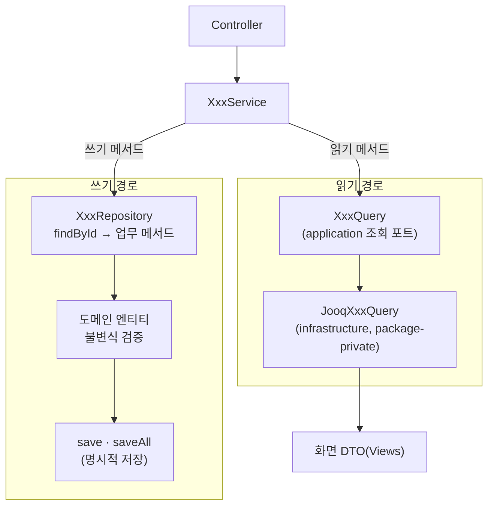
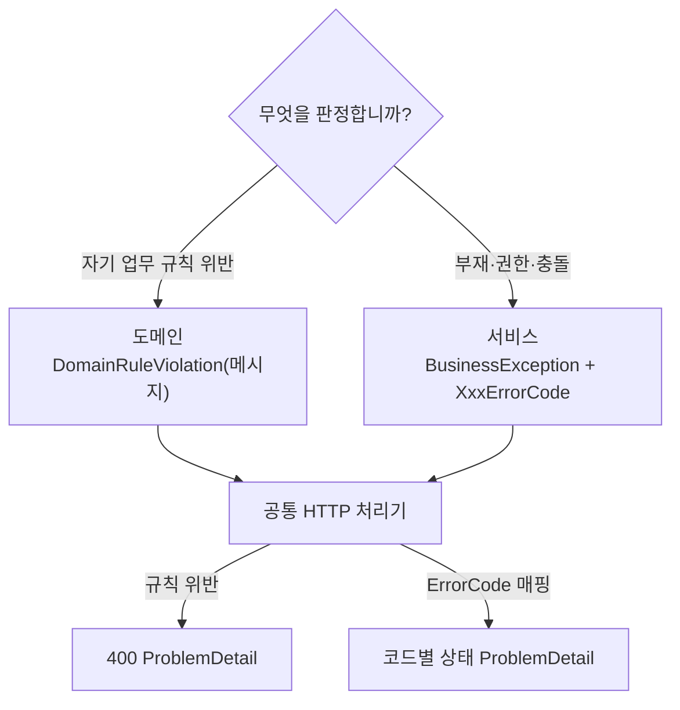

이 절은 백엔드 모듈 하나의 안쪽을 다룹니다. 모듈은 단수 이름으로 두고 `application`·`domain`·`infrastructure`로 나누며, 피처마다 `XxxService` 하나가 읽기와 쓰기를 함께 제공합니다. 읽기와 쓰기의 분리는 클래스 수가 아니라 처리 경로로 지킵니다. 읽기는 `XxxQuery` 포트와 jOOQ 구현으로 화면 DTO를 만들고, 쓰기는 순수 Java 도메인의 업무 메서드와 명시적 `save`를 거칩니다. 기본 조합은 Java·Spring Boot·jOOQ이며 버전·패키지 루트·DB 엔진·정적 검사 도구는 프로젝트가 정합니다.

## 8.2.1 계층별 책임

계층은 위에서 아래로만 의존하고, 도메인은 프레임워크에 의존하지 않는 순수 Java입니다.

| 역할 | 책임 | 하지 않는 것 |
| :--- | :--- | :--- |
| Controller | 요청 형식 검증·HTTP 변환, 서비스 진입 | 업무 판단 |
| Service | 피처의 읽기·쓰기 유스케이스, 트랜잭션, 여러 애그리거트의 조율 | 도메인 불변식의 직접 구현 |
| Domain | 업무 불변식과 의미 있는 상태 전이 | HTTP 상태·Spring 예외·응답 DTO·application `ErrorCode` 참조 |
| Infrastructure | jOOQ 영속성·조회 구현·외부 연동 | 업무 규칙 |

| 단위 | 나누는 기준 |
| :--- | :--- |
| `application` | 유스케이스·피처. 실제 피처가 늘 때 나눕니다 |
| `domain` | 애그리거트. 실제 애그리거트가 늘 때 나눕니다 |
| `infrastructure` | 기술 관심사 |

처음에는 각 계층을 평평하게 두고, 계층 안에서 공유하는 코드는 그 계층 루트에 둡니다. 두 축은 독립적이어서 서비스 하나가 여러 애그리거트를 조율할 수 있고, 서비스와 애그리거트를 1:1로 맞추지 않습니다. 상세는 [계층과 명령](/rules/backend/references/layers/)에 있습니다.

## 8.2.2 읽기와 쓰기의 경로

같은 서비스 안에서 읽기 메서드는 조회 포트로, 쓰기 메서드는 도메인 저장소로 갑니다.

화살표는 호출하는 쪽 → 호출되는 쪽입니다. 읽기 경로는 도메인 엔티티를 복원하지 않고 화면 DTO를 바로 만듭니다. 쓰기 경로는 저장소에서 애그리거트를 복원하고 업무 메서드를 부른 뒤 반드시 `save`합니다. jOOQ에는 변경 감지가 없으므로 저장 호출을 생략하지 않습니다.

| 규칙 | 내용 | 이유 |
| :--- | :--- | :--- |
| 명령의 원본 | 조회 DTO를 명령 판정의 원본으로 쓰지 않습니다 | 화면용 값으로 불변식을 판정하면 도메인을 우회합니다 |
| 저장소 메서드 | `findById`·`findAllById`·`existsBy`·`save`·`saveAll`처럼 의도를 드러냅니다 | 반복문마다 조회·저장하지 않고 묶어 일괄 처리합니다 |
| 엔티티 변경 | 업무 메서드로만 바꾸고, 모든 입력을 검증한 뒤 상태를 바꿉니다 | Setter로 불변식을 우회하지 않습니다 |
| 생성과 복원 | 신규 `create`와 저장소의 `fromPersistence`를 구분합니다 | 복원 때 현재 생성 규칙을 과거 데이터에 다시 적용하지 않습니다 |
| 쓰기 메서드의 보조 조회 | 존재 확인·선택 마스터에는 같은 피처의 조회 포트를 쓸 수 있습니다 | 핵심 불변식·상태 변경은 도메인과 저장소를 거칩니다 |
| 외부 전송 보장 | 커밋과 연결한 영속 outbox, 재시도와 멱등성을 설계합니다 | 프로젝트에 이미 있는 신호·이벤트 기반을 먼저 확인합니다 |

## 8.2.3 피처별 서비스와 트랜잭션

피처마다 `XxxService` 하나에 읽기·쓰기 메서드를 함께 두고, `XxxQueryService`와 명령 서비스로 나누지 않습니다.

| 항목 | 규칙 |
| :--- | :--- |
| 메서드 순서 | 리소스별로 묶고 목록 조회 → 단건 조회 → 생성 → 수정 → 삭제 → 그 밖의 상태 전환 |
| 읽기만 있는 서비스 | 클래스에 `@Transactional(readOnly = true)` |
| 읽기·쓰기가 함께 있는 서비스 | 클래스에 달지 않고 public 메서드마다. 읽기는 `@Transactional(readOnly = true)`, 쓰기는 `@Transactional` |
| 다른 피처 호출 | 완성된 조회는 소유 서비스의 읽기 메서드로 요청합니다. 쓰기 메서드끼리 직접 호출하지 않습니다 |
| 원자성 | 함께 성공해야 하는 변경은 같은 트랜잭션입니다. 외부 호출·파일·메시지 전송을 DB 원자성으로 착각하지 않습니다 |

메서드마다 트랜잭션을 다는 반복은 감수합니다. 클래스에 한 번 달고 쓰기 메서드만 덮어쓰면, 덮어쓰기를 빠뜨린 쓰기 메서드가 읽기 전용으로 실행되어도 눈에 띄지 않기 때문입니다. 기존 `QueryService`는 해당 피처를 고칠 때 같은 피처의 `Service`로 합치고, 관련 없는 피처를 일괄 변경하지 않습니다.

## 8.2.4 조회 포트

화면 조회 포트 `XxxQuery`는 그 조회를 소유한 서비스와 같은 피처의 `application`에 두고, 서비스와 1:1로 구성합니다.

| 규칙 | 내용 |
| :--- | :--- |
| 구현 위치 | `infrastructure`의 package-private `JooqXxxQuery`. 도메인 저장소 구현과 합치지 않습니다 |
| 결과 타입 | 그대로 화면에 나가면 그 피처의 `Views` 타입을 직접 반환합니다. 서비스에서 더 가공할 때만 포트 안에 업무 의미가 드러나는 행 record를 중첩합니다 |
| 부재 | 없는 결과의 표현을 포트 계약에 적고, 서비스가 업무 오류로 바꿉니다 |
| 결정 주체 | 필터·정렬·페이징·건수는 DB가 정하고, 서비스는 확정된 결과를 조립합니다 |
| 소유권 | 공통 조회 저장소나 쿼리 식별자에 여러 피처의 SQL을 모으지 않습니다 |

부모 페이지를 확정한 뒤 자식을 배치로 읽어 붙이는 것은 정상 조립이고, 전체를 읽은 뒤 코드에서 검색·페이지를 대신하는 것과 구분합니다. 다른 모듈의 값이 필요할 때의 선택은 [8.1 모듈 간 조회](/architecture/8-1/)를 따릅니다. 상세는 [조회 포트](/rules/backend/references/queries/)에 있습니다.

## 8.2.5 도메인 오류와 서비스 오류

오류는 판정하는 주체가 표현을 정합니다. 도메인은 업무 규칙 위반을, 서비스는 요청 주체·부재·권한·동시 변경을 판정합니다.

위쪽 마름모는 오류를 만드는 쪽이 묻는 질문이고, 아래 화살표는 예외가 응답으로 바뀌는 방향입니다. 도메인 예외에는 HTTP 상태나 application 코드를 넣지 않으며, HTTP 변환은 공통 처리기 한 곳이 맡습니다.

| 규칙 | 내용 |
| :--- | :--- |
| `XxxErrorCode` 위치 | 모듈마다 `application` 루트에 하나. 애그리거트별로 나누지 않습니다 |
| 도메인 메시지 | 사용자에게 전달 가능한 업무 언어. 내부 상태·비밀값을 넣지 않습니다 |
| 코드 제거 | 호출자가 그 코드로 분기하는지 확인하고, 필요하면 판정을 서비스로 옮기거나 호환성을 해결합니다 |
| 일괄 변환 금지 | 모든 예외를 일반 400으로 바꿔 부재·권한·동시성 오류를 잃지 않습니다 |
| 로그 | 전역 처리기에서 일관되게 남기고, 빈 catch·포괄 catch로 삼키거나 같은 실패를 여러 층에서 중복 기록하지 않습니다 |

테스트는 도메인 규칙 위반과 서비스의 오류 코드를 각각 검증하고 HTTP 변환은 경계에서 확인합니다. 상세는 [도메인 오류와 서비스 오류](/rules/backend/references/errors/)에 있습니다.

## 8.2.6 코드 규칙

이름은 역할을 드러내고, 기술 이름과 역할 이름을 섞지 않습니다.

| 대상 | 규칙 |
| :--- | :--- |
| 역할 이름 | `Controller`·`Service`·`Query`·`Repository`·`Requests`·`Views`·`ErrorCode`. 구현은 `Jooq` 같은 기술 이름을 붙이고 `QueryRepository`처럼 역할을 섞지 않습니다 |
| 의존성 | 생성자 주입. 필드·인자는 선언 타입의 lowerCamelCase |
| 조회 메서드 | 없을 수 있으면 `find`와 `Optional`, 반드시 있어야 하면 `get`과 예외 |
| 타입 | 불변 값·전달 타입은 record, 접근자는 `name()` 형식. 검증·정규화가 필요한 값에 값 객체 |
| 동등성 | 엔티티는 식별자, 값은 내용 |
| 시각 | 현재 시각은 주입한 `Clock`으로 전달 |
| SQL·jOOQ 타입 | `infrastructure`에만 둡니다 |

테스트는 업무 불변식·원자성·중복 명령·권한처럼 바깥에서 관찰할 결과를 검증하고, formatter·lint·경계 검사는 프로젝트가 채택한 도구로 실행합니다. 상세는 [코드 규칙](/rules/backend/references/code-style/)에 있습니다.

## 이 절의 지침

<SectionDocs section="8.2" />
