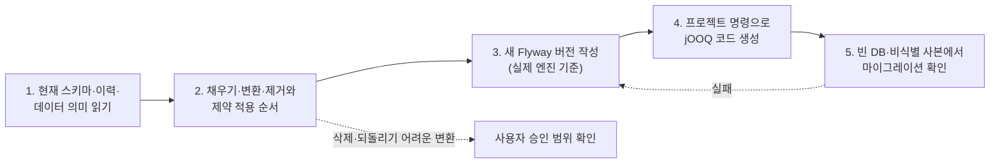

이 절은 데이터베이스 스키마 변경과 기존 데이터 이관의 공통 절차를 다룹니다. 기본 도구는 Flyway와 jOOQ이며, 공유 환경에 적용된 마이그레이션은 고치지 않고 다음 버전을 추가합니다. 사용할 DB 엔진과 버전, 코드 생성 명령, 운영 데이터 삭제·변환의 승인 범위는 프로젝트가 정합니다. 특정 프로젝트의 엔진 선택(예: SQLite)을 모든 프로젝트에 강제하지 않습니다.

## 8.3.1 마이그레이션 흐름

스키마 변경은 읽기 → 순서 설계 → 작성 → 코드 생성 → 검증의 다섯 단계를 차례로 거칩니다.

실선은 작업 순서이고, 점선은 조건이 걸릴 때만 지나는 갈래입니다. 검증에서 행 수·관계·제약이 맞지 않으면 작성 단계로 돌아갑니다.

## 8.3.2 단계별 규칙

각 단계는 하나의 조건을 지키며, 승인과 엔진 조건은 프로젝트가 정한 값을 따릅니다.

| 단계 | 규칙 |
| :--- | :--- |
| 읽기 | 현재 스키마·마이그레이션 이력·관련 데이터의 의미를 먼저 읽습니다 |
| 버전 | 공유 환경에 적용된 마이그레이션은 고치지 않고 다음 버전을 추가합니다 |
| 이관 순서 | 기존 행의 채우기·변환·제거와 제약조건 적용 순서를 정합니다 |
| 승인 | 운영 데이터 삭제·되돌리기 어려운 변환은 사용자가 승인한 범위를 확인합니다. 이미 정한 결정을 다시 묻지 않습니다 |
| 엔진 | 실제 DB 엔진의 트랜잭션·DDL·잠금·외래키 동작에 맞춰 씁니다. 다른 엔진의 문법·잠금 방식을 그대로 쓰지 않습니다 |
| 생성 코드 | 프로젝트 명령으로 jOOQ와 관련 타입을 생성합니다. 생성 파일을 손으로 맞추지 않습니다 |

## 8.3.3 검증과 배포 순서

마이그레이션은 빈 DB와 이전 버전의 비식별 검증 사본 두 곳에서 실행해 확인하고, 운영 DB 자체를 검증용으로 바꾸지 않습니다.

| 확인 대상 | 무엇을 봅니까 |
| :--- | :--- |
| 빈 DB | 처음부터 모든 버전이 차례로 적용되는지 |
| 이전 버전의 비식별 사본 | 행 수·관계·핵심 값이 보존·변환되는지, 새 제약이 기존 행에서 통과하는지 |
| 배포 순서 | 스키마와 애플리케이션 중 무엇을 먼저 배포하는지, 실패 시 복구 수단 |
| 복구 | 백업을 만들었다는 사실과 복구를 확인했다는 사실을 구분합니다 |

이 검증은 [8.9 검증](/architecture/8-9/)의 "스키마" 항목과 같습니다. 이관을 맡은 백엔드 코드의 저장소·조회 구현은 [8.2 백엔드 코드](/architecture/8-2/)의 규칙대로 `infrastructure`에 SQL·jOOQ 타입을 둡니다. 상세 절차는 [DB와 마이그레이션](/rules/database/)에 있습니다.

## 이 절의 지침

<SectionDocs section="8.3" />
