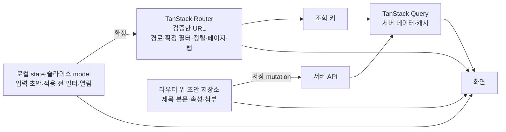
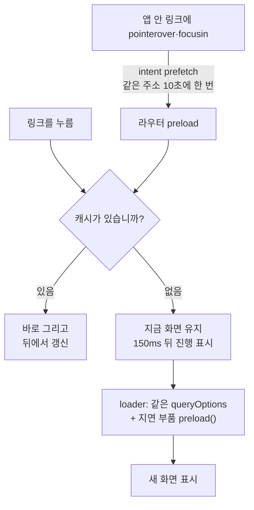

이 절은 React SPA 안의 코드 작성과 상태 소유, 화면 전환 때의 데이터·코드 준비를 다룹니다. 기본 조합은 React·TypeScript·Vite·TanStack Router/Query이고 파일 배치는 공식 `feature-sliced-design` 스킬을 따릅니다. 상태는 세 소유자로 나눕니다. 서버 데이터는 TanStack Query, 확정한 검색 조건은 검증한 URL, 입력 초안은 로컬 state나 라우터 위의 초안 저장소가 가집니다. 라우트 경로·API 엔드포인트·개발 포트·연속 저장과 충돌 해결의 세부 정책은 프로젝트가 정합니다. 부품 선택·테마·레이아웃 표현은 [8.5](/architecture/8-5/)~[8.8](/architecture/8-8/)이 소유하며 이 절에 복제하지 않습니다.

## 8.4.1 코드 작성

컴포넌트는 파생값을 state에 복사하지 않고, Effect는 외부 구독과 동기화에만 씁니다.

| 대상 | 규칙 |
| :--- | :--- |
| 파일 이름 | 컴포넌트는 PascalCase 파일 하나에 하나, 페이지는 `Page` 접미사. 훅은 `use`로 시작하고 일반 유틸·설정 파일은 kebab-case |
| 파생값 | state에 복사해 Effect로 맞추지 않습니다 |
| 사용자 명령 | 이벤트 핸들러·mutation이 처리합니다 |
| Effect | 외부 구독과 동기화에 쓰고 해제합니다 |
| `useMemo`·`useCallback` | 측정된 비용이나 참조 안정성이 필요한 경계에만 씁니다 |
| StrictMode | 드러난 수명주기 문제를 실행 방지 플래그로 숨기지 않습니다 |
| 그룹·별칭·lint | 프로젝트 설정에서 확인합니다. 다른 프로젝트의 페이지 그룹이나 도우미가 있다고 가정하지 않습니다 |

상세는 [코드 작성](/rules/frontend/references/structure/)에 있습니다.

## 8.4.2 상태의 소유자

상태마다 소유자가 하나이며, 소유자가 아닌 곳에 같은 값을 복사하지 않습니다.

화살표는 값이 흘러가는 방향입니다. "확정" 라벨은 적용 전 선택이 URL로 올라가는 순간이며, 이때 URL 갱신·페이지 초기화·조회 키 변경을 한 상태 전환으로 다룹니다. 취소하면 기존 URL을 그대로 둡니다. 초안 저장소는 대화상자와 페이지 표현보다 오래 살아서 크게 보기·분기점 전환에도 내용을 지키고, 저장 성공·버리기에서만 지웁니다.

| 상태 | 소유자 | 지킬 것 |
| :--- | :--- | :--- |
| 서버 데이터·캐시 | TanStack Query | 조회를 소유한 슬라이스의 api에 요청·키·`queryOptions`를 함께 두고, 응답을 바꾸는 모든 인자를 키에 넣습니다 |
| 경로·확정 필터·정렬·페이지·탭 | 검증한 URL | 숫자·날짜·열거형과 기본값을 검증하고 새로고침·링크 공유·뒤로가기에서 같은 조건이 복원되는지 확인합니다 |
| 입력 초안·적용 전 필터·열림 | 로컬 state 또는 슬라이스 model | 백그라운드 재조회로 입력을 덮지 않습니다 |
| 대화상자↔페이지를 넘는 작성 초안 | 라우터 위 초안 저장소 | 저장 성공·버리기에서만 지웁니다 |

## 8.4.3 조회와 변경

변경의 기본 흐름은 mutation 성공 후 관련 키 무효화이고, 낙관적 갱신과 명령 자동 재시도는 기본으로 켜지 않습니다.

| 규칙 | 내용 |
| :--- | :--- |
| 최신 응답 | `ensureQueryData`가 최신 응답을 보장한다고 가정하지 않습니다. 기다려야 하면 `fetchQuery`와 `staleTime`을 명시합니다 |
| 재조회 실패 | 저장 성공 뒤 재조회 실패를 저장 실패로 알리지 않습니다 |
| 저장 충돌 | 초안을 유지하고 다시 읽기·재적용 방법을 줍니다 |
| 연속 저장 | 저장 요청의 초안 판본과 현재 초안을 구분해, 늦게 온 성공 응답이 이후 입력을 초기화하지 않게 합니다. 문서나 계정이 바뀐 뒤 온 응답도 격리합니다 |
| 하위 부품 | 페이지의 키를 직접 참조하지 않도록 콜백을 넘기거나 상태 소유자를 조정합니다 |
| 결과 구분 | 초기 로딩·정상 빈 결과·조회 오류를 구분합니다 |
| 계정 전환 | 이전 범위의 캐시가 보이지 않게 조회 취소와 캐시 제거를 합니다 |
| 큰 목록 | 서버에서 필터·정렬·페이지를 처리합니다. 무한 목록은 보관한 조각 전체가 재조회되는 비용을 확인합니다 |

상세는 [상태와 데이터 흐름](/rules/frontend/references/data-flow/)에 있습니다.

## 8.4.4 화면 전환 때의 준비

첫 화면에 필요한 데이터와 지연 로딩 코드는 라우트 준비 단계에서 함께 받고, 캐시가 있으면 오래됐어도 바로 그립니다.

화살표는 사건의 순서입니다. 마름모는 캐시 유무에 따른 갈림이며, 어느 갈래든 가리는 막을 두지 않습니다. 진행 표시의 모양과 시간은 [8.7 데이터 상태와 입력](/architecture/8-7/)이 소유합니다.

| 규칙 | 내용 |
| :--- | :--- |
| loader | 첫 화면 조회를 loader에서 준비하고 컴포넌트와 같은 `queryOptions`·캐시를 씁니다. 본문뿐 아니라 첫 화면의 목록·사람·선택지·연결 정보도 함께 준비합니다 |
| 캐시 수명 | loader의 라우터 캐시와 Query 캐시 수명을 따로 정해, loader가 생략된 뒤 빈 Query 캐시에서 다시 조회하지 않게 합니다 |
| 지연 로딩 | `React.lazy`를 `preload()`가 있는 래퍼로 감싸고, 그 부품을 쓰는 라우트 준비에서 데이터와 함께 부릅니다. 중첩 화면과 큰 부품(리치 에디터 등)도 같습니다 |
| 배치 | 배치에 영향을 주는 비동기 부품은 빈 채로 그렸다가 채우지 않습니다 |
| 먼저 옮기는 것 | 누른 메뉴의 선택 표시는 응답 전에 옮깁니다 |
| 최신본 차이 | 캐시로 그린 본문이 서버 최신본과 다르면 읽는 글을 바로 바꾸지 않고 "최신 내용 보기" 안내만 띄웁니다 |

## 8.4.5 이동과 복귀

검색 조건과 탭은 검증한 URL에서 읽고, 닫기는 브라우저 뒤로가기만 부르지 않고 이전 맥락을 명시적으로 복구합니다.

| 상황 | 규칙 |
| :--- | :--- |
| 입력 중 검색 | 주소를 `replace`합니다 |
| 사용자가 구분해 돌아올 이동 | `push`합니다 |
| 뒤로 돌아온 목록 | 읽던 위치와 로드한 행을 유지하고, 새 진입의 최신성 정책과 섞지 않습니다 |
| 같은 대상의 페이지와 패널 | 조회와 실제 화면 부품을 공유합니다. 데모도 제품 부품에 가짜 데이터만 연결합니다 |
| 패널·모달로 연 대상 | 직접 접근할 주소를 두고, 직접 진입·새로고침에서는 독립 화면으로 엽니다. 이전 기록이 없으면 목록으로 가는 대체 경로를 줍니다 |
| 대화상자 안 이동 | 바깥 모달을 유지하고 같은 이력 항목을 `replace`합니다. 닫기·배경·Esc는 대화상자 전체를 닫습니다 |
| 라우트 마스킹 | 자기 주소가 있는 작성·수정 양식에 씁니다. `unmaskOnReload`로 새로고침 정책을 명시하고 닫기에는 라우터 히스토리를 씁니다 |
| 링크 연결 | 키트 부품은 `render={<Link … />}`나 `RowLink`(`createLink`)로 라우터 이동에 연결합니다. 본문(Markdown·MDX)의 앱 링크만 `RouterAnchor`를 씁니다 |

표현(미리보기·마스킹·페이지)을 고르는 기준은 [8.6 화면 배치와 탐색](/architecture/8-6/)에 있습니다. 상세는 [화면 전환](/rules/frontend/references/navigation/)에 있습니다.

## 이 절의 지침

<SectionDocs section="8.4" />
