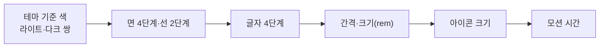

이 절은 모든 화면의 바탕이 되는 시각 위계와 디자인 토큰을 다룹니다. 위계는 중요한 것을 키우기보다 덜 중요한 것을 누그러뜨려 만들고, 값은 화면마다 새로 정하지 않고 테마 한 곳의 토큰에서 가져옵니다. 프로젝트가 값을 정하지 않았으면 Astryx Stone 테마를 확장한 키트의 기본 테마와 Solar 아이콘에서 출발합니다. 고유 브랜드 디자인이나 큰 화면 배율이 필요하면 프로젝트 규칙으로 조정합니다.

## 8.5.1 토큰의 위계

화면 값은 기준 색에서 시작해 면·선, 글자, 간격, 아이콘, 모션 순으로 정합니다.

화살표는 값을 정하는 순서입니다. 면과 선은 기준 글자색을 면 위에 섞어 만들고, 간격과 크기는 rem이라 루트 글자 크기를 따라 함께 커지며, 아이콘 크기는 옆에 놓이는 글자 크기의 약 1.2배에서 출발합니다. 모션은 크기가 아니라 시간 토큰과 "언제 움직이는가"의 규칙입니다.

| 원칙 | 내용 |
| :--- | :--- |
| 위계 | 덜 중요한 요소의 글자색을 보조 색으로 낮추거나 크기를 줄입니다. 사이드바는 본문보다 한 단계 뒤로 물러난 면에 둡니다 |
| 묶음 | 여백과 정렬 → 선 → 면(카드) 순으로, 앞 단계로 구분되지 않을 때만 다음 단계를 씁니다 |
| 색 | 유채색은 상태와 데이터 분류처럼 의미가 있을 때만 씁니다 |

## 8.5.2 테마와 색

라이트·다크 쌍으로 정하는 기준 색은 바닥·페이지 면·옅은 채움·글자 둘·보조 아이콘·강조색뿐이고, 나머지는 `color-mix`로 글자색을 면 위에 섞어 만듭니다.

| 역할 | 토큰 | 기본값(라이트/다크) |
| :--- | :--- | :--- |
| 내부 구분선(행·표·툴바·카드 테두리) | `--color-border` | 글자 13% / 11% |
| 바깥 경계(split 선·inset 외곽·대화상자·팝오버·입력 칸·필터 칩) | `--color-border-emphasized` | 글자 18% / 16% |
| 포인터 아래 | `--color-overlay-hover` | 글자 4% / 5% |
| 고른 값·켜진 도구 채움 | `--color-background-gray` | 글자 10% / 13% |
| 키보드 초점 | `--focus-outline-color` | 강조색 72%, 부품 경계 안쪽 2px |

강조색은 글자색과 같은 먹색이며 앱 크롬에 브랜드 색조를 두지 않습니다. 업무 데이터의 색(사용자가 고른 색, 분류 색)은 UI 테마 색과 따로 관리합니다. 상태는 색 하나로만 전달하지 않고 채움 아이콘·이름·`aria-pressed`·`aria-current`·`aria-expanded`를 함께 둡니다. 라이트·다크는 앱 루트의 `Theme mode` 하나가 정하고, 테마 부품 규칙이 `@media`를 받지 않으므로 휴대폰 크기는 `responsive.css` 한 파일에서 정합니다. 상세는 [테마와 색상](/rules/design-system/references/theme/)에 있습니다.

## 8.5.3 면과 선

화면은 네 단계의 면으로 쌓고, 안쪽 면은 바깥보다 한 단계 위입니다.

| 단계 | 쓰임 | 표현 | 모서리 |
| :--- | :--- | :--- | :--- |
| 바닥 | 사이드바와 페이지가 놓이는 앱 바탕 | `--color-background-body` | — |
| 페이지 | 작업 영역·행·표 머리 | `--color-background-surface` | inset 페이지 16px squircle |
| 올린 면 | 설정 묶음·카드·첨부 칸 | `--color-background-card`, `--color-border` 테두리 | 16px squircle |
| 뜬 면 | 메뉴·팝오버·대화상자 | `--color-background-popover`, `--color-border-emphasized`, 그림자 | 팝오버 12px, 대화상자 16px |

같은 단계의 면을 겹치지 않으므로 카드 안에 같은 카드를 넣지 않고, 목록 항목은 카드가 아니라 행입니다. 선은 1px 테두리로 그리고 Astryx `Divider`는 쓰지 않습니다. 그림자는 뜬 면에만 두며(메뉴 `--shadow-med`, 대화상자 `--shadow-high`), 일반 페이지 본문 바탕에는 16px 간격의 옅은 점 무늬(7%)를 둡니다. 상세는 [면과 경계](/rules/design-system/references/surfaces/)에 있습니다.

## 8.5.4 글자

조밀한 업무 화면의 글자는 네 크기로 위계를 만들고, 긴 글을 읽는 리치 본문만 따로 16px·줄 높이 1.7을 씁니다.

| 쓰임 | 데스크톱 | 휴대폰 | 토큰 |
| :--- | :--- | :--- | :--- |
| 보조 정보·작은 이름·날짜 | 12px | 13px | `--text-supporting-size` |
| 본문·라벨·행 | 13px, 굵기 450, 줄 높이 1.5 | 15px | `--text-body-size` |
| 큰 본문·작은 제목 | 15px, 제목 600 | 17px | `--text-large-size`, `--text-heading-3-*` |
| 페이지 제목 | 24px | 24px | `--text-heading-1-size` |

이 넷에 없는 크기는 이유가 분명할 때만 씁니다. 리치 본문(16px), 휴대폰 입력 칸 글자(16px, iOS 확대 방지), 하단 탭 이름(11px), 상태 그림과 작성 양식 대화상자의 제목(18px)이 그 예입니다. 글꼴은 Pretendard Variable, 고정폭은 JetBrains Mono이며, 위아래로 비교하는 날짜·수·금액은 `hasTabularNumbers`로 맞춥니다. 상세는 [글자](/rules/design-system/references/typography/)에 있습니다.

## 8.5.5 간격과 크기

크기는 rem과 테마 토큰으로 쓰고 1px 선과 그림자만 px로 둡니다. 휴대폰과 데스크톱의 분기점은 `width < 64rem` 하나입니다.

| 항목 | 데스크톱 | 휴대폰 |
| :--- | :--- | :--- |
| 페이지 머리 줄 | 3.25rem | 최소 3.75rem |
| 툴바 | 2.75rem | 최소 3.75rem |
| 컨트롤 sm·md·lg | 1.5·1.75·2rem | 2.75·2.75·3rem |
| 입력 칸 높이·글자 | 2.25rem·13px | 3rem·16px |
| 페이지 좌우 정렬선 | 1rem | 1rem |
| 읽기·설정·작성 열 | 최대 45rem | 화면 폭 |
| 상세 속성 열 / 두 열이 되는 컨테이너 폭 | 16rem / 60rem | 한 열 |
| 사이드바 | 340px(220~380px) | 하단 탭 |

휴대폰에서 누르는 것은 44px 이상이 원칙이고, 짧은 이름의 실행 버튼은 최소 88px 너비를 확보합니다. 사이드바↔하단 탭, 팝오버↔바텀시트, 대화상자↔페이지, 표↔행 목록이 모두 같은 분기점에서 바뀌므로 768px 같은 다른 분기점을 섞지 않습니다. 간격은 `4·8·12·16·24·32…` 단계만 쓰며, 1920px부터 루트 글자를 키워 2560px에서 19px에 이르게 합니다. 상세는 [간격과 크기](/rules/design-system/references/spacing/)에 있습니다.

## 8.5.6 아이콘

화면은 의미 이름(`search`, `back`, `layout-list`)으로 아이콘을 부르고, 의미 이름에서 Solar 아이콘으로 가는 매핑은 생성 스크립트 한 곳에 둡니다.

| 자리 | 크기 | 상태 |
| :--- | :--- | :--- |
| 데스크톱 13px 글자 옆 | 16px | 기본 Linear |
| 알약 안 | 14px | 기본 Linear |
| 메뉴·선택 목록(휴대폰) | 20px | 기본 Linear |
| 휴대폰 머리 줄·툴바·하단 탭·FAB | 24px | 기본 Linear |
| 고름·열림·눌림·현재 위치 | 자리 크기 그대로 | 같은 아이콘의 Bold Duotone(`solarIcon(name, isChosen)`) |

아이콘만 있는 버튼에는 이름(`label`)과 툴팁을 두고, 장식 아이콘은 접근성 트리에서 숨깁니다. 누르는 영역(44px)과 그림 크기를 구분해 그림을 키워 영역을 넓히지 않습니다. 상세는 [아이콘](/rules/design-system/references/icons/)과 해설 [아이콘](/common/icons/)에 있습니다.

## 8.5.7 모션

움직임은 위치가 바뀌었거나 새 내용이 도착했음을 알릴 때, 또는 절차 완료를 한 번 축하할 때만 씁니다.

| 쓰임 | 시간 |
| :--- | :--- |
| 꺾쇠 회전·작은 상태 전환 | `--duration-fast`(100ms) |
| 메뉴·시트 등장 | `--duration-medium`(250ms) 또는 부품 기본값 |
| 상태 화면 문구가 자리 잡기 | 420ms, `cubic-bezier(0.2, 0, 0, 1)` |
| 상태 그림이 도착해 나타나기 | 600ms, 한 번만 |
| 첫 방문 덮개 걷기 | 최소 0.3초 보인 뒤 700ms 페이드 |

화면 전환은 준비된 내용 사이의 짧은 교차 페이드만 쓰며 그 기준은 [8.7](/architecture/8-7/)의 데이터 상태가 소유합니다. 흐림(blur) 전환은 쓰지 않습니다. `prefers-reduced-motion: reduce`이면 이동·등장·회전·화면 전환과 완료 축하 효과(`celebrate`)를 끄고 결과 상태를 바로 보입니다. 상세는 [모션](/rules/design-system/references/motion/)에 있습니다.

## 이 절의 지침

<SectionDocs section="8.5" />
