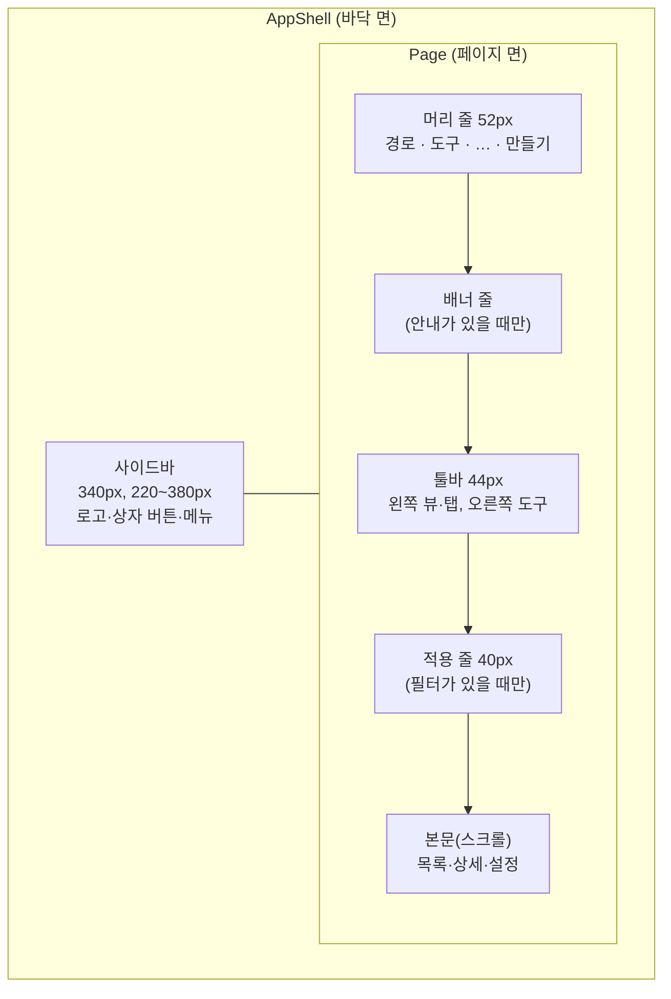
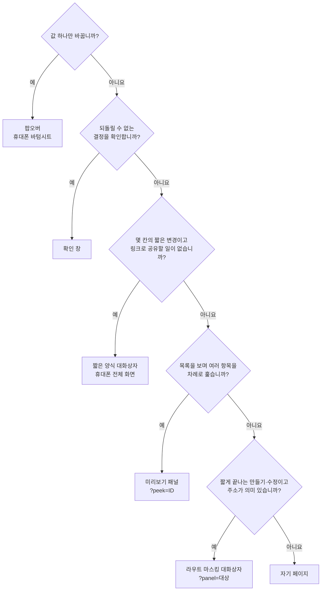

이 절은 앱의 바깥 틀부터 페이지 안 구역의 배치, 항목을 여는 표현과 그 주소 계약, 휴대폰 적응을 다룹니다. 앱 셸(`AppShell`)과 페이지(`Page`)는 화면마다 새로 만들지 않고 고정된 슬롯을 채우며, 데스크톱 사이드바와 휴대폰 하단 탭은 `64rem` 분기점 하나에서 바뀝니다. 항목을 열 때는 정해진 질문을 위에서부터 묻고 처음 맞는 표현을 고릅니다. 메뉴 트리 구성, 각 목록의 성격(처리 목록·작업 목록), 상세의 속성 항목은 프로젝트가 정합니다.

## 8.6.1 앱 셸

앱 셸(`AppShell`)은 shadcn `Sidebar` 위에 메뉴(`NavSpace` 데이터)·페이지·휴대폰 탐색을 조립하고, 셸은 고정한 채 본문만 스크롤합니다.

바깥 상자는 셸의 영역이고, 페이지 안의 화살표는 위에서 아래로 쌓는 고정 순서입니다. 배너 줄과 적용 줄은 내용이 있을 때만 생기며, 뷰나 탭이 없으면 툴바 없이 도구를 머리 줄 오른쪽에 둡니다. 휴대폰에서는 사이드바 자리를 하단 탭이 대신합니다.

| 블록 | 규칙 |
| :--- | :--- |
| 배치 | Inset(바탕 위에 떨어진 페이지 카드, 위·오른쪽 8px, 16px squircle)과 Split(사이드바와 페이지를 가는 선으로 나눔) 중 사용자가 고릅니다. 두 배치의 페이지 슬롯은 같고 휴대폰에는 적용하지 않습니다 |
| 사이드바 | 머리 줄은 페이지 머리 줄과 같은 52px. 메뉴 글자는 보조 색, 포인터 아래와 현재 항목만 본문 색. 현재 항목은 주소의 가장 긴 접두사로 정합니다 |
| 하위 공간 | 내 계정·관리처럼 따로 묶인 공간은 주 메뉴를 대체하고 위에 "← 공간 이름"을 둡니다 |
| 하단 탭 | 현재 메뉴 공간의 앞 네 곳과 더보기. 높이 3.5rem + 홈 표시줄, 아이콘 24px, 이름 11px |
| 휴대폰 상세·양식 | 앱 도구와 하단 탭을 치운 전체 화면. ←·이름·자기 도구와 바닥 고정 동작 줄 |
| FAB | 휴대폰 만들기는 56px, 하단 탭 위에 뜨며 상세·양식에는 두지 않습니다 |

분기점이나 배치를 바꿔도 페이지의 부모 요소 종류를 바꾸지 않아, 작성 중인 초안이 다시 마운트되지 않게 합니다. 상세는 [앱 셸과 모바일 탐색](/rules/design-system/references/app-layout/)과 해설 [셸과 사이드바](/app-shell/shell-and-sidebar/)·[적응형(휴대폰)](/app-shell/adaptive/)에 있습니다.

## 8.6.2 페이지 안의 구역

페이지는 머리 줄·배너·툴바·적용 줄·본문의 순서를 고정하고, 본문은 화면 성격에 따라 폭을 고릅니다.

| 본문 | 폭과 구성 |
| :--- | :--- |
| 목록·표·보드 | 작업 영역 전체 폭, 페이지 면의 불투명한 행. 행 전체가 대상 주소로 가는 링크이고 행 높이는 앱 밀도 설정 하나를 따릅니다 |
| 상세 | 최대 45rem 읽기 열에 소속·제목·본문·이어지는 것. 속성은 넓으면 오른쪽 16rem 열, 좁으면 제목과 본문 사이의 알약. 컨테이너 폭 60rem으로 판단합니다 |
| 설정 | 최대 45rem 가운데 열(위아래 40px). 구역은 작은 이름과 올린 면 안의 값 목록 |
| 작성 페이지 | 같은 45rem 열, 위아래 32px |
| 옆 패널 | 주소가 필요 없는 짧은 조회. 데스크톱 오른쪽 26rem, 휴대폰 바텀시트 |

머리 줄 왼쪽은 경로(마지막 단계부터 말줄임), 오른쪽은 도구·페이지 메뉴(…)·만들기 순이고, 페이지마다 접근 가능한 `h1`은 하나이며 `Page`가 기본으로 냅니다. 본문이 자기 제목을 그리면 `useOwnPageTitle()`로 넘깁니다. 상세 속성 열은 목차 → 대상별 속성 → 정보(작성자·작성일·수정일·버전 수) 순서로 둡니다. 상세는 [페이지 배치](/rules/design-system/references/layout-patterns/)와 해설 [머리 줄과 툴바](/app-shell/header-and-toolbar/)·[목록·표·보드](/app-shell/collections/)·[콘텐츠 폭](/app-shell/content-width/)에 있습니다.

## 8.6.3 표현 고르기

항목을 열거나 값을 바꿀 때는 아래 질문을 위에서부터 묻고 처음 "예"가 나온 표현을 고릅니다.

마름모는 순서대로 묻는 질문이고, 화살표 라벨은 그 답입니다. 상세 본문·활동·여러 단계 작업처럼 오래 머물거나 외부에 링크로 공유하는 것이 주 목적이면 마지막 "자기 페이지"에 닿습니다. 아래 화면의 맥락 유지, 작업 길이, 배경 참조, 주소 공유 필요가 이 순서를 정하는 네 기준입니다.

| 표현 | 데스크톱 | 휴대폰 | 주소 |
| :--- | :--- | :--- | :--- |
| 그 자리에서 고르기 | 팝오버 | 바텀시트 | 없음 |
| 확인 창 | 확인 대화상자 | 확인 대화상자(버튼 세로) | 없음 |
| 짧은 양식 | 모달 대화상자 | 전체 화면 | 없음 |
| 미리보기 패널 | 목록 옆 비모달 패널 | 대상 페이지 | 목록 주소 + `?peek=대상ID` |
| 라우트 마스킹 | 목록 위 대화상자(크게 보기로 페이지 전환) | 처음부터 대상 페이지 | 주소창에 대상의 실제 주소 |
| 자기 페이지 | 페이지 | 페이지 | 대상의 고유 주소 |

모달 위에 모달을 쌓지 않으며, 확인 창만 열린 대화상자 위에 한 겹 허용합니다. 입력이 남은 채 닫으면 버릴지 묻습니다. 상세는 해설 [어떤 모습으로 열까](/app-shell/choosing-presentation/)에 있습니다.

## 8.6.4 대화상자·미리보기·마스킹의 계약

세 오버레이는 각각 하나의 공통 틀과 주소 계약을 가지며, 휴대폰이나 직접 진입에서는 페이지로 바뀝니다.

| 표현 | 공통 틀 | 주소와 기록 | 닫기 |
| :--- | :--- | :--- | :--- |
| 대화상자 | shadcn `Dialog` 위의 키트 틀(`FormDialog`·`ConfirmDialog`·`DetailSurface`, 머리·스크롤 본문·선택적 바닥, 위아래 12dvh). 제품 화면은 `Dialog`를 직접 조립하지 않습니다 | 없음 | 닫기 X·Esc·배경, 초점은 연 요소로 |
| 미리보기 패널 | `PeekPanel`(본문의 약 45%), 처리 목록은 `InboxLayout` | 처음 열 때 `push`, 열린 채 다른 항목은 `replace`. 새로고침·공유에서 목록과 패널을 함께 엽니다 | Esc·닫기, 초점은 그 행으로 |
| 라우트 마스킹 | 목록 위 대화상자, `useOpenPanel`·`usePanel` | 목록 주소에 `?panel=대상`, 주소창에는 대상 주소. 직접 링크·새로고침(`unmaskOnReload`)은 대상 페이지 | 내부 이동 횟수와 관계없이 창 전체를 닫고 처음 연 목록의 조건·스크롤로 복귀 |

목록에서 행을 누르면 무엇이 열리는지는 목록이 하는 일로 정하고 한 목록 안에서 하나로 통일합니다. 받은 항목·알림·승인 대기 같은 처리 목록은 미리보기를, 업무·문서·자료 같은 작업 목록은 자기 페이지를 열며, 애매하면 작업 목록으로 봅니다. 대화상자 쓰임은 되돌리기 어려운 결정(`ConfirmDialog`), 몇 칸의 짧은 양식(`FormDialog`), 제목·본문 작성(`ComposeSurface`)의 셋입니다. 상세는 [공통 다이얼로그](/rules/design-system/references/dialog/), [미리보기 패널](/rules/design-system/references/peek/), [라우트 마스킹](/rules/design-system/references/route-masking/)에 있고, 상태·복귀의 코드 계약은 [8.4](/architecture/8-4/)가 소유합니다.

## 이 절의 지침

<SectionDocs section="8.6" />
