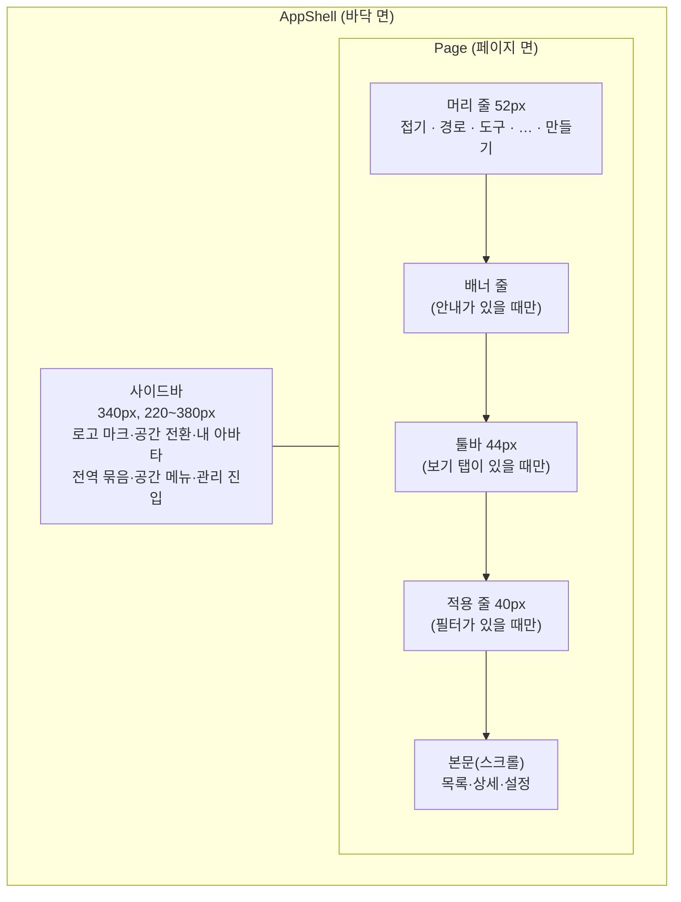
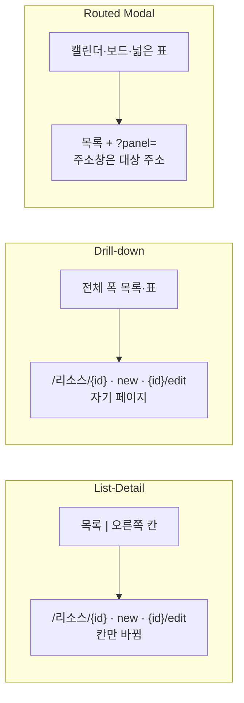
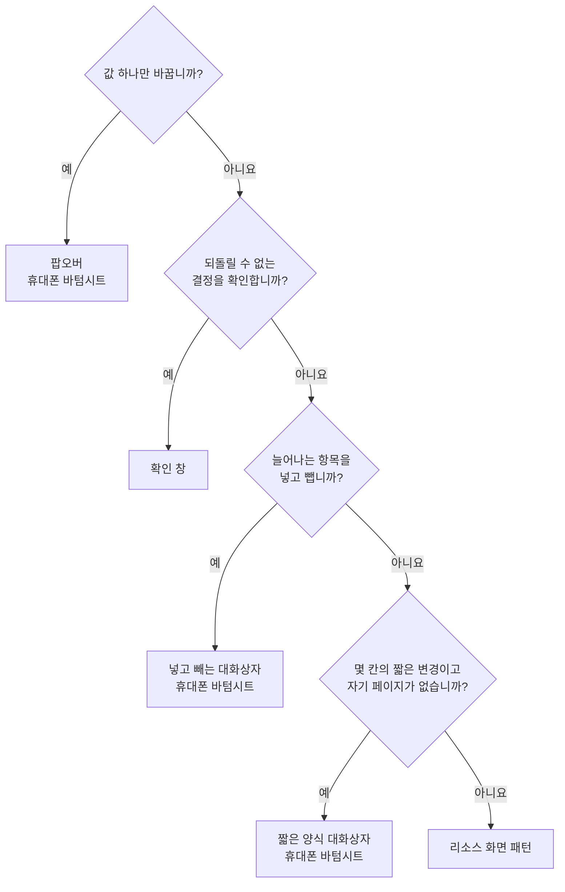

이 절은 앱의 바깥 틀부터 페이지 안 구역의 배치, 리소스의 목록·상세·생성·수정을 띄울 곳과 그 주소 계약, 휴대폰 적응을 다룹니다. 앱 셸(`AppShell`)과 페이지(`Page`)는 화면마다 새로 만들지 않고 고정된 슬롯을 채우며, 데스크톱 사이드바와 휴대폰 하단 막대는 `64rem` 분기점 하나에서 바뀝니다. 리소스는 세 패턴 가운데 하나로 열고, 그 밖의 작은 조작은 정해진 질문을 위에서부터 묻고 처음 맞는 표현을 고릅니다. 공간과 메뉴 구성, 리소스마다 고른 패턴, 상세의 속성 항목은 프로젝트가 정합니다.

## 8.6.1 앱 셸

앱 셸(`AppShell`)은 shadcn `Sidebar` 위에 메뉴(`NavSpace` 데이터)·페이지·휴대폰 탐색을 조립하고, 셸은 고정한 채 본문만 스크롤합니다.

바깥 상자는 셸의 영역이고, 페이지 안의 화살표는 위에서 아래로 쌓는 고정 순서입니다. 배너 줄과 적용 줄은 내용이 있을 때만 생기며, 보기 탭이 없으면 툴바 없이 검색·필터·정렬을 머리 줄 오른쪽에 둡니다. 휴대폰에서는 사이드바 자리를 하단 막대가 대신합니다.

| 블록 | 규칙 |
| :--- | :--- |
| 배치 | Inset(바탕 위에 떨어진 페이지 카드, 위·오른쪽 8px, 16px squircle)과 Split(사이드바와 페이지를 가는 선으로 나눔) 중 사용자가 고릅니다. 두 배치의 페이지 슬롯은 같고 휴대폰에는 적용하지 않습니다. 화면 전체 폭의 상단 머리 줄은 두지 않습니다 |
| 공간 | 기능 묶음이 다른 최상위 영역. 주소의 첫 마디가 공간이고, 공간마다 사이드바 메뉴가 바뀝니다. 공간 밖 화면(계정·인스턴스 설정·전역 진입)은 접두가 없습니다 |
| 사이드바 머리 | 52px. 왼쪽에 정사각 로고 마크와 공간 전환 셀렉터, 오른쪽에 내 아바타 |
| 전역 진입 | 검색·알림함·내 것을 모든 공간의 메뉴 맨 위 이름표 없는 묶음에 둡니다. 눌러도 사이드바는 지금 공간 그대로입니다 |
| 관리 진입 | 공간마다 그 공간의 관리를 사이드바 맨 아래에, 권한이 있을 때만. 인스턴스 설정은 공간 전환 메뉴의 구분선 아래 |
| 고른 표시 | 이동 중인 주소로 그립니다. 묶음 머리와 잎의 주소가 같으면 잎을 고릅니다 |
| 하단 막대 | 떠 있는 유리 막대. 알림함·지금 공간의 핵심 메뉴 둘·메뉴 시트와 검색 원 |
| 휴대폰 상세·양식 | 하단 막대를 치운 전체 화면. ←·이름·자기 도구와 바닥 고정 동작 줄 |
| 만들기 | 휴대폰은 앱 바 오른쪽 알약(만들기 +와 화면 메뉴 …)에 둡니다. 떠 있는 만들기 버튼은 두지 않습니다 |

분기점이나 배치를 바꿔도 페이지의 부모 요소 종류를 바꾸지 않아, 작성 중인 초안이 다시 마운트되지 않게 합니다. 상세는 [앱 셸과 모바일 탐색](/rules/design-system/references/app-layout/)과 해설 [셸과 사이드바](/app-shell/shell-and-sidebar/)·[적응형(휴대폰)](/app-shell/adaptive/)에 있습니다.

## 8.6.2 페이지 안의 구역

페이지는 머리 줄·배너·툴바·적용 줄·본문의 순서를 고정하고, 본문은 화면 성격에 따라 폭을 고릅니다.

| 본문 | 폭과 구성 |
| :--- | :--- |
| 목록·보드 | 작업 영역 전체 폭, 페이지 면의 불투명한 행. 행 전체가 대상 주소로 가는 링크이고 행 높이는 앱 밀도 설정 하나를 따릅니다. 끝에는 같은 끝 줄(수·더 보기)을 마지막 줄 바로 아래에 붙입니다 |
| 표 | 본문 폭을 다 쓰되 열이 펼쳐지는 폭은 1920px까지, 남는 폭은 끝의 빈 열. 머리 칸을 눌러 정렬합니다. 머리 44px, 줄 48px |
| 상세 | 최대 45rem 읽기 열에 제목 위 줄(다른 곳에 없는 값만)·제목·본문·이어지는 것. 속성은 넓으면 오른쪽 16rem 열, 좁으면 제목과 본문 사이의 알약. 컨테이너 폭 60rem으로 판단합니다 |
| 칸 머리 | 상세·작성·수정 페이지와 List-Detail의 오른쪽 칸이 같은 `PaneFrame`. 52px, 왼쪽 뒤로, 오른쪽 동작. 스크롤하면 이름이 나타납니다 |
| 설정 | 최대 45rem 가운데 열(위아래 40px). 표가 들어가는 관리 화면은 본문 폭의 `AdminSurface` |
| 작성 페이지 | 같은 45rem 열, 위아래 32px. 스크롤하는 내용과 바닥 두 칸 |
| 옆 패널 | 주소가 필요 없는 기록 한 줄의 사실. 데스크톱 오른쪽 26rem, 휴대폰 바텀시트 |

머리 줄 왼쪽은 경로(마지막 단계부터 말줄임), 오른쪽은 도구·페이지 메뉴(…)·만들기 순이고, 페이지마다 접근 가능한 `h1`은 하나이며 `Page`가 기본으로 냅니다. 본문이 자기 제목을 그리면 `useOwnPageTitle()`로 넘깁니다. 상세의 동작은 본문 안이 아니라 상세를 품은 화면의 머리 오른쪽 한 곳에 그리며, 셋까지 펼치고 넷부터 주 동작만 밖에 둡니다. 상세는 [페이지 배치](/rules/design-system/references/layout-patterns/)와 해설 [머리 줄과 툴바](/app-shell/header-and-toolbar/)·[목록·표·보드](/app-shell/collections/)·[콘텐츠 폭](/app-shell/content-width/)에 있습니다.

## 8.6.3 리소스 화면 패턴

리소스(목록과 자기 주소를 가진 대상)의 목록·상세·생성·수정은 세 패턴 가운데 하나로 엽니다. 패턴은 리소스가 아니라 여는 화면이 정합니다.

세 상자는 같은 높이에서 비교하도록 나란히 두었습니다. 위 칸은 목록이 놓이는 모습, 아래 칸은 항목을 열었을 때의 주소입니다. 휴대폰에서는 세 패턴 모두 상세·생성·수정을 자기 페이지로 엽니다.

| 패턴 | 언제 쓰나 | 쓰지 않는 곳 |
| :--- | :--- | :--- |
| List-Detail | 줄 하나가 제목과 한두 줄로 읽히고 하나씩 열어 읽고 넘기는 리소스 | 표·보드·캘린더(좁히면 열이 빠집니다) |
| Drill-down | 열을 비교하는 표, 오래 읽는 상세, 길거나 단계가 있는 양식 | — |
| Routed Modal | 목록 자체가 화면을 다 쓰고, 상세를 잠깐 보고 돌아오는 일이 잦을 때 | 휴대폰(페이지로 갑니다) |

목록 옆에서 따로 훑어보는 미리보기 패널은 두지 않습니다. 줄을 누르면 패턴이 정한 곳이 열립니다. 상세는 [리소스 화면 패턴](/rules/design-system/references/resource-patterns/)에 있습니다.

## 8.6.4 작은 조작의 표현 고르기

리소스를 여는 것이 아닌 조작은 아래 질문을 위에서부터 묻고 처음 "예"가 나온 표현을 고릅니다.

마름모는 순서대로 묻는 질문이고, 화살표 라벨은 그 답입니다. 자기 주소가 있는 대상을 열거나 만드는 일은 마지막 "리소스 화면 패턴"에 닿습니다.

| 표현 | 데스크톱 | 휴대폰 | 주소 |
| :--- | :--- | :--- | :--- |
| 그 자리에서 고르기 | 팝오버 | 바텀시트 | 없음 |
| 확인 창 | 확인 대화상자 | 바텀시트(버튼 세로) | 없음 |
| 넣고 빼는 고르기 | 목록·찾기 칸이 있는 대화상자 | 바텀시트 | 없음 |
| 짧은 양식 | 모달 대화상자 | 바텀시트 | 없음 |
| 기록 한 줄의 사실 | 옆 패널 | 바텀시트 | 없음 |

모달 위에 모달을 쌓지 않으며, 확인 창만 열린 대화상자 위에 한 겹 허용합니다. 입력이 남은 채 닫으면 버릴지 묻습니다. 상세는 해설 [어떤 모습으로 열까](/app-shell/choosing-presentation/)에 있습니다.

## 8.6.5 대화상자와 마스킹의 계약

두 오버레이는 각각 하나의 공통 틀과 주소 계약을 가지며, 휴대폰이나 직접 진입에서는 페이지로 바뀝니다.

| 표현 | 공통 틀 | 주소와 기록 | 닫기 |
| :--- | :--- | :--- | :--- |
| 대화상자 | shadcn `Dialog` 위의 키트 틀(`FormDialog`·`ConfirmDialog`·`DetailSurface`, 머리·스크롤 본문·선택적 바닥, 위아래 12dvh). 제품 화면은 `Dialog`를 직접 조립하지 않습니다 | 없음 | 닫기 X·Esc·배경, 초점은 연 요소로 |
| 라우트 마스킹 | 목록 위 대화상자, `useOpenPanel`·`usePanel`, 대화상자끼리 바꿔 끼우기 `swapDialog` | 목록 주소에 `?panel=대상`, 주소창에는 대상 주소. 직접 링크·새로고침(`unmaskOnReload`)은 대상 페이지 | 내부 이동 횟수와 관계없이 창 전체를 닫고 처음 연 목록의 조건·스크롤로 복귀 |

대화상자에서 다른 대화상자로 넘어갈 때는 닫혔다 열리지 않고 자리를 이어받으며, 두 내용을 View Transitions로 겹쳐 바꿉니다. 대화상자 쓰임은 되돌리기 어려운 결정(`ConfirmDialog`), 몇 칸의 짧은 양식(`FormDialog`), 제목·본문 작성(`ComposeSurface`)의 셋입니다. 상세는 [공통 다이얼로그](/rules/design-system/references/dialog/), [라우트 마스킹](/rules/design-system/references/route-masking/)에 있고, 상태·복귀의 코드 계약은 [8.4](/architecture/8-4/)가 소유합니다.

## 이 절의 지침

<SectionDocs section="8.6" />
