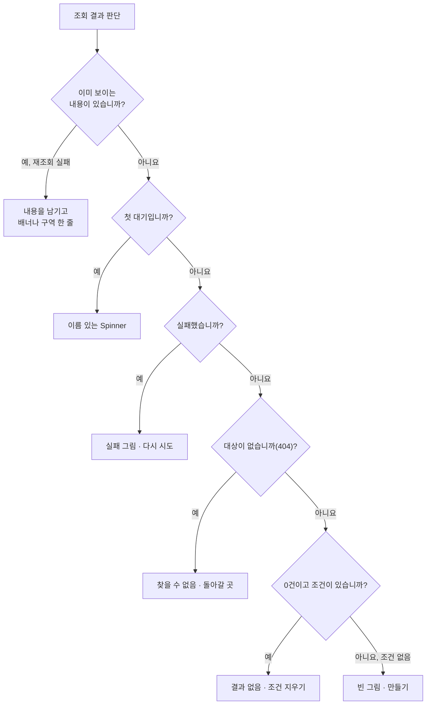

이 절은 조회가 늦거나 비거나 실패했을 때의 화면과 알림, 사용자의 입력·검색·작성 상호작용을 다룹니다. 상태마다 사용자가 할 수 있는 다음 행동이 다르므로 대기·실패·없는 대상·결과 없음·처음을 정해진 순서로 구분하고, 알림은 원인이 생긴 자리에서 가장 가까운 곳에 둡니다. 앱 첫 진입만 덮개로 가리고 그 뒤의 화면 이동에는 본문을 가리는 막을 두지 않습니다. 실제 필터 속성과 선택지 한도, 본문 편집기의 명시·자동 저장 정책, 활동 영역의 댓글 기능은 프로젝트가 정합니다.

## 8.7.1 어떤 상태 화면을 보일까

목록·상세는 아래 순서로 판단하고 처음 해당하는 상태를 보입니다.

마름모는 순서대로 묻는 질문이고, 화살표 라벨은 그 답입니다. 이미 보이는 내용이 있으면 전체 상태 화면으로 덮지 않는 것이 첫 갈림입니다. 일부 출처만 실패하면 실패한 것을 빼고 보여 준다고 알립니다.

상태 화면은 `PageState`(펜 선 그림·제목·필요할 때의 설명·행동 하나)로 그립니다. 페이지에서는 문구를 창 높이의 32%에 고정하고, 대화상자·패널·작은 구역은 위쪽에 두는 작은 형태(`isCompact`)를 씁니다. 그림은 테마 색으로 칠해 라이트·다크에서 같은 파일을 쓰며 접근성 트리에서 숨깁니다. 상세는 [데이터 상태](/rules/design-system/references/data-states/)와 해설 [상태와 피드백](/app-shell/states-and-feedback/)에 있습니다.

## 8.7.2 화면을 바꾸는 동안

첫 진입, 캐시 있는 이동, 캐시 없는 이동은 서로 다른 표시를 씁니다.

| 상황 | 표시 |
| :--- | :--- |
| 앱 첫 진입 | 빌드 때 HTML에 넣은 첫 방문 덮개(`BootCover`). 최소 0.3초 보이고 0.7초에 걸쳐 걷습니다. 공개 문서·랜딩은 미리 그린 본문(SSG·프리렌더) |
| 캐시가 있는 이동 | 오래됐어도 바로 그리고 뒤에서 갱신합니다(stale-while-revalidate) |
| 캐시가 없는 이동 | 이전 화면을 그대로 두고, 150ms가 지나면 콘텐츠 카드 위쪽 테두리에 높이 2px 진행 표시. 한 번 띄우면 최소 300ms 둡니다 |
| 준비된 화면끼리 | 콘텐츠 영역만 짧게 교차 페이드. 동작 줄이기·로그인 오가기·진행 중인 전환·열린 대화상자에서는 전환하지 않습니다 |
| 목록 조건 변경 | 이전 결과를 유지하고(`placeholderData`) 진행 중임을 알립니다 |
| 대화상자 데이터 준비 | 이름 있는 원형 Spinner, 준비되면 한 번에 표시. 실패는 다시 시도로 끝납니다 |

화면 전체 스켈레톤과 영역별 덮개는 쓰지 않으며, 스켈레톤은 실제 배치와 같을 때만 씁니다. 데이터와 코드를 언제 준비하는지는 [8.4 프론트 코드와 상태](/architecture/8-4/)가 소유합니다.

## 8.7.3 알림의 자리

오류와 완료 알림은 범위에 맞는 자리에 두고, 토스트는 화면 변화만으로 결과를 알 수 없는 짧은 완료에만 씁니다.

| 범위 | 자리 |
| :--- | :--- |
| 입력 하나 | 그 칸 곁 |
| 양식 저장 실패 | 양식 위 배너(`role="alert"`). 입력은 지킵니다 |
| 페이지 전체(변경 실패·충돌·읽기 전용) | 머리 줄 아래, 툴바 위 배너 줄 |
| 대화상자의 오류 | 그 대화상자 안 |
| 결과가 보이지 않는 짧은 완료(주소 복사·보관·백그라운드 작업 시작) | 토스트. 되돌릴 수 있으면 "되돌리기" 하나를 두고 충분히 오래 남깁니다 |
| 저장 버튼 없이 바로 저장되는 상세 속성 변경 | 결과가 보여도 5초 "되돌리기" 토스트, 2px 막대가 줄어들고 포인터가 올라가면 멈춥니다 |
| 화면을 그릴 수 없는 오류 | 라우트 오류 화면과 다시 시도 |

오류·경고·되돌릴 수 없는 결과·다음 행동이 필요한 내용은 토스트에 두지 않고, 결과가 화면에 바로 보이면 알리지 않습니다. 바로 저장되는 속성의 되돌리기는 서버 최신본을 다시 읽은 뒤 바꾼 속성만 이전 값으로 저장해 그 사이 다른 사람의 변경을 덮지 않습니다.

## 8.7.4 입력 표면과 키보드

어떤 상호작용을 어느 표면에서 할지는 하는 일로 정하고, 단축키는 한글 조합 중(`isComposing`)에 무시합니다.

| 하는 일 | 데스크톱 | 휴대폰 |
| :--- | :--- | :--- |
| 값 하나 고르기·짧은 동작 메뉴 | 팝오버 | 바텀시트 |
| 몇 칸의 변경 | 짧은 양식 대화상자 | 전체 화면 대화상자 |
| 제목·본문 작성 | 목록 위 대화상자(자기 주소) | 페이지 |
| 행 하나의 사실 확인 | 옆 패널 | 바텀시트 |

| 키 | 동작 |
| :--- | :--- |
| Esc | 열린 메뉴·검색·대화상자를 닫고 연 요소로 초점을 돌립니다 |
| Ctrl/⌘+Enter | 작성 양식 제출 |
| Enter | 짧은 양식의 한 줄 칸 제출 |
| Ctrl/⌘+S | 명시 저장을 고른 본문 편집의 저장 |

행·카드 전체를 누르면 대상을 열고, 행 안의 링크·사람·별·메뉴는 자기 동작만 합니다. 화면 이동은 링크(`href`)로 해 새 탭·주소 복사가 되게 합니다. 큰 목록에서 고르는 칸은 처음 8개·검색 시 최대 50개를 보이고, 순서 바꾸기는 손잡이 끌기와 Alt+↑/↓를 함께 줍니다. 표현을 고르는 전체 순서는 [8.6](/architecture/8-6/)에 있고, 상세는 [입력과 상호작용](/rules/design-system/references/interaction-patterns/)에 있습니다.

## 8.7.5 검색·필터·표시

목록 도구는 글자로 좁히는 검색, 속성 값으로 거르는 필터, 같은 결과를 어떻게 보일지 정하는 표시의 세 역할로 나누고 이 순서로 묶습니다.

| 도구 | 규칙 |
| :--- | :--- |
| 검색 | 둥근 도구가 그 자리에서 같은 높이의 칸으로 열립니다. 접어도 검색어를 유지하고 도구를 켜진 모양과 모서리 점으로 둡니다 |
| 필터 | 같은 속성의 값은 OR, 다른 속성끼리는 AND. 데스크톱은 속성 → 값의 두 단계 팝오버, 휴대폰은 두 단계 바텀시트. 적용 중이면 툴바 아래 40px 칩 줄 |
| 표시 | 보기 방식·정렬 기준·방향·그룹을 알약 줄로 고르고, 기본과 다르면 도구에 점과 "기본 표시로 초기화" |
| 조건의 소유 | 확정한 조건은 검증한 URL이 가집니다. 입력 중 검색은 300ms 뒤 `replace`, 기본값과 같은 값은 주소에서 뺍니다 |

만들기 버튼은 세 도구보다 넓은 간격 뒤에 둡니다. 상세는 [검색·필터·표시](/rules/design-system/references/search-filter/)와 해설 [검색·필터·표시](/app-shell/filters-and-display/)에 있습니다.

## 8.7.6 생성 양식과 화면 문구

제목과 본문이 있는 것을 만들고 고칠 때는 한 양식(`ComposeForm`·`ComposeSurface`)을 대화상자·페이지·휴대폰에서 같이 씁니다.

| 규칙 | 내용 |
| :--- | :--- |
| 구성 | 테두리 없는 작성 면의 제목(대화상자 18px, 페이지 24px)과 서식 막대 없는 본문, 그 아래 속성 알약 |
| 제출 버튼 | 필수 값이 비어도 막지 않습니다. 누르면 빠진 항목 곁에 알리고 첫 빠진 항목으로 초점을 옮깁니다. 저장 중에만 처리 중으로 막습니다 |
| 초안 | 라우터 위 초안 저장소에 두어 크게 보기·분기점 전환에서도 남기고, 저장 성공·버리기에서만 지웁니다 |
| 닫기 | 입력이 있는 채로 닫기·Esc·배경·취소·←를 누르면 "계속 작성 / 버리기"를 묻습니다 |
| 수정 충돌 | 다시 읽기·내 내용으로 다시 저장을 고르게 합니다 |
| 단계형 | 여러 사람의 결정이 필요한 신청처럼 정말 복잡한 작성에만 씁니다 |

화면 문구는 사용자의 판단·행동·오류 복구에 도움이 될 때만 넣습니다. 부품에 설명·바닥글 슬롯이 있다는 이유로 채우지 않고, 저장 위치·공유 범위·권한·삭제 결과처럼 결과를 바꾸는 정보는 유지합니다. 상세는 [생성 양식](/rules/design-system/references/creation-form/)과 [문구·본문과 검증](/rules/design-system/references/content-and-review/)에 있습니다.

## 이 절의 지침

<SectionDocs section="8.7" />
