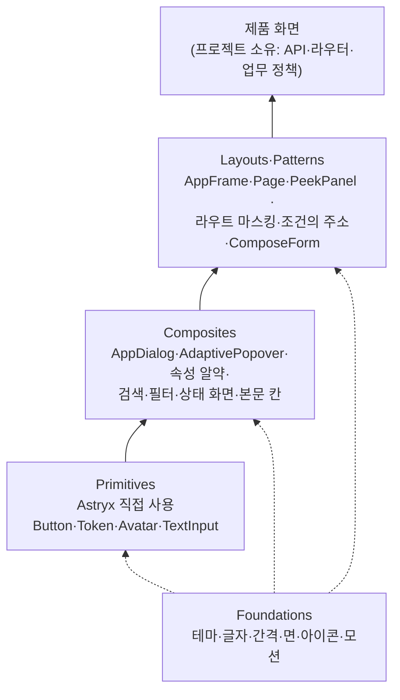
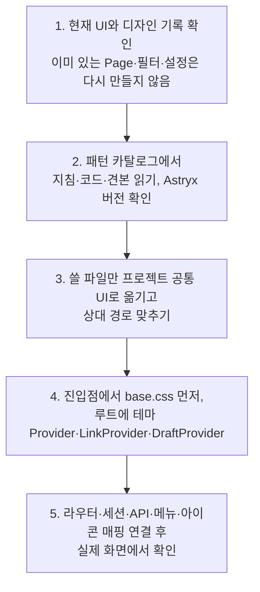

이 절은 Astryx 기본 부품과 그 위의 조합 부품·배치·패턴을 고르고 프로젝트에 채택하는 규칙을 다룹니다. 독립된 UI 역할을 가진 부품은 Astryx를 직접 import하고, 여러 부품을 묶어 반복해 쓰는 단위만 조합 부품으로 둡니다. 레퍼런스 코드는 플러그인에 포함하지 않고 공개 저장소의 workspace 키트에 있으며, 실제로 쓸 파일만 프로젝트 소유 코드로 옮깁니다. 프로젝트는 자기 도메인 전용 조합과 실제 API·라우터·저장 계약을 연결합니다. 규칙에 따라 만든 부품 코드와 조작 가능한 실행 견본은 사이트의 **UI 키트** 메뉴에서 확인합니다.

## 8.8.1 부품의 층

화면은 Astryx 기본 부품 위에 조합 부품을 올리고, 배치(Layouts)와 사용 패턴(Patterns)의 규칙 안에서 조립합니다.

실선은 아래 층을 써서 위 층을 만드는 방향입니다. 점선은 Foundations의 토큰이 모든 층에 값을 주는 관계이며, 그 값은 [8.5 화면 기초](/architecture/8-5/)가 소유합니다. Layouts와 Patterns는 더 큰 부품이라서가 아니라 공간과 행동의 기준이라서 따로 분류합니다. 조합은 값과 동작을 props로 받고 제품의 API·라우트·업무 정책을 직접 소유하지 않습니다.

| 범주 | 소유하는 내용 | 코드 위치(키트) |
| :--- | :--- | :--- |
| Foundations | 테마·색상, 글자, 간격·크기, 면·경계·그림자·곡률, 아이콘, 모션 | `foundations` |
| Primitives | Astryx 부품의 쓰임과 변형 | Astryx 직접 사용 |
| Composites | 다이얼로그·곁에 여는 내용·검색·필터·표시·속성·올리기·상태·본문 칸 | `composites` |
| Layouts | 앱 셸·사이드바·모바일 탐색·페이지 머리·툴바·목록·상세·설정·옆 패널 | `layouts` |
| Patterns | 여러 화면에 걸리는 동작 계약: 라우트 마스킹, 조건의 주소, 대기·빈 상태·실패, 행 클릭·키보드 | `patterns` |
| Playground | 앞의 요소로 만든 기능 단위 앱 16개 | `site/samples/playground` |

상세는 [패턴의 글·코드·실행 견본](/rules/design-system/references/pattern-catalog/)에 있습니다.

## 8.8.2 Primitives

기본 부품은 이름만 바꾼 래퍼로 API를 복제하지 않고, 고래밥이 정하는 것은 테마 변형·크기와 쓰임의 구분뿐입니다.

| 부품 | 쓰는 곳 | 기준 |
| :--- | :--- | :--- |
| Button | 실행 동작 | 제출·확인 `primary`, 취소 `ghost`, 되돌리기 어려운 동작 `destructive`, 페이지 만들기 `create`, 툴바 도구 `tool`·`view-active`, 뷰 알약 `view`·`view-active` |
| IconButton | 아이콘만 있는 동작 | 이름과 툴팁. 열린·켜진 상태는 Bold Duotone |
| Token | 분류·라벨 | 둥근 알약, 링크가 될 수 있음. 실행 도구를 라벨처럼 꾸미지 않습니다 |
| Badge·StatusDot | 개수·상태 | Badge는 개수에만, 상태는 StatusDot이나 Token |
| Avatar | 사람 | 사진과 이름을 함께, 지정 안 됨도 같은 자리 |
| TextInput·TextArea·Selector | 이름 있는 값 | 데스크톱 36px·13px, 휴대폰 48px·16px. 큰 목록은 검색이 있는 고르기 |
| Dialog | — | 제품 화면은 공통 다이얼로그(`AppDialog`)를 쓰고 직접 쓰지 않습니다 |

날짜는 Astryx `Calendar`를 공통으로 쓰고 브라우저 기본 날짜 선택기를 섞지 않습니다. 상세는 [Primitives](/rules/design-system/references/basic-components/)에 있습니다.

## 8.8.3 Composites

조합 부품은 반복되는 동작·접근성·반응형 정책을 한 곳에 묶고, 견본과 Playground도 같은 조합을 import합니다.

| 조합 | 소유하는 책임 |
| :--- | :--- |
| 공통 다이얼로그·확인 창·짧은 양식 | 위치·여백·스크롤·닫기·초점 |
| 곁에 여는 내용(`AdaptivePopover`·`SheetBody`) | 데스크톱 팝오버 ↔ 휴대폰 바텀시트, 시트 손잡이 여백 |
| 동작 메뉴·행 메뉴 | 아이콘·이름·고른 표시, 고른 뒤 닫기 |
| 검색·필터·표시 도구 | 열기·닫기·지우기, 적용 줄, 기본과 다른 표시 |
| 속성 알약 | 빈 값·필수·값 고르기, 상세 열에서 행 모양 |
| 활동·댓글 피드 | 이벤트 한 줄 기록, 댓글 카드·한 단계 답글 |
| 행 순서 바꾸기 | 손잡이·Alt+방향키·Esc 취소·위치 음성 안내 |
| 파일 올리기 칸 | 고르기·끌어 놓기·형식과 크기 확인. 업로드 자체는 제품의 첨부 계약 |
| 상태 화면 | 빈 목록·결과 없음·없는 대상·실패의 그림과 문구 |
| 본문 칸 | 종이 위의 리치 본문. 특정 에디터를 기본 의존성으로 복사하지 않습니다 |
| 그룹 머리 | 그룹 이름·개수·접기, 스크롤에 붙는 띠 |

휴대폰에는 팝오버를 두지 않고 언제나 바텀시트로 열며, 시트는 쌓지 않습니다. 팝오버·바텀시트와 행 메뉴의 확인 대화상자는 열거나 고를 때만 만듭니다. 구현이 없는 조합을 메뉴에 빈 항목으로 만들지 않고, 아이콘 표시 고르기·전역 검색 팔레트·프로필 패널 같은 제품 고유 조합은 프로젝트가 소유합니다. 상세는 [Composites](/rules/design-system/references/composed-components/)에 있습니다.

## 8.8.4 키트 채택

키트는 선택해서 채택하는 설계와 코드의 스냅샷이며, 설치·동기화만으로 제품 소스에 복사되지 않습니다.

화살표는 채택 순서입니다. 3단계 이후의 코드는 그 프로젝트 소유이며, 원본 저장소에서 import하지 않고 공통 변경도 자동으로 적용되지 않습니다. 4단계의 `DraftProvider`는 작성 양식을 쓸 때만 라우터보다 위에 둡니다.

| 규칙 | 내용 |
| :--- | :--- |
| 우선순위 | 프로젝트 디자인·기존 부품·사용자가 준 참고 화면이 있으면 그것을 우선합니다 |
| 버전 기록 | 키트의 manifest가 레퍼런스 ID·리비전·검증한 패키지 버전과 범위를 기록합니다. 사용자 프로젝트에 관리 메타데이터를 강제로 더하지 않습니다 |
| 개선 | 증상 → 바뀐 기준 → 영향받는 패턴 → 확인 결과를 근거로 지침과 키트를 함께 고칩니다. 한 프로젝트의 우연한 구현을 공통 규칙으로 올리지 않습니다 |
| 미확인 범위 | 실제 기기의 가상 키보드, 스크린 리더, 실제 서버 연동은 채택한 프로젝트가 직접 검증합니다 |

상세는 [기본 레퍼런스의 사용과 갱신](/rules/design-system/references/reference-kit/)과 해설 [구현 메모: Astryx](/app-shell/implementation-notes/)에 있습니다.

## 8.8.5 Astryx 작업 절차

모양을 바꿀 때는 덜 침습적인 방법부터 차례로 시도하고, 내부 클래스 덮어쓰기와 `!important`는 쓰지 않습니다.

| 순서 | 방법 |
| :--- | :--- |
| 1 | 기존 부품의 props와 레이아웃 슬롯 |
| 2 | `defineTheme`의 토큰·부품 규칙·변형. 새 변형에는 TypeScript 선언도 함께 둡니다 |
| 3 | 테마가 표현하지 못하는 반응형 규칙. 목적에 맞는 파일과 범위로 제한합니다 |
| 4 | 정당한 `xstyle` 또는 swizzle. swizzle은 이유·원본 버전·수정 범위·import 경로를 기록합니다 |

구현 전에 설치된 Astryx 버전과 공통 UI의 공개 export를 확인하고, `astryx build`·`template`·`component`·`search`·`docs` 명령으로 기존 부품을 먼저 찾습니다. 검색 결과가 없다고 새 부품부터 만들지 않습니다. CSS 레이어는 reset → astryx-base → astryx-theme 순서로 진입점에서 고정하고, 한 버전의 우회를 모든 버전의 규칙으로 만들지 않고 프로젝트 디자인 기록에 둡니다.

## 이 절의 지침

<SectionDocs section="8.8" />
