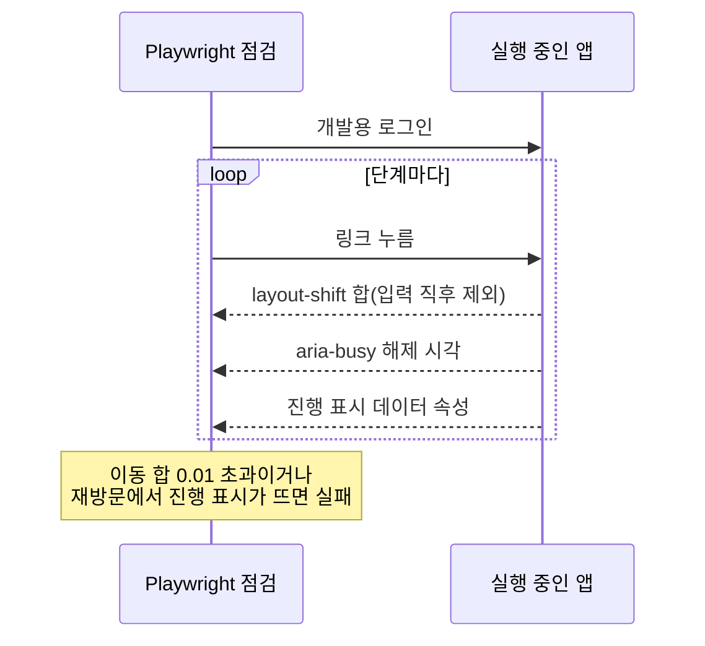

이 절은 코드나 문서를 바꾼 뒤 변경 종류에 맞춰 확인할 항목을 다룹니다. 검증은 변경 종류가 정하며, 의미 있는 검증이 통과하면 이유 없이 전체 검사를 반복하지 않습니다. 자동 검사 통과와 실제 동작 확인을 구분하고, 하지 않은 검증은 완료로 기록하지 않습니다. 실제 검사 스크립트와 CI 명령, 경로·포트, 개발용 로그인 방법은 프로젝트가 정합니다.

## 8.9.1 변경별 확인 항목

변경 종류마다 반드시 확인할 것이 다르며, 한 변경이 여러 종류에 걸치면 해당 행을 모두 확인합니다.

| 변경 | 확인할 것 | 근거 절 |
| :--- | :--- | :--- |
| 화면 | 타입·빌드·프로젝트 검사, 바뀐 주 동작, 그 화면의 로딩·빈 결과·오류 | [8.7](/architecture/8-7/) |
| 화면 전환·로딩·캐시·지연 로딩 | 주요 이동을 차례로 누르는 Playwright 점검(8.9.2) | [8.4](/architecture/8-4/), [8.7](/architecture/8-7/) |
| 반응형·모양 | 데스크톱·휴대폰, 제공하는 밝게·어둡게 모드, 키보드 주 동작 | [8.5](/architecture/8-5/), [8.6](/architecture/8-6/) |
| 서버 로직 | 해당 유스케이스의 성공·실패·권한, 트랜잭션 실패, 프로젝트 정적 검사 | [8.2](/architecture/8-2/) |
| API 계약 | 서버 명세와 생성 타입, 영향받는 호출자, 오류 응답 | [8.1](/architecture/8-1/) |
| 스키마 | 빈 DB와 이전 버전 사본의 마이그레이션, 데이터 보존·변환 | [8.3](/architecture/8-3/) |
| 스킬·문서 | 링크·이름·실제 명령, 동기화, 행동이 달라지는 수정의 대표 상황 | — |

기존 서버를 임의로 종료하거나 운영 데이터를 검증용으로 바꾸지 않습니다. 상세는 [변경에 맞는 검증](/rules/goraebap-mode/references/verification/)에 있습니다.

## 8.9.2 화면 전환 점검

화면 전환·로딩·캐시·지연 로딩 부품을 바꾸면, 실행 중인 앱에 개발용 로그인으로 들어가 주요 이동을 차례로 누르고 단계마다 이동과 대기를 잽니다.

실선은 점검이 앱에 보내는 조작이고, 점선은 앱에서 재는 값입니다. 대기는 주소 변경 시각이 아니라 준비 중 표시(`aria-busy`)가 풀릴 때까지로 재고, 진행 표시는 데이터 속성으로 감지합니다.

| 단계 | 무엇을 봅니까 |
| :--- | :--- |
| 같은 틀 안 이동 | 레이아웃 이동 합 0.01 이하 |
| 3초 넘게 지난 페이지로 다시 방문 | 캐시로 바로 그려 진행 표시가 뜨지 않음 |
| 목록 → 상세 → 뒤로 → 같은 상세 | 이동 합과 `aria-busy` 해제까지의 대기 |
| 새 종류의 화면 | 그 화면을 지나는 단계를 더합니다 |

확인할 때는 첫 방문, 캐시가 있는 재방문, 느린 코드·데이터, 중첩 경로, 빠른 연속 이동과 동작 줄이기를 나눕니다. 상세는 [데이터 상태](/rules/design-system/references/data-states/)에 있습니다.

## 8.9.3 화면 검증 절차

화면은 제품 부품에 가짜 데이터만 연결한 플레이그라운드나 실제 페이지에서 확인하고, 타입 검사나 번들 생성만으로 시각적 동등성을 선언하지 않습니다.

| 대상 | 확인할 것 |
| :--- | :--- |
| UI 검사 | 내부 클래스 덮어쓰기·`!important`·테마 밖 색·내부 변수·무분별한 인라인 스타일·제품의 데모 import. 기존 검사 도구를 먼저 씁니다 |
| 폭과 모드 | 390px 휴대폰, 768~1023px 중간 폭, 1440px 데스크톱을 라이트·다크로 |
| 측정 | 토큰 선언값이 아니라 실제 글자·SVG 크기·클릭 영역과 주변 여백 |
| 조작 | 키보드·포커스 복귀·시트 손잡이·고정 바닥 줄·키보드 가림·실제 한국어 입력 |
| 전환점 | 편집·선택 중에 분기점을 넘도록 창 크기와 셸 변형을 바꿔 초안·Undo·선택 상태가 남는지 |
| 문구 | 렌더링된 제목·보조 문구·배지·바닥글·빈 상태를 읽기 흐름에서 검토 |
| 큰 화면 | 큰 화면 확대와 브라우저 배율에서 rem 부품이 함께 커지는지, 아이콘 잉크 중심이 맞는지 |

본문만 확인하고 시트 안을 빠뜨리지 않습니다. 상세는 [문구·본문과 검증](/rules/design-system/references/content-and-review/)에 있습니다.

## 8.9.4 완료 보고

완료 보고는 수행한 검증과 확인하지 못한 범위를 구분해 적습니다.

| 구분 | 적을 것 |
| :--- | :--- |
| 자동으로 강제한 규칙 | 실행한 검사 명령과 결과 |
| 실제 화면·동작에서 확인한 항목 | 확인한 폭·모드·조작 |
| 아직 확인하지 못한 것 | 실기기·스크린 리더·실제 서버 연동처럼 이번에 하지 않은 범위 |

## 이 절의 지침

<SectionDocs section="8.9" />
