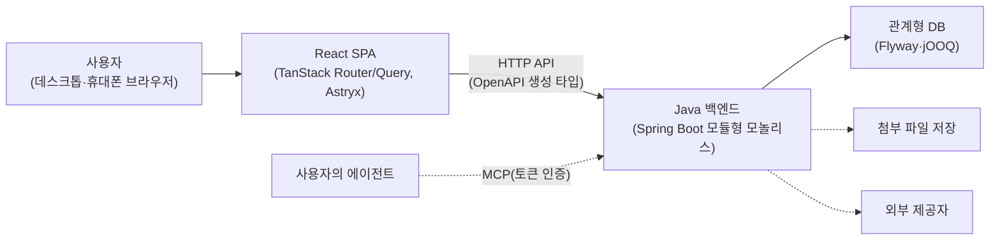

Webcraft는 특정 제품이 아니라 여러 업무용 웹 앱이 함께 따르는 기준 아키텍처(reference architecture)입니다. 이 정의서에서 "시스템"은 Webcraft를 따라 만든 웹 앱 하나를 뜻합니다. 그 앱은 브라우저에서 도는 React·TypeScript SPA, Java·Spring Boot·jOOQ로 만든 모듈형 모놀리스 백엔드의 HTTP API, Flyway로 스키마를 관리하는 관계형 DB로 이루어집니다. 첨부 파일, 외부 제공자 호출, 사용자의 에이전트가 쓰는 MCP 연결은 제품이 필요할 때만 더합니다. 도메인 모듈 목록, DB 엔진과 버전, 인프라와 배포 권한은 각 프로젝트가 정합니다.

## 시스템 한눈에 보기

화살표는 요청을 보내는 쪽에서 받는 쪽으로 향합니다. 실선은 모든 Webcraft 앱에 있는 경로이고, 점선은 제품이 필요할 때만 두는 경로입니다. SPA에서 백엔드로 가는 화살표의 "OpenAPI 생성 타입"은 서버가 계약의 원본이고 프론트엔드가 그 명세에서 생성한 클라이언트 타입으로 API를 부른다는 뜻입니다. 사용자의 에이전트는 제품이 MCP 연결을 제공할 때만 생기며, REST와 같은 권한 검사와 존재 노출 정책을 적용받습니다.

## 목차

| 절 | 제목 | 답하는 질문 |
| :--- | :--- | :--- |
| 1 | [1. 소개와 목표](/architecture/1/) | 어떤 앱을 대상으로 무엇을 지키려 하는가 |
| 2 | [2. 아키텍처 제약](/architecture/2/) | 무엇을 마음대로 정할 수 없는가 |
| 3 | [3. 맥락과 범위](/architecture/3/) | 앱의 경계와 외부 상대는 누구이고, Webcraft와 프로젝트는 어디서 갈리는가 |
| 4 | [4. 해결 전략](/architecture/4/) | 구조를 이루는 근본 선택은 무엇인가 |
| 5 | [5. 구성 요소 뷰](/architecture/5/) | 코드는 어떤 블록으로 나뉘는가 |
| 6 | [6. 실행 뷰](/architecture/6/) | 실행 중에 블록이 어떻게 협력하는가 |
| 7 | [7. 배치 뷰](/architecture/7/) | 어떤 환경에 어떻게 배포하고 바꾸는가 |
| 8 | [8. 횡단 관심사](/architecture/8/) | 여러 블록에 반복되는 규칙은 무엇인가 |
| 9 | [9. 아키텍처 결정](/architecture/9/) | 왜 그렇게 정했고 무엇을 기각했는가 |
