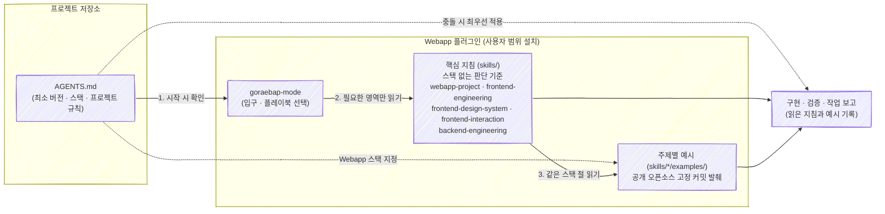
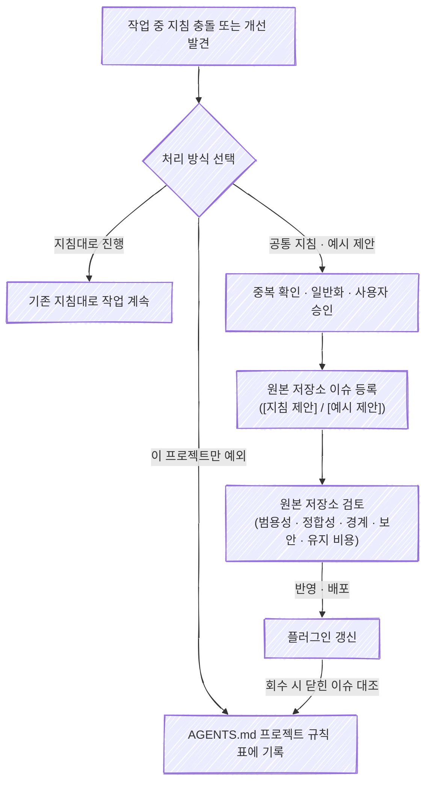

# Webapp 플러그인

웹 플랫폼 개발 지침(프로젝트·프론트엔드 엔지니어링·디자인 시스템·인터랙션·백엔드 엔지니어링)과 스택별 주제 예시입니다. 사용자 범위에 설치하면 에이전트가 작업에 맞는 지침을 스스로 불러 씁니다.

## 동작 구조

프로젝트는 지침 사본을 두지 않고 `AGENTS.md` 하나로 설치된 Webapp 플러그인을 가리킵니다. 에이전트는 작업에 맞는 핵심 지침(`skills/`)과 같은 스킬의 `examples/`에서 프로젝트 스택과 이름이 같은 절을 함께 읽고, 충돌하는 부분은 `AGENTS.md`의 프로젝트 규칙을 우선 따릅니다.



작업 중 지침과 부딪히거나 개선점을 찾으면 프로젝트 작업은 멈추지 않고 아래 흐름으로 예외와 공통 제안을 나눕니다.



## 설치

Claude Code:

```text
/plugin marketplace add dev-goraebap/dev.goraebap --scope user
/plugin install webapp@dev-goraebap --scope user
```

Codex:

```text
codex plugin marketplace add https://github.com/dev-goraebap/dev.goraebap.git --ref main
codex plugin add webapp@dev-goraebap
```

Antigravity:

원본 저장소를 받은 뒤 `plugins/webapp/dist/antigravity/plugins/webapp` 폴더를 `~/.gemini/config/plugins/webapp`에 복사하거나 연결하면 다음 턴부터 자동으로 불러옵니다.

## 프로젝트에 연결

프로젝트에서 onboarding에 연결을 요청합니다. 에이전트가 AGENTS.md에 `<!-- webapp@dev-goraebap:start -->` ~ `<!-- webapp@dev-goraebap:end -->` 마커로 감싼 "개발 지침" 관리 블록과 마커 밖의 "프로젝트 규칙" 표를 넣습니다. 마커 덕분에 나중에 관리 블록만 안전하게 갱신할 수 있고, 다른 플러그인 블록과도 섞이지 않습니다. 프로젝트에 지침 사본, 동기화 스크립트, 시작 훅을 만들지 않습니다.

개발 지침 블록은 최소 버전을 요구하고, 프로젝트가 쓰는 스택을 다음 줄로 정합니다. 에이전트는 영역 지침을 읽을 때마다 같은 스킬의 `examples/`에서 그 스택과 이름이 같은 절을 함께 읽습니다. 맞는 스택 절이 없으면 이 줄을 빼고 지침만으로 작업합니다.

```markdown
- Webapp 스택: <스택 id>
```

프로젝트만 다르게 하는 결정은 프로젝트 규칙 표에 한 줄씩 적습니다. 에이전트는 지침보다 이 표를 먼저 따릅니다. 다른 프로젝트에도 맞는 규칙은 onboarding의 회수로 플러그인 원본 수정을 제안받습니다.

지침 사본(`.agents/skills/<접두사>-mode` 등)이나 동기화 훅이 있는 프로젝트는 onboarding에 사본에서 전환을 요청합니다. 사본에서 고친 부분은 프로젝트 규칙으로 옮기고, 사본·스크립트·훅은 확인을 받은 뒤 지웁니다.

## 갱신

플러그인을 갱신하면 연결된 모든 프로젝트가 새 지침을 따릅니다. 프로젝트 AGENTS.md의 최소 버전보다 낮은 플러그인이 설치돼 있거나 지침을 읽을 수 없으면 에이전트는 추측으로 진행하지 않고, 작업 상태를 `~/.goraebap/handoff/` 아래 이어받기 문서로 남긴 뒤 설치·갱신 방법과 새 세션에서 읽을 문서 경로를 안내합니다. 커밋·푸시·외부 전송은 이 플러그인 설치만으로 허용되지 않습니다.

Claude Code에서 자동 갱신은 공식 마켓플레이스가 아니면 기본값이 꺼짐입니다. 사용자가 `/plugin` → Marketplaces → `dev-goraebap` → Enable auto-update로 켜거나, 조직 관리자가 managed settings의 `extraKnownMarketplaces` 항목에 `"autoUpdate": true`를 넣습니다. 자동 갱신은 세션 시작 때가 아니라 첫 메시지 뒤 최대 10분 안에 돌며, 실행 중인 세션은 시작할 때의 판을 유지하고 `/reload-plugins`를 입력하거나 다음에 실행할 때 새 버전이 적용됩니다.

Claude Code 배포본에는 세션 시작 훅(`hooks/hooks.json`, `hooks/update-check.mjs`)이 들어갑니다. `update-check.mjs`는 새로 시작할 때만(`startup`), AGENTS.md에 Webapp 관리 블록이 있는 프로젝트에서만 돌며, 하루 한 번 원본 저장소의 최신 버전을 받아 `~/.goraebap/cache/webapp-latest.json`에 기억합니다. 설치된 버전보다 높으면 `Webapp 새 버전이 나왔습니다(0.8.0 → 0.8.1). 에이전트에게 "Webapp 업데이트해 줘"라고 하면 갱신합니다.` 한 줄을 보이고, 에이전트가 첫 요청 전에 한 번 갱신을 제안합니다. 동의하면 아래 수동 갱신 명령을 실행한 뒤 `/reload-plugins`를 안내합니다. 같은 최신 버전은 한 번만 알리므로, 미루면 다음 버전이 나올 때까지 다시 묻지 않습니다. 네트워크 실패나 Node가 없는 경우에는 조용히 넘어갑니다. Codex 배포본에는 훅이 없습니다.

직접 갱신할 때는 다음 명령을 실행하고, Claude Code에서는 `/reload-plugins`를 입력하거나 새 세션을 엽니다.

Claude Code:

```text
claude plugin marketplace update dev-goraebap
claude plugin update webapp@dev-goraebap
```

Codex:

```text
codex plugin marketplace upgrade dev-goraebap
```

Antigravity:

최신 `plugins/webapp/dist/antigravity/plugins/webapp` 폴더를 `~/.gemini/config/plugins/webapp`에 다시 복사하거나 연결을 갱신하면 다음 턴부터 적용됩니다.

지침과 예시 개선 제안은 Webapp 원본 저장소(`dev-goraebap/dev.goraebap`)의 이슈로 받으며, 중복 확인과 타당성·보안 검토를 거쳐 반영합니다. 역할별 모델 설정 `~/.claude/rules/goraebap-models.md`는 기존 경로를 유지하며, `~/.goraebap/`에는 최신 버전 확인 캐시(`cache/`), 이어받기 문서(`handoff/`), 직접 올리지 못한 이슈 문서(`issues/`)가 남습니다.
