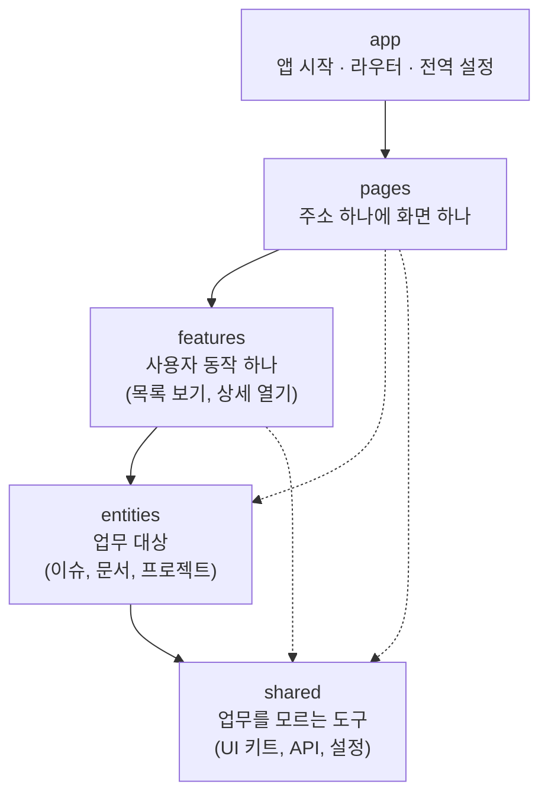

import { FileTree, Aside, Card, CardGrid } from '@astrojs/starlight/components';

Webcraft 프로젝트는 어디를 열어도 같은 자리에 같은 종류의 코드가 있어요. 그래서 처음 보는 기능도 어디부터 읽을지 바로 알 수 있고, 에이전트도 새 코드를 어디에 둘지 헤매지 않아요. 이 장은 그 자리를 정하는 두 가지 규칙을 설명해요.

## 저장소 하나에 제품 하나

프론트엔드와 백엔드를 한 저장소의 두 폴더로 둬요. 두 쪽을 한 번에 고쳐야 하는 기능도 커밋 하나, 리뷰 하나로 끝나요.

<FileTree>
- my-product/
  - web/ 프론트엔드(React)
    - src/
    - package.json
  - server/ 백엔드(Spring Boot)
    - src/
    - build.gradle
  - AGENTS.md 에이전트가 읽는 프로젝트 안내
  - CLAUDE.md `@AGENTS.md` 한 줄
</FileTree>

## 프론트엔드는 다섯 층으로

`web/src`는 역할에 따라 층으로 나눠요. [Feature-Sliced Design](https://feature-sliced.design/)을 바탕으로, 쓰지 않는 층은 두지 않도록 다듬었어요.

화살표는 가져올 수 있는 방향이에요. 위층은 아래층을 가져올 수 있고, 아래층은 위층을 모릅니다. 점선처럼 중간 층을 건너뛰어도 돼요.

<Aside type="caution" title="이렇게 하면 안 돼요">
- `entities`에서 `features`를 가져오기: 아래층이 위층을 알게 돼요.
- `features/work-item-list`에서 `features/work-item-detail`을 직접 가져오기: 같은 층끼리는 서로 모르게 둬요. 둘을 엮는 일은 위층(`pages`)이 해요.
- 다른 슬라이스의 내부 파일을 가져오기: 슬라이스 밖에서는 그 슬라이스의 `index.ts`만 가져와요.
</Aside>

실제 프로젝트에서는 이렇게 보여요.

<FileTree>
- web/src/
  - app/ 라우터, 쿼리 클라이언트, 테마
  - pages/
    - login/
    - _app/ 로그인한 사람의 화면
      - inbox/
      - my-work/
      - workspace/
  - features/
    - work-item-list/
    - work-item-detail/
  - entities/
    - work-item/
    - project/
    - document/
  - shared/
    - ui/
      - kit/ Webcraft 키트에서 받은 부품
    - api/
    - config/
</FileTree>

## 주소는 pages 폴더가 정해요

`pages` 아래 폴더 하나가 주소 한 단계예요. 라우트 목록을 따로 관리하지 않고, 폴더를 만들면 주소가 생겨요.

<FileTree>
- pages/
  - _app/
    - route.tsx 로그인 확인, 앱 틀
    - inbox/
      - route.tsx `/inbox` 아래 전체에 걸리는 틀
      - page.tsx `/inbox` 화면
      - $id.tsx `/inbox/123` 화면
      - ui/ 이 화면만 쓰는 부품
      - model/ 이 화면만 쓰는 상태
</FileTree>

| 파일·폴더 | 뜻 |
| :--- | :--- |
| `page.tsx` | 그 주소의 화면 |
| `route.tsx` | 그 주소와 아래 주소 전체에 걸리는 틀. 권한 확인이나 먼저 읽을 데이터를 여기에 둬요 |
| `$id.tsx` | 주소의 한 단계가 값인 화면(`/inbox/123`) |
| `_app/` | 밑줄로 시작하는 폴더는 주소에 나타나지 않아요. 여러 화면이 같은 틀을 쓸 때 묶어요 |
| `ui/` · `model/` · `api/` | 화면 안의 코드 묶음이에요. 주소로 치지 않아요 |

<CardGrid>
  <Card title="규칙 원문" icon="document">
    에이전트가 따르는 프론트엔드 규칙 전체는 [규칙 목록](/reference/rules/)에서 볼 수 있어요.
  </Card>
  <Card title="실제 코드" icon="github">
    이 구조로 만든 제품은 [cowork](https://github.com/dev-goraebap/cowork)에서 볼 수 있어요.
  </Card>
</CardGrid>
