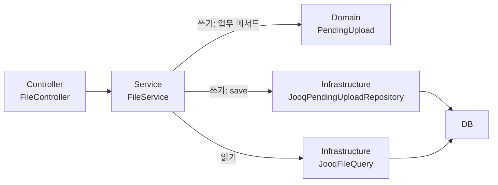

import { FileTree, Aside } from '@astrojs/starlight/components';

서버는 모듈형 모놀리스예요. 프로그램은 하나로 배포하지만, 안쪽은 업무 단위의 모듈로 나누고 모듈 사이에는 공개 계약으로만 이야기해요. 서비스·큐·캐시를 따로 두는 일은 구체적인 요구와 운영 비용을 보고 정해요.

## 패키지 모양

cowork의 기본 패키지는 `xyz.goraebap.cowork`이고, 그 아래를 기술 기반 `shared`와 업무 모듈 `module`로 나눠요.

<FileTree>
- server/src/main/java/xyz/goraebap/cowork/
  - ServerApplication.java
  - shared/ 업무를 모르는 기술 기반
    - config/
    - domain/
    - error/ 오류 코드와 예외
    - persistence/ DB 연결, jOOQ 바인딩
    - storage/ 파일 저장소
    - text/
    - web/ 예외 처리기, 현재 사용자, 목록 인자
  - module/
    - user/
    - file/
    - notification/
    - system/
    - seed/
    - realtime/
    - search/
    - mcp/
    - workspace/
      - project/
      - issue/
      - document/
      - richbody/
      - activity/
</FileTree>

## 모듈 안

모듈은 단수 이름으로 두고, 안을 `application` · `domain` · `infrastructure`로 나눠요. 모듈 루트에는 다른 모듈이 쓰는 공개 계약(`…Facade`, `…Spi`, 이벤트)과 공개 값 타입만 둬요. 아래는 파일 모듈이에요.

<FileTree>
- module/file/
  - FileFacade.java 다른 모듈이 쓰는 공개 계약
  - AttachedFile.java 계약이 돌려주는 값
  - …
  - application/
    - FileController.java 요청 형식 검증, HTTP 변환
    - FileService.java 읽기·쓰기 유스케이스, 트랜잭션
    - FileQuery.java 화면 조회 포트
    - FileRequests.java HTTP 요청 타입
    - FileViews.java HTTP 응답 타입
    - FileErrorCode.java 이 모듈의 오류 코드
    - …
  - domain/
    - attachment/
      - Attachment.java
      - AttachmentRepository.java
    - upload/
      - PendingUpload.java
      - PendingUploadRepository.java
      - …
  - infrastructure/
    - JooqAttachmentRepository.java
    - JooqFileQuery.java
    - JooqPendingUploadRepository.java
    - …
</FileTree>

| 역할 | 맡는 일 |
| :--- | :--- |
| Controller | 요청 형식 검증과 HTTP 변환 |
| Service | 피처의 읽기·쓰기 유스케이스, 트랜잭션, 도메인 조율 |
| Domain | 업무 불변식과 의미 있는 상태 바꾸기. 프레임워크에 기대지 않는 순수 Java |
| Infrastructure | jOOQ 영속성, 조회, 외부 연동 |

## 요청이 지나는 길



피처마다 `…Service` 하나에 읽기와 쓰기 메서드를 함께 둬요. 읽기와 쓰기는 서비스 클래스를 나누지 않고 처리 경로로 나눠요.

| 메서드 | 처리 경로 |
| :--- | :--- |
| 읽기 | 같은 피처의 조회 포트(`FileQuery`) → jOOQ 구현(`JooqFileQuery`) → 화면 응답 타입 |
| 쓰기 | 도메인 저장소에서 복원 → 업무 메서드와 불변식 검증 → 명시적으로 `save` |

jOOQ에는 변경 감지가 없어서, 쓰기 메서드는 `save`를 빠뜨리지 않아요. 아래는 업로드를 준비하는 쓰기 메서드예요. 도메인 객체를 만들고(`PendingUpload.create`), 저장소에 저장하고, 응답 타입으로 돌려줘요.

```java cowork="server/src/main/java/xyz/goraebap/cowork/module/file/application/FileService.java" lines="61-76" {4,11}
```

현재 시각은 주입한 `Clock`에서 받아요(`clock.instant()`).

## 트랜잭션

- 읽기만 있는 서비스는 클래스에 `@Transactional(readOnly = true)`를 달아요.
- 읽기와 쓰기가 함께 있으면 클래스에 달지 않고, public 메서드마다 읽기는 `@Transactional(readOnly = true)`, 쓰기는 `@Transactional`을 달아요.
- 함께 성공해야 하는 변경은 같은 트랜잭션에서 처리해요. 외부 호출, 파일, 메시지 전송은 DB 트랜잭션으로 되돌릴 수 없다는 점을 따로 다뤄요.

## 모듈 사이

| 필요한 것 | 하는 방법 |
| :--- | :--- |
| 다른 모듈의 기능 | 그 모듈 루트의 `…Facade`를 불러요. 내부 `application`·`domain`·`infrastructure` 타입은 참조하지 않아요 |
| 다른 모듈에 구현을 요구 | 소유 모듈 루트에 `…Spi`를 두고 밖에서 구현해요. 인자로 넘겨받을 수 있으면 Spi를 만들지 않아요 |
| 다른 모듈의 표시 정보 | 부모 페이지를 정한 뒤 Facade로 묶어서 읽어요 |
| 다른 모듈의 값으로 검색·정렬·건수 | 그 화면의 SQL 조회에서 직접 읽어도 돼요. 조회 구현 안으로만 한정해요 |

<Aside title="두 피처에 같은 코드가 필요할 때">
이 순서로 판단해요. 도메인 규칙이 겹치면 `domain`으로 옮겨요. 조율 로직을 함께 쓰면 소유 피처를 정해 그 피처의 공유 서비스로 뽑아요. 어느 피처에도 속하지 않고 실제로 두 곳 이상이 쓰면 `application` 바로 아래에 둬요. 모양만 비슷하고 바뀌는 이유가 다르면 각각 둬요. `application/shared` 같은 별도 공용 층은 만들지 않아요.
</Aside>
