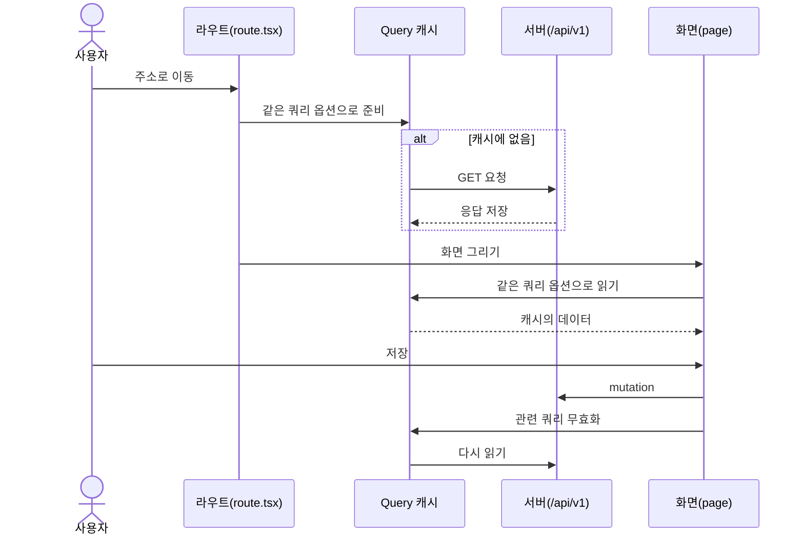

화면의 상태는 누가 가지는지에 따라 세 곳에 나눠 둬요. 서버 데이터는 TanStack Query 캐시, 확정한 조건은 주소, 입력 중인 초안은 화면 안이에요. 이 장은 주소에 들어갈 때 데이터를 준비하고, 화면이 그것을 읽고, 저장한 뒤 다시 읽는 흐름을 설명해요.

| 상태 | 가지는 곳 |
| :--- | :--- |
| 서버 데이터와 그 캐시 | TanStack Query |
| 경로, 확정한 필터·정렬·페이지·탭 | TanStack Router가 검증한 주소 |
| 입력 초안, 적용 전 필터, 열림 상태 | 컴포넌트 state나 그 슬라이스의 `model/` |

## 한 번 들어가고, 저장하기까지



## 조회 옵션은 한 곳에

조회를 소유한 슬라이스의 `api/`에 요청, 쿼리 키, 쿼리 옵션을 함께 둬요. 라우트와 화면이 같은 옵션을 쓰므로 둘이 같은 캐시를 봐요. 응답을 바꾸는 인자(여기서는 `key`)는 모두 쿼리 키에 넣어요.

```ts title="web/src/entities/project/api/projects.ts"
export const projectKeys = {
  all: ['projects'] as const,
  list: (status: ProjectStatus) => ['projects', 'list', status] as const,
  project: (key: string) => ['projects', 'one', key.toUpperCase()] as const,
  members: (key: string) => ['projects', 'members', key.toUpperCase()] as const,
};

/** Whatever changed in projects: every project read is read again. */
export const refreshProjects = (client: QueryClient) => client.invalidateQueries({ queryKey: projectKeys.all });

// …

/** One project by its key (a current key or an old one); a missing one fails as not found. */
export const projectOptions = (key: string) => queryOptions({
  queryKey: projectKeys.project(key),
  queryFn: ({ signal }) => getJson<Project>(at(key), signal),
});
```

## 라우트가 준비해요

주소에 들어가면 `route.tsx`의 `loader`가 화면이 첫 그림에 쓸 데이터를 캐시에 준비해요. cowork는 이 일을 `prepare` 도우미 하나로 해요.

```ts title="web/src/pages/_app/workspace/projects/$key/route.tsx" {7}
import { createFileRoute } from '@tanstack/react-router';
import { projectOptions } from '@/entities/project';
import { prepare } from '@/shared/lib/prepare';

/** /workspace/projects/{key} 아래 전부: 프로젝트(이름 · 권한)를 먼저 읽어 둔다. 메뉴와 페이지 머리가 그 이름을 쓴다. */
export const Route = createFileRoute('/_app/workspace/projects/$key')({
  loader: ({ context, params }) => prepare(context.queryClient, `project:${params.key}`, ({ prime }) => prime(projectOptions(params.key))),
});
```

`prepare`는 꼭 있어야 하는 것(`ensure`)과 있으면 좋은 것(`prime`)을 나눠요. 캐시가 있으면 기다리지 않고 그것으로 그리고, 오래된 데이터는 화면이 마운트할 때 다시 읽어요. 준비가 실패해도 화면으로 넘어가고, 오류는 화면이 보여 줘요.

```ts title="web/src/shared/lib/prepare.ts" {8,11}
/**
 * 화면이 첫 그림에 쓸 것을 미리 읽는 도구. 라우트 loader와 대화상자(PanelHost)가 같은 준비 함수를 함께 쓴다.
 * 캐시가 있으면 기다리지 않고 그것으로 그리며, 오래된 데이터는 각 화면이 마운트할 때 갱신한다. 오류 표시는 각 화면이 맡는다.
 */
export type Prep = {
  client: QueryClient;
  /** 꼭 있어야 하는 것: 캐시가 있으면 그것을, 없으면 읽어 온다. 실패하면 준비가 멈춘다. */
  ensure: QueryClient['query'];
  ensureInfinite: QueryClient['infiniteQuery'];
  /** 있으면 좋은 것: ensure와 같되 실패해도 넘어간다. */
  prime: QueryClient['query'];
  primeInfinite: QueryClient['infiniteQuery'];
  // …
};

// …

/** 주소(id) 하나의 준비를 돌리고, 무엇을 읽었는지 적어 둔다(isPrepared). */
export async function prepare(client: QueryClient, id: string, run: (prep: Prep) => Promise<unknown>) {
  const keys: QueryKey[] = [];
  const ensure: QueryClient['query'] = options => { keys.push(options.queryKey); return client.query({ ...options, staleTime: 'static' }); };
  // …
}
```

## 화면이 읽고, 저장한 뒤 무효화해요

화면은 라우트와 같은 쿼리 옵션으로 캐시에서 읽어요. 쓰기는 mutation으로 보내고, 끝나면 관련 쿼리를 무효화해서 다시 읽어요. 아래 화면은 멤버 역할을 바꾼 뒤 프로젝트 조회 전체(`['projects']` 아래)를 무효화해요.

```tsx title="web/src/pages/_app/workspace/projects/$key/ui/ProjectMembersPage.tsx" {6,8,12}
export function ProjectMembersPage({ crumbs }: { crumbs: Crumb[] }) {
  const { key = '' } = useParams({ strict: false }) as { key?: string };
  const client = useQueryClient();
  const openPanel = useOpenPanel();
  const isMobile = useIsMobile();
  const project = useQuery(projectOptions(key));
  const canChange = !!project.data?.can.manage;
  const members = useQuery(projectMembersOptions(key));
  // …
  const set = useMutation({
    mutationFn: ({ userId, role, isIn }: { userId: string; role: ProjectRole | null; isIn: boolean }) => setProjectRole(project.data?.key ?? key, userId, role, isIn),
    onSettled: () => refreshProjects(client),
  });
  // …
}
```

낙관적 갱신과 명령 자동 재시도는 기본으로 켜지 않아요. 중복 실행과 되돌리는 비용을 확인한 뒤 고르는 선택이에요. 저장은 성공했는데 다시 읽기가 실패하면, 저장 실패로 알리지 않아요.

## 초안은 서버 데이터와 따로

입력 중인 초안은 서버 데이터와 분리해 둬요. 뒤에서 다시 읽어 온 데이터가 입력 중인 내용을 덮지 않게 해요. 저장이 충돌하면 초안을 남겨 두고, 다시 읽고 다시 적용할 방법을 줘요.

필터는 고르는 동안은 초안이고, 적용할 때 주소를 바꿔요. 주소 갱신, 페이지 초기화, 쿼리 키 변경을 한 번에 일어나는 일로 다뤄요. 취소하면 주소는 그대로예요. 그래서 새로고침, 링크 공유, 뒤로 가기에서도 같은 조건이 돌아와요.

## 화면을 옮길 때

- 캐시가 있으면 오래됐어도 바로 그리고, 뒤에서 새로 읽어요.
- 캐시가 없으면 다음 화면이 준비될 때까지 지금 화면을 그대로 둬요. 150ms가 지나도 준비되지 않으면 콘텐츠 카드 위쪽 테두리에만 진행 표시를 띄워요.
- 앱 안 링크에 포인터나 초점이 오면 그 화면을 미리 준비해요.
- 뒤로 돌아온 목록은 읽던 자리와 불러온 줄을 되도록 그대로 보여 줘요.
