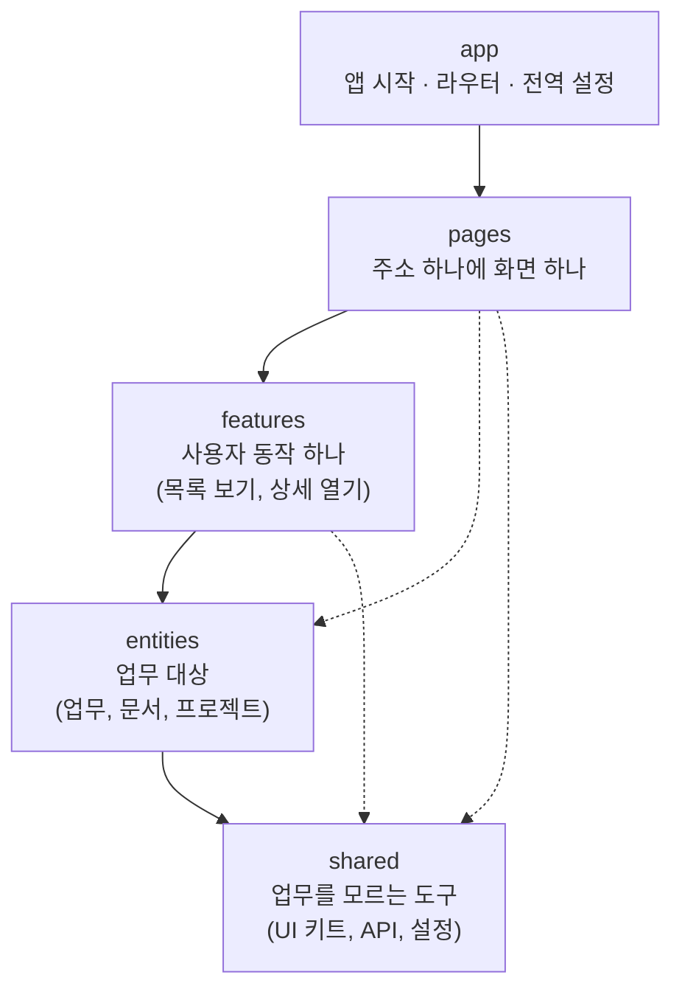

import { FileTree, Aside } from '@astrojs/starlight/components';

`web/src`는 역할에 따라 `app` · `pages` · `features` · `entities` · `shared` 다섯 층으로 나눠요. [Feature-Sliced Design](https://feature-sliced.design/)을 바탕으로, 쓰지 않는 층(widgets 등)은 두지 않아요. 이 장은 층을 나누는 규칙과, `pages` 폴더가 주소를 정하는 규칙을 설명해요.

## 다섯 층



화살표는 가져올 수 있는 방향이에요. 위층은 아래층을 가져올 수 있고, 아래층은 위층을 모릅니다. 점선처럼 중간 층을 건너뛰어도 돼요.

<Aside type="caution" title="이렇게 하면 안 돼요">
- `entities`에서 `features`를 가져오기: 아래층이 위층을 알게 돼요.
- `features/work-item-list`에서 `features/work-item-detail`을 직접 가져오기: 같은 층끼리는 서로 모르게 둬요. 둘을 엮는 일은 위층(`pages`)이 해요.
- 다른 슬라이스의 내부 파일을 가져오기: 슬라이스 밖에서는 그 슬라이스의 `index.ts`만 가져와요.
</Aside>

cowork의 `web/src`는 이렇게 생겼어요.

<FileTree>
- web/src/
  - app/ 앱 시작, 라우터, 테마, 앱 틀
  - pages/
    - login/
    - onboarding/
    - print/
    - _app/ 로그인한 사람의 화면
  - features/
    - work-item-list/
    - work-item-detail/
    - picture-change/
    - …
  - entities/
    - work-item/
    - project/
    - document/
    - …
  - shared/
    - api/ HTTP 도우미와 생성한 API 타입
    - auth/
    - config/
    - lib/
    - ui/ cowork가 만든 공용 부품
      - kit/ Webcraft 키트에서 받은 부품
</FileTree>

## 주소는 pages 폴더가 정해요

TanStack Router의 파일 라우팅이 `src/pages`를 읽어요. 폴더 하나가 주소 한 단계이고, 슬라이스 하나예요. 라우트 목록을 따로 관리하지 않고, 폴더를 만들면 주소가 생겨요.

```ts cowork="web/vite.config.ts" lines="58-66" {5,7}
```

`indexToken: 'page'` 때문에 `page.tsx`가 그 주소의 화면이 되고, `routeFileIgnorePattern` 때문에 `ui/` · `api/` · `model/` · `lib/` · `config/` · `index.ts`는 주소로 치지 않아요.

<FileTree>
- pages/_app/
  - route.tsx 로그인 확인. 안 했으면 `/login`으로
  - page.tsx `/`에 오면 홈으로 보내기
  - inbox/
    - route.tsx `/inbox` 목록과 옆 칸, 먼저 읽을 알림
    - $id.tsx `/inbox/123`
    - ui/ 이 주소만 쓰는 부품
    - model/ 이 주소만 쓰는 상태와 로직
  - my-work/
    - page.tsx `/my-work` 화면
    - ui/
  - workspace/
    - projects/
      - page.tsx `/workspace/projects` 화면
      - new.tsx `/workspace/projects/new` 화면
      - index.ts 공개 진입점. 주소로 치지 않음
      - ui/
      - $key/
        - route.tsx 프로젝트를 먼저 읽어 두기
        - page.tsx
        - members/
          - page.tsx
        - work-items/
          - page.tsx
          - $number/
          - model/
          - ui/
        - ui/
        - …
    - …
</FileTree>

| 파일·폴더 | 뜻 |
| :--- | :--- |
| `page.tsx` | 그 주소의 화면 |
| `route.tsx` | 그 주소와 아래 주소 전체에 걸리는 라우트. 레이아웃, 접근 확인, 먼저 읽을 데이터를 여기에 둬요 |
| `$key/`, `$id.tsx` | 주소의 한 단계가 값인 자리(`/workspace/projects/ABC`, `/inbox/123`) |
| `_app/` | 밑줄로 시작하는 폴더는 주소에 나타나지 않아요. 로그인한 사람의 화면을 앱 틀 하나로 묶어요 |
| `ui/` · `model/` · `api/` · `lib/` · `config/` · `index.ts` | 슬라이스 안의 코드 묶음이에요. 주소로 치지 않아요 |

## 슬라이스 안

- 컴포넌트는 `ui/`에 파일 하나에 하나씩 둬요. 파일 이름은 PascalCase이고, 페이지 컴포넌트에는 `Page`를 붙여요(`ProjectMembersPage.tsx`).
- 여러 파일이 함께 쓰는 훅과 로직은 `model/`에 둬요. 훅 이름은 `use`로 시작하고, 일반 도구와 설정 파일 이름은 kebab-case예요.
- 서버 조회는 그 조회를 소유한 슬라이스의 `api/`에 요청·쿼리 키·쿼리 옵션을 함께 둬요. 흐름은 [데이터 흐름](/web/frontend/data-flow/)에 있어요.

## 다른 주소의 코드를 가져올 때

`pages`의 파일은 자기 주소 폴더와 조상 주소 폴더의 코드만 가져와요. 목록과 그 아래 상세처럼 위 주소의 부품을 아래 주소가 함께 쓰는 것은 되고, 옆 주소의 코드를 가져오는 것은 안 돼요. 두 주소가 함께 쓰는 코드는 공통 조상 폴더로 올려요.

아래 `members/page.tsx`는 조상 주소(`$key/`)의 `ui/`에 있는 화면을 가져와요.

```tsx cowork="web/src/pages/_app/workspace/projects/$key/members/page.tsx" lines="1-13" {5}
```

층 방향, 같은 층의 다른 슬라이스, 옆 주소 가져오기는 `npm run lint:ui`(`web/scripts/check-ui.mjs`)가 검사해요. 검사 전체는 [린트와 코딩 스타일](/web/frontend/lint/)에 있어요.
