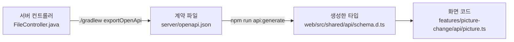

import { Tabs, TabItem } from '@astrojs/starlight/components';

화면과 서버는 따로 빌드하고 따로 실행하지만, 저장소는 하나예요. 제품 하나에 저장소 하나를 두고, 그 안에 `web/`과 `server/`를 나란히 둬요.

## 한 저장소라서 되는 것

- API와 화면을 함께 바꾸는 기능이 커밋 하나, 리뷰 하나로 끝나요.
- 화면의 타입을 서버가 만든 계약 파일(`server/openapi.json`)에서 생성해요. 계약이 어긋나면 화면 빌드가 실패해서 배포 전에 드러나요. 순서는 [화면과 서버 사이의 계약](/web/project/contract/)에 있어요.
- 에이전트가 한 세션에서 양쪽 코드와 AGENTS.md 하나를 함께 읽어요.
- 규칙, 문서, 결정 기록이 한곳에 있어요.

## 기능 하나가 바꾸는 파일

파일 올리기 API를 예로 들면, 기능 하나가 저장소 안의 이 파일들을 함께 바꿔요.



<Tabs>
<TabItem label="서버 컨트롤러">
```java title="server/src/main/java/xyz/goraebap/cowork/module/file/application/FileController.java"
// …
@RestController
@RequestMapping("/api/v1/files")
@RequiredArgsConstructor
public class FileController {
    private final FileService fileService;

    /**
     * Returns where to send the bytes. The body is an explicit exception to the empty 201 of shared guideline 01,
     * since the browser uses the URL and headers right away.
     */
    @PostMapping("/uploads")
    @ResponseStatus(HttpStatus.CREATED)
    public FileViews.UploadTicket upload(
            @AuthenticationPrincipal CurrentUser user, @Valid @RequestBody FileRequests.Upload request) {
        return fileService.prepare(user, request);
    }
}
```
</TabItem>
<TabItem label="생성한 타입">
```ts title="web/src/shared/api/schema.d.ts"
// …
        UploadTicket: {
            /** Format: uuid */
            id?: string;
            /** Format: uri */
            url?: string;
            method?: string;
            headers?: {
                [key: string]: string;
            };
            /** Format: date-time */
            expiresAt?: string;
        };
```
</TabItem>
<TabItem label="화면 코드">
```ts title="web/src/features/picture-change/api/picture.ts" {6}
import { measureImage } from '@/shared/lib/image-traits';
import { sendCommand, sendJson, type components } from '@/shared/api';

export async function uploadPicture(picture: Blob) {
  if (picture.size > 1024 * 1024) throw new Error('사진은 1MB 이하로 올려 주세요.');
  const ticket = await sendJson<components['schemas']['UploadTicket']>('/api/v1/files/uploads', 'POST',
    { filename: 'profile.jpg', size: picture.size, purpose: 'AVATAR', width: 512, height: 512, dominantColor: (await measureImage(picture)).dominantColor });
  if (!ticket.url || !ticket.id) throw new Error('사진 업로드를 준비하지 못했습니다.');
  // …
}
```
</TabItem>
</Tabs>

서버의 `FileViews.UploadTicket`이 바뀌면 계약 파일과 생성한 타입이 따라 바뀌고, 화면 코드가 그 타입에 맞지 않으면 화면 빌드가 실패해요. 네 파일이 한 커밋에 함께 들어가요.

## 빌드 도구는 각자 써요

저장소 루트에는 공용 빌드 도구(npm workspaces, Nx, Turborepo 같은 것)를 두지 않아요. cowork 루트에는 `package.json`이 없어요.

| 폴더 | 빌드 도구 | 검사 |
| :--- | :--- | :--- |
| `web/` | npm | `web/`에서 `npm run check` |
| `server/` | Gradle | `server/`에서 `./gradlew test integrationTest` |

두 쪽을 한 번에 띄우는 일만 루트의 `dev.sh`가 맡아요. 명령 전체는 [명령어](/web/reference/commands/)에 있어요.

## 감수하는 것

- 저장소가 커지고, CI가 화면과 서버를 모두 다뤄요.
- 화면만 보는 사람도 서버 코드를 함께 받아요.
- 화면과 서버의 저장소 권한을 따로 줄 수 없어요.
