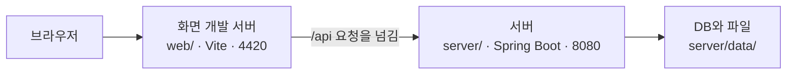
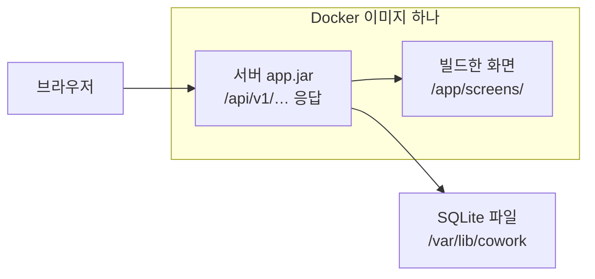

import { Aside } from '@astrojs/starlight/components';

Webcraft 프로젝트는 화면과 서버를 서로 다른 프로그램으로 만들어요. 화면은 `web/`의 React SPA(Vite로 빌드)이고, 서버는 `server/`의 Spring Boot API예요. 둘은 `/api` 아래 HTTP(JSON)로만 이야기하고, 실시간 알림에는 웹소켓도 써요. 이 장의 예는 대표 프로젝트 [cowork](https://github.com/dev-goraebap/cowork)에서 가져왔어요.

## 개발할 때



저장소 루트에서 `sh dev.sh`를 실행하면 서버(8080)와 화면(4420)이 함께 떠요. 화면은 서버가 상태 확인(`/api/v1/health`)에 답한 뒤에 띄워요(`scripts/wait-for-server.mjs`). 한쪽만 띄우려면 `sh dev.sh server`나 `sh dev.sh web`을 써요.

브라우저는 화면 개발 서버(4420)만 열어요. 화면이 보낸 `/api` 요청은 Vite가 8080의 서버로 넘겨요. 웹소켓도 같은 길로 넘어가요(`ws: true`).

```ts cowork="web/vite.config.ts" lines="75-77" {3}
```

다른 곳에 떠 있는 서버를 쓰려면 환경 변수 `DEV_API_TARGET`에 그 주소를 넣어요.

## 배포할 때



배포할 때는 Docker 이미지 하나에 서버 jar와 빌드한 화면을 함께 넣어요. 서버가 `/api` 요청에 답하고, 그 밖의 주소에는 빌드한 화면을 내보내요. 파일 이름이 아닌 주소에는 `index.html`을 돌려줘서 화면의 라우터가 주소를 처리해요.

```dockerfile cowork="Dockerfile" lines="11-12,…,18-21,…,27-29,…,33-34,…,41-41"
```

이미지는 하나지만 빌드 단계(`screens`, `server`)는 따로예요. 화면만 바꾸면 서버 단계는 캐시를 그대로 쓰고, 서버만 바꾸면 화면 단계가 캐시돼요.

## 누가 무엇을 가지나

화면과 서버를 나누는 기준은 "누가 원본을 가지는가"예요. 같은 원본을 두 곳에서 고치고 맞추는 구조를 만들지 않아요.

| 화면이 가지는 것 | 서버가 가지는 것 |
| :--- | :--- |
| 주소: 경로, 확정한 필터·정렬·페이지·탭 | 데이터의 원본 |
| 화면 상태: 열림·닫힘, 적용 전 선택 | 권한 판정 |
| 입력 중인 초안 | 업무 규칙 |
| 보여 주는 방식: 부품, 배치, 반응형 | 최종 검증 |

화면은 서버 데이터를 TanStack Query 캐시에 받아 두지만, 그건 사본이에요. 원본과 판정은 서버에 있어요.

<Aside title="화면이 숨겨도 서버가 다시 확인해요">
화면은 서버가 응답에 실어 준 `can`(`view`·`edit`·`manage`)으로 버튼을 보이거나 숨겨요. 권한을 화면에서 다시 계산하지 않아요. 그래도 요청이 오면 서버가 권한을 다시 판정해요. 자세한 규칙은 [API 계약과 오류](/web/backend/api/)에 있어요.
</Aside>
