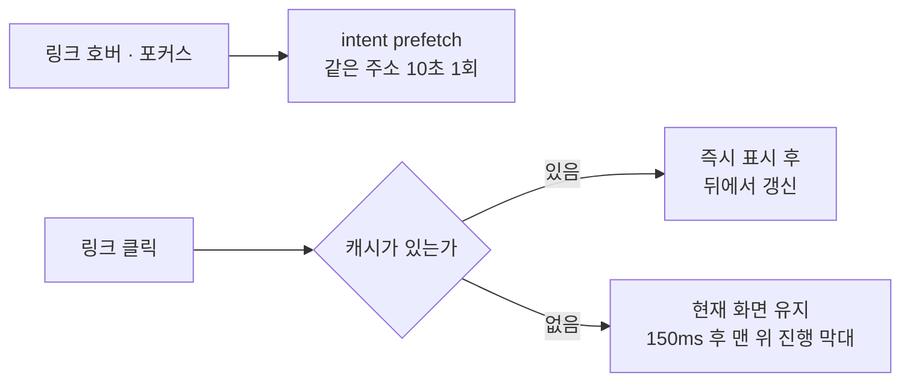

## 미리 준비, 캐시 우선 표시, 지연 진행 표시

첫 화면에 필요한 조회는 라우트의 데이터 준비(loader)에서 컴포넌트와 같은 조회 옵션·캐시로 준비합니다. 캐시가 있으면 오래됐더라도 즉시 그리고 뒤에서 갱신하는 stale-while-revalidate를 기본으로 삼으며, 캐시 신선도 조건 때문에 첫 그림을 거르지 않습니다. 캐시로 먼저 그린 본문이 서버 최신본과 다르면 읽던 글을 바로 바꾸지 않고 "최신 내용 보기" 안내만 띄웁니다.

앱 안 링크에 포인터나 초점이 오면 그 화면을 미리 준비합니다(intent prefetch). 링크마다 붙이지 않고 문서에 한 번 걸어 `pointerover`·`focusin`에서 앱 안 `a[href]`를 라우터의 미리 준비 기능으로 준비하며, 같은 주소는 10초에 한 번만 부릅니다.

캐시가 없으면 다음 화면이 준비될 때까지 지금 화면을 유지하고 가리는 막을 두지 않습니다. 150ms가 지나면 화면 맨 위 막대로 진행 표시를 띄우고, 한 번 띄우면 300ms 이상 보입니다. 누른 메뉴의 선택 표시는 응답 전에 옮깁니다. 메뉴·링크 진입, 뒤로 돌아오기, 검색 조건 변경을 구분해 로딩·스크롤·캐시 정책을 정하고, 화면 표현은 인터랙션의 [데이터 상태](../../../../../../../plugins/webapp/skills/frontend-interaction/references/data-states.md)를 따릅니다.

<Diagram caption="링크 호버·포커스로 미리 준비하고, 캐시 유무에 따라 즉시 표시와 지연 진행 표시로 나눕니다.">

</Diagram>

<Slot name="intent-preload" />

## 지연 로딩 코드와 데이터 함께 준비

지연 로딩하는 화면 코드는 데이터와 함께 전환 전에 준비합니다. 라우트 안에서 고르는 중첩 화면과 화면 안에서 지연 로딩하는 큰 컴포넌트(리치 에디터 등)도 같은 기준을 따릅니다. 바깥 라우트만 준비하고 안쪽 지연 로딩 컴포넌트가 렌더 중에 처음 로드되면 가장 가까운 대기 경계가 앱 셸까지 숨길 수 있고, 본문 에디터가 뒤늦게 붙으면 아래 영역이 밀립니다.

- 지연 로딩 컴포넌트는 코드가 이미 받아져 있어도 처음 그릴 때 한 번 멈출 수 있으므로, 미리 받는 함수를 가진 래퍼로 감싸 받은 뒤에는 바로 그리게 합니다. 그 컴포넌트를 쓰는 화면의 라우트 준비에서 그 함수를 데이터와 함께 부릅니다.
- 배치에 영향을 주는 비동기 컴포넌트는 빈 채로 먼저 그렸다가 나중에 채우지 않습니다.
- 새 경로의 일치 항목이 그려지는 시점과 이동이 끝났다고 알리는 시점을 구분하고, 새 화면에 이전 주소를 넘겨 본문을 다시 마운트하지 않습니다.

본문뿐 아니라 첫 화면에 쓰는 목록·사람·선택지·연결 정보도 같은 조회 옵션으로 준비합니다. 하위 컴포넌트가 나중에 시작하는 조회와 URL 조건을 빠뜨리지 않습니다. 라우터가 데이터 준비 결과를 기억하는 기간과 서버 데이터 캐시의 수명을 따로 정해, 준비가 생략된 뒤 빈 캐시에서 화면이 다시 조회하지 않게 합니다.

## 검색 기록, 목록 복귀, 이동 중인 주소

검색 조건과 탭은 검증한 URL에서 읽습니다. 입력 중 검색처럼 중간 단계가 쌓이는 변경은 replace로, 사용자가 구분해서 돌아올 이동은 push로 기록합니다. 뒤로 돌아온 목록은 가능한 한 읽던 위치와 이미 로드한 행을 유지하고, 새로 진입할 때의 최신성 정책과 섞지 않습니다.

사이드바의 메뉴와 고른 표시는 이동이 끝난 주소가 아니라 이동 중인 주소로 계산합니다. 이동이 끝난 주소를 쓰면 다음 화면의 loader가 끝날 때까지 메뉴가 이전 공간에 머물러, 누른 뒤 메뉴가 늦게 바뀝니다.

<Slot name="pending-location" />

반응형 메뉴·뒤로가기·닫기, 포커스와 Esc 동작을 확인합니다. 모달과 페이지에서 떠날 때 저장되지 않은 초안을 어떻게 할지도 정합니다.

| 상황 | 처리 기준 |
| --- | --- |
| 입력 중 검색 조건 변경 | 히스토리 replace로 중간 단계 누적 방지 |
| 구분해서 돌아올 화면 이동 | 히스토리 push로 기록 유지 |
| 목록으로 뒤로 복귀 | 읽던 위치와 로드한 행 유지 |
| 사이드바 메뉴 선택 표시 | 이동 중인 주소 기준으로 응답 전에 반영 |
