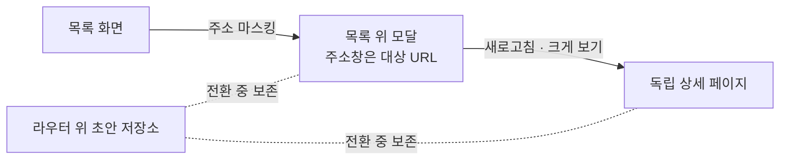

## 직접 주소와 세 가지 리소스 패턴

목록 위에서 패널이나 모달로 상세를 열더라도 대상에는 직접 접근할 수 있는 주소를 둡니다. 패널·모달 표현을 쓴다면 직접 URL 진입과 새로고침에서는 독립 화면으로 열리는지 확인합니다. 닫기는 이전 화면 맥락을 복구하고, 이전 기록이 없으면 해당 목록으로 가는 명시적인 대체 경로를 제공합니다. 브라우저 뒤로가기만 무조건 부르지 않습니다.

전체 페이지와 상세 패널이 같은 대상을 열면 조회와 실제 화면 컴포넌트를 공유합니다. 데모나 플레이그라운드도 제품 컴포넌트에 가짜 데이터만 연결합니다.

리소스의 목록·상세·생성·수정을 어디에 띄우는지는 디자인 시스템의 [리소스 화면 패턴](../design-system/resource-patterns.mdx)이 정하고, 라우트는 그 패턴에 맞춰 짭니다. 상세·만들기의 휴대폰 전체 화면 여부와 탐색 바 배치는 디자인 시스템의 레이아웃 기준을 따르며, 라우트에서 전달하는 화면 종류와 셸이 판단하는 화면 종류가 어긋나지 않게 합니다.

- List-Detail은 목록을 부모 라우트, 오른쪽 칸(`/리소스/{id}`, `/리소스/new`, `/리소스/{id}/edit`)을 자식 라우트로 둡니다. 칸을 바꿔도 부모 라우트의 목록 조회와 스크롤이 남고 목록이 다시 그려지지 않습니다. 집중 보기는 검색 조건 `?focus=1`로 둡니다. 쓰던 내용이 있는 칸을 떠날 때는 라우터의 이동 막기로 버릴지 묻습니다. 휴대폰 폭에서는 같은 주소가 칸이 아니라 페이지로 그려집니다.
- Drill-down은 상세·생성·수정을 각자 라우트로 두고, 상세의 뒤로는 브라우저 기록이 아니라 경로의 위 단계(목록) 주소로 이동합니다. 수정을 끝내거나 취소하면 원래 상세로, 생성을 저장하면 만든 상세로 replace합니다.
- Routed Modal은 아래의 마스킹으로 엽니다.

```text
/space-a/items           # 목록
/space-a/items/new       # 생성
/space-a/items/{id}      # 상세 (직접 진입 가능)
/space-a/items/{id}/edit # 수정
```

## 대화상자 안 이동과 마스킹 초안

대화상자 안에서 허용한 대상으로 이동할 때는 바깥 모달을 유지하고 내용만 교체합니다. 내부 이동은 같은 대화상자 이력 항목을 replace하며, 닫기·배경·Esc는 내부의 직전 상세가 아니라 대화상자 전체를 닫습니다. 처음 연 위치와 조건은 따로 보존하고, 브라우저 뒤로가기와 닫기를 같은 의미로 다루지 않습니다. 별도의 확인 창은 이 내부 이동과 구분합니다.

목록 위 대화상자(마스킹)는 Routed Modal 리소스의 상세·작성·수정에 씁니다. 라우터의 주소 마스킹(주소창에는 대상 주소를 보이고 실제로는 목록 위에 여는 것)을 채택하면 대상의 직접 진입 경로와 목록 위의 패널 상태를 함께 정의합니다. 새로고침하면 마스킹을 풀지 정책을 설정으로 명시하고, 닫기에는 라우터의 히스토리를 씁니다. 메모리 히스토리로 실행하는 견본에서도 같은 훅이 동작해야 합니다.

초안은 패널·페이지의 표현 전환보다 오래 사는 경계(라우터 위의 초안 저장소)에 두어 크게 보기·분기점 전환에서도 제목·본문·속성을 함께 보존하고, 저장 성공·버리기에서만 지웁니다. 키트 컴포넌트의 링크는 라우터의 링크로 그려 라우터 이동에 연결하고, 본문(Markdown·MDX)의 앱 링크는 본문 칸이 누르기를 받아 라우터 이동으로 엽니다. 전체 페이지를 다시 읽는 이동으로 빠지지 않게 합니다. 경로별 계약은 [패턴의 글과 코드](../design-system/pattern-catalog.mdx)에서 확인합니다.

<Diagram caption="목록 위 마스킹 모달과 독립 페이지가 같은 주소와 라우터 위 초안 저장소를 공유합니다.">

</Diagram>

## 공간과 메뉴의 주소

공간이 여럿인 앱은 화면 주소의 첫 마디를 공간으로 둡니다(`/공간-a/…`). 어느 공간에도 속하지 않는 화면(계정, 인스턴스 설정, 전역 진입)은 공간 접두 없이 둡니다. API 경로의 첫 마디도 같은 영역 이름으로 맞춥니다([API 계약](../../../../../../plugins/webapp/skills/backend-engineering/references/api.md)).

- 전역 화면에서 보일 메뉴는 마지막으로 있던 공간으로 정하고, 그 값은 세션 저장소(`sessionStorage`)에 둡니다. 저장하지 못하면 열려 있는 동안만 기억합니다.
- 화면 주소를 옮기면 옛 주소에서 새 주소로 돌려보내는 라우트를 둡니다.
