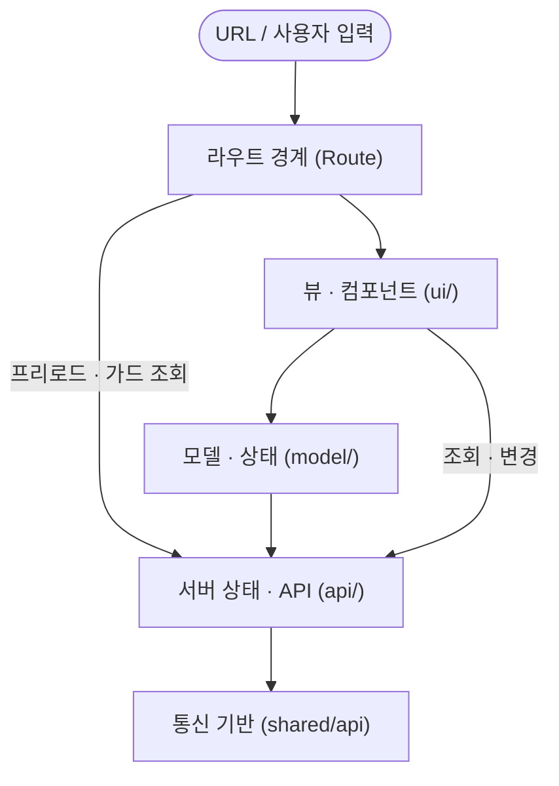

정적 폴더 배치와 FSD 의존성 규칙은 [디렉토리 구조](../directory-structure/index.md)에서 다룹니다. 이 문서는 요청과 사용자 상호작용이 **어떤 코드 구성 요소들을 어떤 순서와 책임으로 거치는지(실행 경계)**를 명세합니다.

- 프레임워크별 구현 규칙: 스택 전환(`React · TanStack` · `Angular`)

## 1. 구성 요소와 호출 흐름

프론트엔드 코드는 역할에 따라 다섯 개의 실행 구성 요소로 나눕니다.

| 구성 요소 | 주요 위치 | 핵심 책임 | 하지 않는 일 |
| --- | --- | --- | --- |
| **라우트 경계** | `pages/` 라우트 진입 파일 | 주소 매칭, 쿼리·파라미터 검증, 인증·권한 가드, 데이터 프리로드 | 긴 화면 마크업, 폼 입력 상태, 원시 HTTP 직접 호출 |
| **뷰 · 컴포넌트** | `ui/` | 화면 렌더링, 로컬 UI 상태(열림/닫힘·입력 초안), 이벤트 위임 | 원시 HTTP 직접 호출, 복잡한 비즈니스 계산 내장, 서버 데이터 로컬 복사 |
| **모델 · 상태** | `model/` | 프레임워크 무관 순수 도메인 규칙·파생 계산·검증, 복합 워크플로 조율 | DOM·레이아웃 스타일 직접 제어, 원시 HTTP 통신 |
| **서버 상태 · API** | `api/` | 조회 옵션(`queryOptions`), 변경(Mutation)과 캐시 무효화, DTO 매핑 | 화면 알림·모달 제어 같은 UI 표현 |
| **통신 기반** | `shared/api/`, `shared/lib/` | 공통 HTTP 래퍼, 인증 쿠키·헤더, 공통 에러 변환(`ApiError`), 브라우저 API 래퍼 | 특정 도메인·업무 규칙 판단 |

## 2. 구성 요소별 경계 규칙

### 라우트 경계 (Route)

- 주소 진입 시 필요한 파라미터 검증, 인증·권한 가드, 초기 데이터 프리로드를 맡습니다.
- 가드와 로더가 서버 데이터를 읽을 때는 화면 컴포넌트와 **같은 조회 옵션(`queryOptions`)**을 공유해 중복 요청을 막습니다.
- 화면 레이아웃과 상호작용 구현은 `ui/`로 위임하고 라우트 진입 파일은 얇게 유지합니다.

### 뷰 · 컴포넌트 (`ui/`)

- 화면을 그리는 **표시 컴포넌트**와 서버 상태·동작을 연결하는 **화면/섹션 컴포넌트**를 구분해 관리합니다.
- `ui/` 컴포넌트는 `fetch`나 원시 HTTP 클라이언트를 직접 호출하지 않고, `api/`가 제공하는 조회 옵션과 변경 함수를 경유합니다.
- 서버에서 받아 온 데이터를 로컬 UI 상태에 복사해 수동 동기화하지 않고, 서버 상태 캐시가 제공하는 값을 그대로 읽습니다.
- 입력 중인 폼 초안처럼 저장 전까지 서버 갱신에 덮어씌워지면 안 되는 값만 로컬 UI 상태로 분리합니다.

### 모델 · 상태 (`model/`)

- 비즈니스 규칙, 정렬·필터 계산, 유효성 검증, 상태 전이 로직은 프레임워크에 의존하지 않는 **순수 TypeScript 함수와 타입**으로 먼저 작성합니다.
- 프레임워크 전용 상태 어댑터(커스텀 훅, Injectable 서비스 등)는 순수 로직과 라우터·캐시를 이어 주는 얇은 연결층으로만 씁니다.

### 서버 상태 · API (`api/`)

- 읽기 요청은 캐시 키, 요청 함수, 신선도 유지 시간(`staleTime`)을 묶은 **조회 옵션(`queryOptions`)**으로 정의합니다.
- 쓰기 요청(생성·수정·삭제)은 호출 직후 관련된 캐시 키 무효화(invalidation) 또는 계정 전환 시 전체 캐시 초기화까지 함께 책임집니다.
- 서버 응답 형식이 화면 모델과 다르면 `api/` 경계에서 변환해 뷰에 원시 DTO 구조가 퍼지지 않게 합니다.

### 통신 기반 (`shared/api`)

- 기본 경로, 인증 자격 증명(`credentials`), 타임아웃, HTTP 상태 코드별 `ApiError` 변환을 한 곳에서 처리합니다.
- 특정 화면의 토스트 문구나 리다이렉트 같은 UI 흐름 제어는 통신 기반에 넣지 않습니다.

## 3. 상태 소유 경계

| 상태 종류 | 소유 주체 | 예시 |
| --- | --- | --- |
| **URL 상태** | 라우터 (경로·검색 파라미터) | 선택된 항목 ID, 검색어, 필터, 정렬, 페이지 번호 |
| **서버 상태** | 서버 상태 캐시 (`api/`) | 로그인 세션, 목록·상세 데이터, 권한 정보 |
| **로컬 UI 상태** | 해당 컴포넌트 (`ui/`) | 모달·드로어 열림, 저장 전 입력 초안, 복사 완료 표시 |
| **클라이언트 전역 상태** | 전역 프로바이더·서비스 (`app/`, `shared/`) | 테마, 사이드바 접힘 등 여러 화면이 공유하는 비서버 UI 설정 |

- URL로 표현할 수 있는 탐색·필터 조건은 URL이 원본을 소유하고, 컴포넌트 로컬 상태로 중복 저장하지 않습니다.
- 서버 상태는 전역 클라이언트 스토어에 복제하지 않고 캐시 계층이 단일 원본으로 관리합니다.
