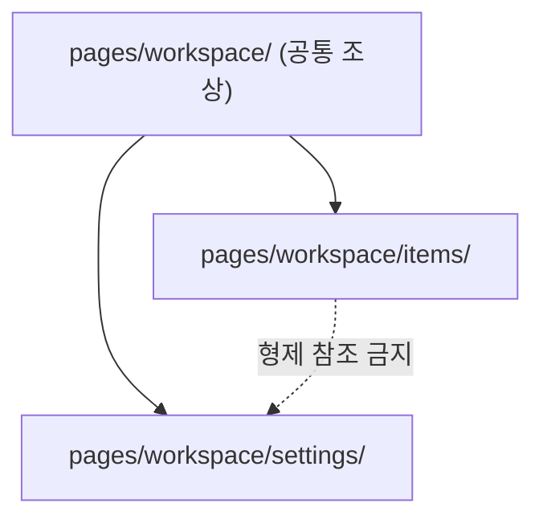

기본 개념(레이어·슬라이스·세그먼트·공개 API)은 [Feature-Sliced Design(FSD) 공식 문서](https://feature-sliced.design/kr/docs)를 따릅니다. 이 문서는 공식 FSD v2.1의 레이어 기준에 주소 기반 `pages` 규칙과 프레임워크별 적용 방식을 더해 정리합니다.

- 프레임워크별 라우팅·폴더 적용: 스택 전환(`React · TanStack` · `Angular`)
- 코드 구성 요소별 실행 책임: [구성 요소와 실행 흐름](../components-and-flow/index.md)
- 설계 배경: [프론트엔드 폴더 구조를 FSD로 정착시키기까지](../../articles/why-fsd-layers.md)
- 적용 절차: [화면·슬라이스 추가](../../playbooks/new-page-and-slice/index.md)

## 1. 레이어 구성과 선택적 도입

소스 루트(`src/`) 아래는 공식 FSD v2.1의 **여섯 개 레이어**를 기준으로 나눕니다. 모든 레이어를 처음부터 억지로 만들지 않고, 해당 책임의 코드가 실제로 생길 때 추가합니다.

```layers
# title: FSD v2.1 6개 레이어 (src/)
# direction: down
# caption: 상위 레이어는 하위 레이어의 공개 API만 참조합니다. 점선 테두리는 필요 시 추가하는 선택 레이어입니다.
app | 기본 | 진입점 · 전역 설정 · 프로바이더 · 라우터 등록 · 전역 앱 셸
pages | 기본 | URL 경로와 1:1로 대응하는 라우트 슬라이스
widgets | 선택 | 여러 페이지에서 재사용하는 독립적인 복합 UI 블록
features | 선택 | 여러 화면에서 재사용하는 사용자 동작과 상호작용
entities | 선택 | 도메인 모델 · 조회 옵션 · 표시용 컴포넌트
shared | 기본 | 업무 무관 UI 키트 어댑터 · 제품 공용 UI · HTTP · 유틸 · 설정
```

| 레이어 | 필수 여부 | 책임 | 슬라이스 구분 |
| --- | --- | --- | --- |
| `app` | 기본 | 앱 부트스트랩, 전역 스타일·프로바이더, 라우터 등록, 전역 앱 셸 | 없음 (세그먼트만 사용) |
| `pages` | 기본 | 주소별 화면과 전용 로직, 부모 라우트의 레이아웃·가드·데이터 준비 | URL 경로(라우트 슬라이스) |
| `widgets` | 선택 | 여러 페이지에서 반복되며 `features`·`entities`를 함께 조합하는 독립 UI 블록(예: 전역 검색, 공통 헤더·사이드바) | 블록 단위 |
| `features` | 선택 | 여러 화면에서 쓰이는 사용자 행위(예: 로그인, 필터 적용, 항목 생성) | 기능 단위 |
| `entities` | 선택 | 도메인 타입·모델, 서버 조회 옵션, 도메인 표현 컴포넌트 | 도메인 단위 |
| `shared` | 기본 | 업무와 무관한 공용 UI, API 클라이언트, 유틸, 환경 설정 | 없음 (세그먼트만 사용) |

- 한 페이지에서만 쓰는 큰 조합 블록은 `widgets`로 빼지 않고 해당 `pages` 라우트 슬라이스 안에 둡니다(`Pages-First`).
- 여러 페이지에 걸쳐 재사용되면서 하위 레이어(`features`·`entities`)를 조합해야 하는 독립 블록이 생겼을 때만 `widgets`를 추가합니다.

## 2. 의존성 경계 규칙

| 출발 영역 | 허용 대상 | 금지 대상 |
| --- | --- | --- |
| 상위 레이어 | 자기 레이어 내부(규칙 범위 내), 하위 레이어의 공개 API | 상위 레이어 |
| `widgets` / `features` / `entities` 슬라이스 | 자기 슬라이스 내부, 하위 레이어의 공개 API | 같은 레이어의 다른 슬라이스, 타 슬라이스 내부 파일 직접 참조 |
| `pages` 라우트 슬라이스 | 자기 폴더, **조상 라우트 폴더**, 하위 레이어의 공개 API | **형제 라우트 폴더**, 하위(자식) 라우트 내부 구현 |
| `app` / `shared` | 같은 레이어 내 다른 세그먼트 (`app`은 모든 하위 레이어 참조 가능) | `shared`에서 상위 레이어 참조 |

- `widgets`, `features`, `entities` 슬라이스는 반드시 루트의 `index.ts`(공개 API)를 통해서만 외부에 노출합니다.
- 슬라이스 내부 파일끼리는 자유롭게 참조하되 순환 참조를 만들지 않습니다.
- 경계 규칙은 코드 리뷰에만 맡기지 않고 린트나 정적 검사 스크립트로 확인합니다.

## 3. FSD v2.1 기준: 이전 버전과의 차이와 지향 · 비권장

이 기준은 **FSD v2.1**을 토대로 합니다. v2.1은 v2.0의 폴더 문법을 깨뜨리지 않으면서도, 실무에서 드러난 과도한 분리 문제를 바로잡는 방향으로 관점을 조정했습니다.

### v2.0에서 달라진 점

- **Pages-First로의 전환**: v2.0에서는 초기부터 코드를 잘게 쪼개 `features`·`entities`에 두고 `pages`를 얇은 조립 껍데기로 두는 경향이 강했습니다. v2.1에서는 화면 전용 로직과 UI를 먼저 `pages` 안에 두고, 실제로 여러 곳에서 재사용될 때만 하위 레이어로 내립니다.
- **`processes` 레이어 폐기**: 여러 페이지에 걸친 흐름을 담던 `processes` 레이어는 경계를 흐린다는 이유로 공식 폐기(Deprecated)되었습니다.
- **크로스 임포트(`@x`) 표준화**: 같은 레이어 슬라이스 간 참조는 여전히 금지하되, `entities` 간 도메인 관계처럼 불가피한 예외는 전용 공개 API(`entities/A/@x/B`)로 명시적으로 드러내 관리합니다.

### 지향하는 점 vs 권장하지 않는 점

| 구분 | 지향 (Do) | 비권장 (Don't) |
| --- | --- | --- |
| **분리 시점** | **Pages-First**: 한 화면에서만 쓰는 UI·상태·API는 해당 `pages` 슬라이스에 두고, 복수 소비처가 생길 때 하위 레이어로 승격 | 처음부터 단일 화면 전용 코드를 `widgets`·`features`·`entities`로 미리 쪼개는 조기 분리 |
| **레이어 구성** | `app · pages · shared`를 기본으로 두고 `widgets · features · entities`는 필요 시 선택 도입 | 폐기된 `processes` 레이어 생성, 빈 선택 레이어를 습관적으로 미리 나열 |
| **공개 API** | `export { A, B } from "./..."`처럼 외부 계약을 명시적으로 선언 | `export *` 와일드카드 재내보내기로 내부 구현을 통째로 노출 |
| **`shared` 구성** | `shared/ui/button`, `shared/lib/date`처럼 단위별 진입점 유지, 업무 지식 배제 | `shared/ui/index.ts` 같은 거대 배럴 파일 생성, 도메인·API 상태가 섞인 컴포넌트 혼입 |
| **슬라이스 경계** | 타 슬라이스는 항상 공개 API로만 참조, 불가피한 동층 엔티티 참조만 `@x`로 격리 | 슬라이스 내부 세그먼트 경로 직접 import, 동층 슬라이스 간 암묵적 상호 참조 |

## 4. 주소 기반 `pages` 규칙

`pages`는 화면 컴포넌트를 평평하게 모아 두는 폴더가 아니라 **애플리케이션의 URL 트리**입니다.

```tree
pages/
  <parent-group>/          # 부모 경로 또는 경로 없는 레이아웃 (셸·가드·공통 데이터)
    <child-route>/         # /<parent>/<child> 화면
      ui/                  # 이 화면에서만 쓰는 UI 조각
      model/               # 이 화면 전용 상태·로직
      api/                 # 이 화면 전용 요청
```

- **폴더 = 주소**: 라우트 폴더의 계층을 따라가면 앱의 주소 구조가 그대로 드러나야 합니다.
- **부모 경로와 화면 분리**: 하위 주소 전체에 걸리는 레이아웃·권한 가드·공통 데이터 준비는 부모 폴더가 맡고, 각 주소의 화면은 자기 폴더가 맡습니다.
- **경로 없는 레이아웃**: URL에 경로 조각을 추가하지 않고 공통 틀이나 인증 가드만 묶을 때는 라우터가 지원하는 경로 없는 묶음 방식을 사용합니다.
- **조상-자식 참조만 허용**: `pages` 안의 파일은 자기 폴더와 조상 라우트 폴더만 참조합니다. 형제 주소끼리 함께 쓰는 코드가 생기면 공통 조상 폴더로 올리거나 `features`·`entities`로 승격합니다.



- 제품 안에 공간(예: 사용자 공간, 관리자 공간)이 여럿이면 `pages` 아래에 공간별 라우트 폴더로 나누되, `features`와 `entities`는 공간별로 쪼개지 않고 도메인 기준으로 유지합니다.

## 5. 세그먼트와 코로케이션

슬라이스 내부는 목적에 따라 표준 세그먼트로 나눕니다.

| 세그먼트 | 역할 |
| --- | --- |
| `ui/` | 화면·표시 컴포넌트 |
| `model/` | 상태, 파생 계산, 비즈니스 로직, 도메인 타입 |
| `api/` | 서버 통신 함수, 조회 옵션, DTO 변환 |
| `lib/` | 해당 슬라이스 전용 순수 헬퍼 함수 |
| `config/` | 상수, 라우트·메뉴 설정, 기능 플래그 |

- **코로케이션 우선**: 한 파일에서만 쓰는 작은 조각은 별도 파일이나 세그먼트로 억지로 쪼개지 않고 같은 파일 위쪽에 둡니다.
- 여러 파일이 공유할 때 `model/`이나 `ui/` 세그먼트로 분리하고, 다른 슬라이스에서도 재사용되는 시점에 하위 레이어(`features`·`entities`·`shared`)로 승격합니다.

## 6. UI 키트 · 제품 공용 · 앱 셸 경계

| 구분 | 위치 | 책임 |
| --- | --- | --- |
| UI 키트 (디자인 시스템) | 외부 패키지 또는 `shared/ui` 하위 분리 폴더 | 업무를 모르는 기본 컴포넌트·레이아웃 뼈대 |
| 제품 공용 UI | `shared/ui/` | 제품 전반에서 반복되지만 특정 도메인에 묶이지 않는 UI 조합 |
| 업무를 아는 앱 셸 | `app/` 또는 최상위 `pages/` 부모 라우트 | 메뉴 구성, 권한별 진입, 공간 전환을 포함한 외곽 셸 |

컴포넌트의 시각 규칙, 토큰, 레이아웃 패턴은 [디자인 시스템](/design-system/overview)이 원본이며, 이 문서는 코드 배치와 의존성 경계만 다룹니다.
