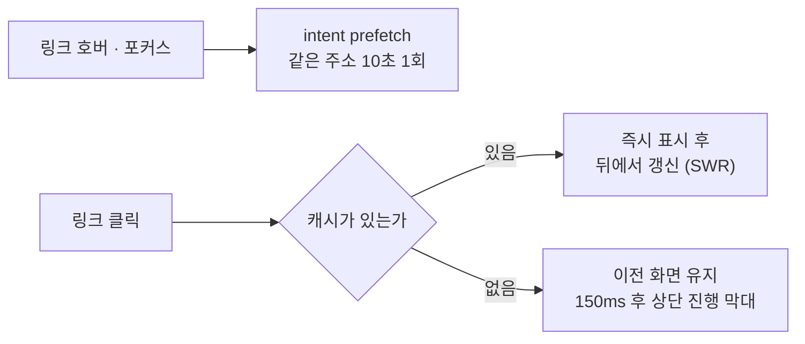
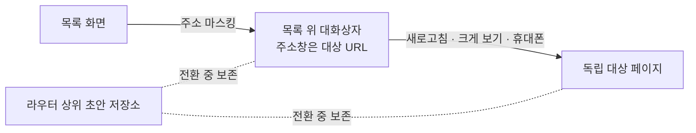

라우트 폴더 배치와 `pages` 계층 규칙은 [디렉토리 구조](../directory-structure/index.md)에서 다룹니다. 이 문서는 리소스별 주소 계약, 화면 전환과 대기 표시, 목록 위 대화상자 마스킹 기준을 명세합니다.

- 프레임워크별 구현 규칙: 스택 전환(`React · TanStack` · `Angular`)
- 설계 배경: [실용적인 페이지 전환: 스켈레톤 대신 준비된 화면으로](/blog/page-transition), [목록 맥락을 지키면서 주소를 잃지 않는 라우팅 마스크](../../articles/url-and-routed-modals.md)

## 1. 리소스 주소 계약과 화면 패턴

목록 위에서 패널이나 모달로 상세를 열더라도 모든 리소스 대상에는 직접 접근할 수 있는 고유 주소를 둡니다.

```text
/<space>/items            # 목록
/<space>/items/new        # 생성
/<space>/items/{id}       # 상세 (직접 진입·새로고침 가능)
/<space>/items/{id}/edit  # 수정
```

- **직접 진입·컴포넌트 공유**: 전체 페이지와 목록 위 패널이 같은 대상을 열면 조회 옵션과 실제 화면 컴포넌트를 공유합니다.
- **명시적 복귀 경로**: 닫기 동작은 이전 화면 맥락을 복구하되, 이전 기록이 없을 때 돌아갈 목록 경로를 명시적으로 둡니다. 브라우저 뒤로가기만 무조건 호출하지 않습니다.
- **리소스 패턴별 라우트 구조**: 화면 패턴 선택 기준은 [디자인 시스템 리소스 화면 패턴](/design-system/resource-patterns)을 따르고, 라우트는 아래 계약에 맞춥니다.

| 패턴 | 라우트 구조 | 이동 · 이탈 규칙 |
| --- | --- | --- |
| **List-Detail** | 목록을 부모 라우트, 오른쪽 칸(`/items/{id}`, `/items/new`, `/items/{id}/edit`)을 자식 라우트로 구성 | 칸을 바꿔도 부모 목록 조회와 스크롤 유지; 집중 보기는 `?focus=1`; 작성 중 이탈 시 이동 차단 확인; 휴대폰 폭에서는 같은 주소를 독립 페이지로 표시 |
| **Drill-down** | 목록·상세·생성·수정을 각각 독립 라우트로 구성 | 상세의 뒤로 버튼은 브라우저 기록 대신 상위 목록 주소로 이동; 수정 완료·취소는 원래 상세로 `replace`, 생성 저장은 만든 상세로 `replace` |
| **Routed Modal** | 목록 주소 위 대화상자 + 대상 주소 마스킹 | 데스크톱은 목록 위 대화상자, 직접 진입·새로고침·휴대폰은 독립 페이지 |

### 공간 주소와 메뉴 기억

- 공간이 여럿인 앱은 화면 주소의 첫 마디를 공간으로 둡니다(`/<space>/...`). 어느 공간에도 속하지 않는 전역 화면(계정, 인스턴스 설정 등)은 공간 접두 없이 둡니다. API 경로 첫 마디도 같은 영역 이름으로 맞춥니다([API 설계](/backend/reference/api-design)).
- 전역 화면에서 보여 줄 메뉴는 마지막으로 머문 공간을 기준으로 정하고 `sessionStorage`에 보관합니다. 저장할 수 없는 환경에서는 현재 탭 수명 동안만 기억합니다.
- 화면 주소를 옮기면 옛 주소에서 새 주소로 리다이렉트하는 라우트를 남깁니다.

## 2. 화면 전환과 미리 준비



- **캐시 우선 표시(SWR)**: 첫 화면에 필요한 조회는 라우트 준비 단계에서 컴포넌트와 같은 조회 옵션으로 실행합니다. 캐시가 있으면 오래됐더라도 즉시 화면을 전환하고 뒤에서 갱신합니다.
- **본문 변경 시 강제 교체 금지**: 캐시로 먼저 그린 본문이 서버 최신본과 다르면 사용자가 읽던 본문을 갑자기 갈아끼우지 않고 “최신 내용 보기” 안내만 띄웁니다.
- **전역 intent prefetch**: 앱 내부 링크에 포인터나 초점이 오면 그 화면의 코드와 데이터를 미리 준비합니다. 링크마다 개별 핸들러를 붙이지 않고 문서 수준에서 `pointerover`·`focusin`으로 내부 `a[href]`를 위임 감지하며, 같은 주소는 10초에 한 번만 준비합니다.
- **이동 중 주소 기반 메뉴 반영**: 사이드바의 공간·선택 메뉴 표시는 이동이 끝난 주소가 아니라 **이동 중인 목적지 주소**로 계산해 클릭 직후 반응합니다. 페이지 헤더 경로(브레드크럼)와 본문은 준비가 끝난 주소와 함께 바꿉니다.

### 히스토리 기록과 목록 복귀

| 상황 | 처리 기준 |
| --- | --- |
| 입력 중 검색 조건·필터 중간 변경 | 히스토리 `replace`로 중간 단계 누적 방지 |
| 사용자가 구분해 돌아올 화면 이동 | 히스토리 `push`로 기록 유지 |
| 목록으로 뒤로 복귀 | 읽던 스크롤 위치와 이미 로드한 행 유지 |
| 본문(Markdown 등) 내부 앱 링크 | 전체 페이지 새로고침 대신 라우터 이동으로 가로채 처리 |

## 3. 대기 표시와 전환 점검

앱 첫 진입만 스플래시 화면으로 덮고([렌더링과 초기 로딩](../rendering/index.md)), 그 뒤의 화면 이동에는 본문을 가리는 불투명 막을 두지 않습니다.

- **이전 화면 유지**: 캐시가 없어 기다릴 때는 빈 화면이나 전체 스켈레톤으로 넘기지 않고 이전 화면을 그대로 둡니다.
- **150ms 임계 · 300ms 최소 유지**: 준비가 `150ms` 안에 끝나면 진행 막대를 띄우지 않습니다. `150ms`를 넘기면 화면 최상단에 높이 `2px`의 진행 막대를 레이아웃 위에 겹쳐(콘텐츠 밀림 없이) 띄우고, 한 번 띄웠으면 최소 `300ms` 유지한 뒤 새 화면과 함께 즉시 내립니다.
- **접근성 표시**: 진행 막대는 화면 읽기 프로그램에 상태 문구(`role="status"`)로 알리고, 준비 중인 본문 영역은 `aria-busy`로 드러냅니다. 목록 조건을 바꾸는 동안은 이전 결과를 자리 값으로 유지합니다.
- **View Transition**: 준비가 끝난 새 화면으로 교체할 때 브라우저 View Transitions API를 적용해 화면 전환을 부드럽게 잇습니다.
- **전환 품질 점검 기준**: 첫 방문, 캐시 재방문, 느린 데이터·코드, 중첩 경로, 연속 이동, 동작 줄이기 설정을 나눠 점검합니다. 브라우저 자동화 점검에서 레이아웃 이동 합(CLS, 입력 직후 500ms 제외)이 `0.01`을 넘거나, 캐시가 있는 재방문에서 진행 표시가 뜨면 실패로 봅니다.

## 4. 라우팅 마스크 (목록 위 대화상자)

Routed Modal 리소스의 상세·작성·수정은 데스크톱에서 목록 맥락을 유지한 채 대화상자로 열고, 주소창에는 대상의 실제 주소를 표시합니다.



| 진입 · 동작 | 결과 |
| --- | --- |
| 데스크톱 목록에서 열기 | 목록 주소에 패널 쿼리(`?panel=대상`) + 대상 주소 마스킹, 대화상자 표시 |
| 직접 링크 · 새로고침 | 마스크를 풀어 독립 대상 페이지로 렌더링 |
| 휴대폰에서 열기 · 휴대폰 폭 진입 | 마스킹을 끄고 일반 페이지 이동으로 대상 페이지 렌더링 |
| 크게 보기(페이지로 열기) | 대상 페이지로 `replace`, 입력 초안 보존 |
| 대화상자 안 내부 이동(상세 → 수정 등) | 바깥 대화상자를 닫지 않고 같은 마스킹 이력을 `replace`해 내용만 교체 |
| 닫기 · 배경 클릭 · `Esc` | 내부 이동 횟수와 무관하게 대화상자 전체를 닫아 처음 연 목록의 조건·스크롤로 복귀 (처음 연 기록이 없으면 패널 쿼리만 제거한 목록) |
| 저장 성공 | 결과 페이지로 `replace` (뒤로 가면 목록) |

- **초안 보존 경계**: 입력 초안은 대화상자나 페이지 마운트보다 오래 사는 **라우터 상위 초안 저장소**에 두어, 크게 보기나 화면 폭 분기점 전환 중에도 제목·본문·속성을 함께 보존합니다. 초안은 저장 성공이나 명시적 버리기에서만 비웁니다.
- **전역 검색과 폼 적용**: 고유 주소가 있는 전역 검색(`/search`)이나 긴 폼도 같은 원칙을 따릅니다. 데스크톱은 현재 화면 위 대화상자로 열고 주소만 마스킹하며, 휴대폰은 바텀시트 대신 처음부터 대상 페이지로 이동합니다. 고유 주소가 없는 짧은 양식(이름 바꾸기, 폴더 생성)은 마스킹 없이 [짧은 양식 대화상자](/design-system/dialog)만 씁니다.
- **대화상자 내부 대기 표시**: 캐시가 없는 패널을 열 때도 화면 전환과 동일하게 `150ms` 뒤에 대기 표시를 띄우고 최소 `300ms` 유지합니다([디자인 시스템 대기 표시](/design-system/loading-feedback)).
