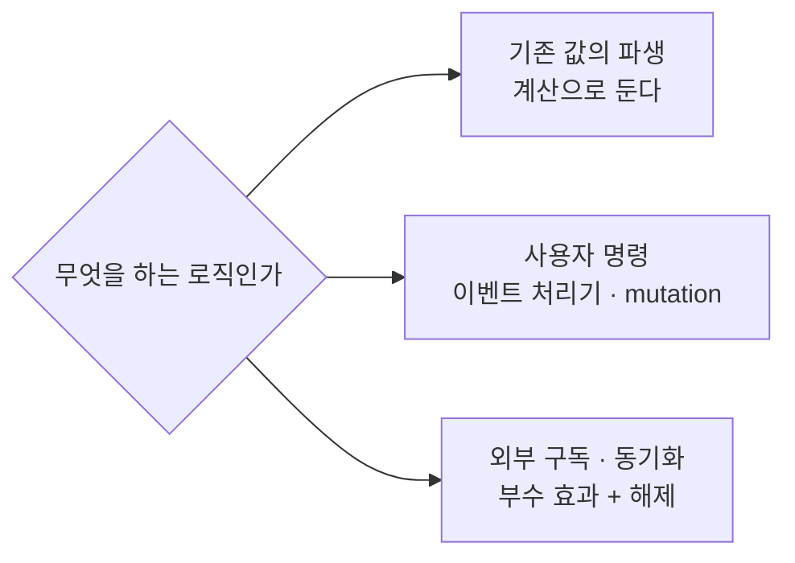

## 파일과 이름 규칙

파일 배치와 공개 API는 [화면 계층](../../structure/layers/index.mdx)을 따릅니다. 컴포넌트는 파일 하나에 하나씩 두고, 페이지 컴포넌트는 이름만 보고 페이지인지 알 수 있게 Page를 붙입니다. 파일 이름의 대소문자와 접미사는 스택의 공식 스타일 가이드를 따르고 한 프로젝트 안에서 섞지 않습니다.

<Slot name="naming" />

라우트 묶음 폴더, 경로 별칭, 린트 규칙은 프로젝트마다 다를 수 있으므로 작업 전에 현재 프로젝트 설정을 먼저 확인하고, 다른 프로젝트의 페이지 그룹이나 도우미 함수가 있다고 가정하지 않습니다.

## 파생값, 부수 효과, 메모이제이션

기존 입력이나 상태에서 계산할 수 있는 파생값을 별도 상태에 복사해 부수 효과로 맞추지 않습니다. 사용자 클릭이나 제출 같은 명령은 이벤트 처리기와 변경 요청(mutation)이 처리하고, 부수 효과는 외부 구독과 동기화에만 쓰며 반드시 해제합니다.

값과 함수의 메모이제이션은 습관적으로 붙이지 않고, 측정된 비용이 있거나 참조 안정성이 필요한 경계에서만 씁니다. 개발 모드의 검사에서 드러난 수명주기 문제는 실행 방지 플래그로 덮지 않고 원인을 고칩니다.

<Slot name="effects" />

<Diagram caption="로직의 성격에 따라 파생 계산, 이벤트 처리기, 부수 효과로 자리를 나눕니다.">

</Diagram>

| 상황 | 처리 기준 |
| --- | --- |
| 파생값 계산 | 상태로 복사하지 않고 계산으로 둠 |
| 사용자 동작 | 부수 효과가 아니라 이벤트 처리기·mutation에서 실행 |
| 메모이제이션 | 측정된 비용 또는 참조 안정성이 필요한 경계에만 사용 |
| 개발 모드 검사 오류 | 실행 방지 플래그로 숨기지 않고 수명주기 원인을 수정 |
