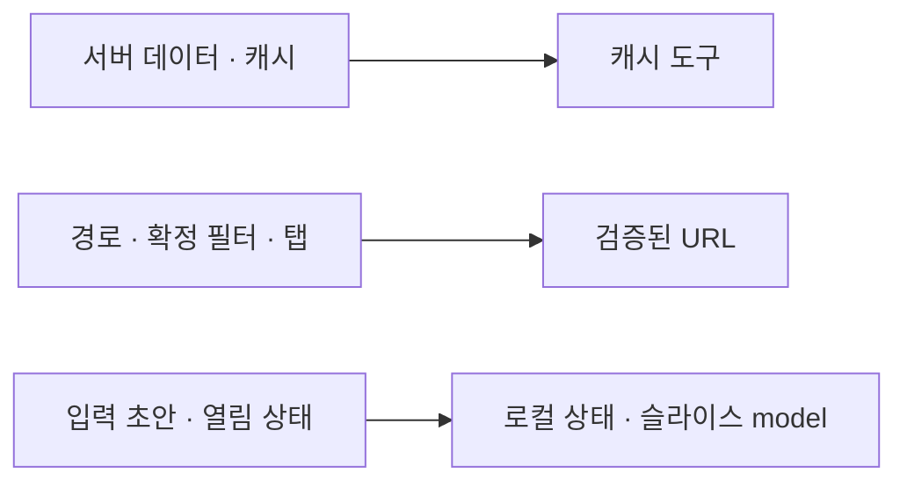

## 상태별 소유자 구분

프론트엔드 상태가 꼬이는 가장 흔한 원인은 같은 값을 여러 곳에 복제해 두고 서로 맞추려 할 때입니다. 상태를 서버 데이터, 확정된 URL 조건, 임시 입력 초안 세 가지로 나누고 각자 하나의 소유자에게 맡깁니다.

| 상태 | 소유자 |
| --- | --- |
| 서버 데이터 · 캐시 | 서버 데이터 캐시 도구 |
| 경로 · 확정 필터 · 정렬 · 페이지 · 탭 | 라우터가 검증한 URL |
| 입력 초안 · 적용 전 필터 · 열림 상태 | 로컬 상태 또는 해당 슬라이스 `model/` |

<Diagram caption="상태마다 원본 소유자를 하나로 정해 중복 복사를 막습니다.">

</Diagram>

하위 컴포넌트가 페이지의 캐시 키를 직접 참조하지 않도록 콜백을 넘기거나 상태 소유자를 조정합니다.

## 서버 데이터와 초안 분리

서버에서 읽어 온 원본 데이터와 사용자가 고치는 수정 초안은 분리합니다. 백그라운드 재조회가 돌아도 입력 중인 초안을 덮어쓰지 않으며, 저장 충돌이 나면 초안을 버리지 않고 유지한 채 다시 읽기나 재적용 방법을 제공합니다.

저장 요청이 진행 중인 동안에도 계속 편집할 수 있는 화면이라면, 저장 요청에 실어 보낸 초안 판본과 현재 편집 중인 초안을 구분합니다. 그래야 늦게 도착한 이전 저장의 성공 응답이 이후에 입력한 내용을 초기화하지 않습니다.

- 백그라운드 재조회가 사용자의 현재 입력 초안을 덮지 않게 분리합니다.
- 저장 중 편집을 허용하면 요청 판본과 현재 판본을 비교해 늦게 온 응답을 걸러 냅니다.
- 연속 저장의 직렬화·충돌·재시도 정책을 정하고, 문서나 계정이 바뀐 뒤 도착한 응답도 격리합니다.

읽기·편집 전환과 저장 표시 방식은 디자인 시스템 지침을 따릅니다.

## 필터 확정과 URL 동기화

필터를 확정할 때는 URL 갱신, 페이지 번호 초기화, 조회 키 변경을 하나의 상태 전환으로 다룹니다. 적용 버튼을 누르기 전의 선택은 초안이며, 취소하면 기존 URL을 그대로 유지합니다.

URL에서 읽는 숫자, 날짜, 열거형과 기본값은 라우터 경계에서 검증해 새로고침, 링크 공유, 뒤로가기에서도 같은 조건이 복원되게 합니다. 칩, 선택기, 휴대폰 시트의 표현 규칙은 디자인 시스템 지침에 둡니다.

<Callout title="초안과 확정의 경계">
적용 전 필터는 로컬 초안에 두고, 확정하는 순간에만 URL을 바꿔 페이지를 초기화하고 조회를 갱신합니다.
</Callout>
