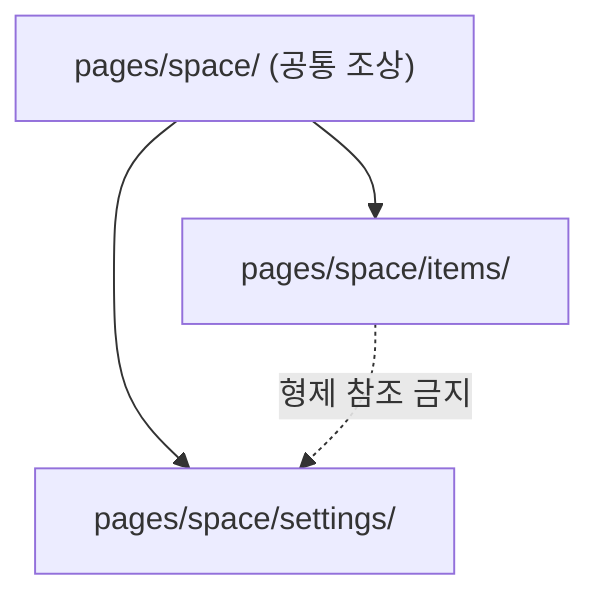

## 다섯 층과 widgets를 두지 않는 이유

파일 배치와 레이어·슬라이스·공개 API는 FSD를 따릅니다. 공식 `feature-sliced-design` 스킬이 설치되어 있으면 함께 읽되 이 글의 규칙이 우선하며, FSD 검사기를 따로 유지하지 않습니다.

프론트엔드는 FSD의 다섯 층인 `app`, `pages`, `features`, `entities`, `shared`로 나누고 widgets 층은 두지 않습니다. 상위 층은 하위 층만 참조하며, 코로케이션을 살려 슬라이스 안에서 컴포넌트는 파일 하나에 하나씩 둡니다. 여러 파일이 함께 쓰는 로직은 슬라이스의 `model/`에 모으고, 한 파일에서만 쓰는 작은 조각은 억지로 파일을 나누지 않고 그 파일 위쪽에 둡니다.

| 층 | 역할 |
| --- | --- |
| `app` | 진입점, 전역 설정, 공간·메뉴·권한을 아는 앱 셸 |
| `pages` | 주소별 화면과 부모 경로, 폴더 하나가 주소 하나 |
| `features` | 여러 화면에서 재사용하는 사용자 동작과 상호작용 |
| `entities` | 도메인 모델, 조회 옵션, 표시 컴포넌트 |
| `shared` | 업무를 모르는 UI 키트, 제품 공용 컴포넌트, 기본 유틸 |

## 주소가 곧 pages 슬라이스

`pages`는 화면을 모아 두는 일반 폴더가 아니라 주소입니다. 폴더 하나가 주소 하나이자 슬라이스 하나라서, 폴더 구조만 보면 앱의 주소가 보입니다. 주소를 등록하는 방법은 라우터를 따릅니다. 파일 라우팅이 있는 라우터는 `pages` 폴더를 읽게 하고, 설정으로 라우트를 정하는 라우터는 폴더마다 그 주소와 아래 주소를 정하는 라우트 파일을 두어 부모 폴더의 라우트 파일이 자식 폴더의 것을 잇습니다.

어느 쪽이든 폴더마다 그 아래 주소들의 부모 경로(레이아웃·가드·데이터 준비)를 맡는 부분과 그 주소의 화면을 맡는 파일을 나눠 둡니다. 주소에 나타나지 않는 묶음 폴더로 여러 주소에 같은 틀을 겁니다. 파일 라우팅을 쓰면 폴더 안의 슬라이스 세그먼트(`ui/`·`model/`·`api/`·`lib/`·`config/`)와 공개 진입점은 라우트로 읽지 않게 라우터를 설정합니다.

<Slot name="routing" />

`pages` 안의 파일은 자기 라우트 폴더와 조상 라우트 폴더의 것만 가져옵니다. 형제 주소의 코드는 가져오지 않으며, 두 주소가 함께 쓰는 코드는 공통 조상 폴더로 올립니다. 프로젝트의 화면 규칙 검사로 확인합니다. 공간이 여럿인 앱은 공간마다 `pages` 아래 폴더를 두어 주소로 묶되, `features`와 `entities`는 공간별로 나누지 않습니다.

<Diagram caption="pages는 자기 폴더와 조상 폴더만 참조하고 형제 주소끼리는 참조하지 않습니다.">

</Diagram>

## 키트, 제품 공용, 앱 셸의 경계

`shared` 층 안에서 UI 키트와 제품이 만든 공용 컴포넌트는 서로 다른 폴더로 나눕니다. 업무를 모르는 레이아웃(앱 셸 틀·페이지·분할 보기·칸 머리·휴대폰 도구)은 키트 안의 레이아웃 폴더에 모으고, 공간·메뉴 항목·권한에 따른 관리 진입처럼 업무를 아는 앱 셸은 `app` 층에 둡니다.

분할 화면의 진입부와 목록 줄, 위 단계 경로, 버릴지 묻는 창, 양식 바닥 같은 패턴의 공통 뼈대는 한 곳에 두고 화면마다 다시 조립하지 않습니다. 화면은 줄·도구·칸 내용만 넘깁니다.

<Callout title="화면 표현과의 경계">
레이아웃과 컴포넌트의 시각·반응형 표현 기준은 디자인 시스템과 인터랙션에서 다루고, 여기서는 코드 배치와 소유 경계에 집중합니다.
</Callout>
